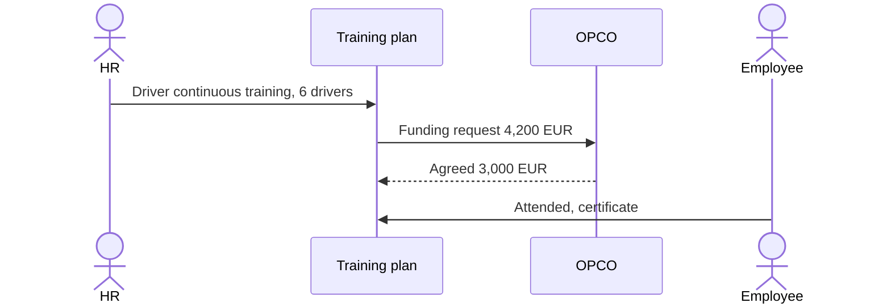

🏠 [Specs](../../../../README.md) › 🧩 [Functional capabilities](../../../README.md) ›
👥 [F9 HR and projects](../../README.md) › 📝 [Use cases](../README.md) ›
📝 [Use cases: FL-F9-09 Train and protect](README.md) › 📝 UC-F9-25 Run the training plan with OPCO funding

# 📝 UC-F9-25 Run the training plan with OPCO funding

**Status:** ✅ specified

## Summary

HR builds the yearly training plan from needs and mandatory trainings, requests OPCO funding, follows sessions and
certificates, and the employees' personal training accounts.

## Personas

- [U06 Human resources](../../../../01-users/personas/u06-hr.md)
- [U02 Manager](../../../../01-users/personas/u02-manager.md)
- [U01 Employee](../../../../01-users/personas/u01-employee.md)
- [U38 Training coordinator](../../../../01-users/personas/u38-training-coordinator.md)

## Goal

People trained in time, mandatory trainings never expired, funding claimed.

## Trigger

The yearly plan; a need; a mandatory training due.

## Frequency

Yearly plan; monthly follow-up.

## Preconditions

- Skills and certifications on employees ([UC-F9-11](../04-grow/uc-f09-11-run-appraisals-and-track-skills.md)).

## Postconditions

- **Succeeded:** sessions planned, funded and attended; certificates kept.
- **Failed:** an expired mandatory training blocks the assignment that needs it.

## Main flow

1. HR opens the training plan ([S-F9-22](../../screens/09-train-and-protect/s-f09-22-training-plan.md)): needs from
   appraisals and managers, mandatory trainings due (driver training, safety, health).
2. They plan sessions with providers, cost and funding: OPCO, the personal training account
   ([CR-FR-159](../../../../10-country-packs/france/education/cr-fr-159-personal-training-account.md)), the company.
3. The OPCO funding request is sent and its decision recorded; the funded share is invoiced to the OPCO by the provider
   or claimed.
4. Attendance and certificates are recorded; certifications update,
   [BR-F9-17](../../business-rules/br-f09-17-mandatory-trainings-must-be-current-for-the-work-that-needs-them.md).
5. Hours feed the training declaration and the professional interviews
   ([UC-F9-21](../08-hr-duties/uc-f09-21-schedule-professional-interviews-and-health-visits.md)).

## Alternative flows

- 2a. In-house training by the company's own trainers.

## Error flows

- 3e. The OPCO refuses: the company or the employee pays, or the session is moved.
- 4e. A mandatory training expired: the work needing it cannot be planned
  ([UC-F9-15](../06-plan-and-deliver-work/uc-f09-15-plan-shifts.md)).

## Business rules

- [BR-F9-17 Mandatory trainings must be current for the work that needs them](../../business-rules/br-f09-17-mandatory-trainings-must-be-current-for-the-work-that-needs-them.md)

## Entities

- [E-F9-22 Training session](../../data/e-f09-22-training-session.md)
- [E-F9-12 Qualification](../../data/e-f09-12-certification.md)

## Permissions

HR; the owner reads; HR data stays with HR and the person
([BR-F9-02](../../business-rules/br-f09-02-hr-data-stays-with-hr-and-the-person.md)). Managers propose; employees
request.

## Notifications

Employees: sessions; HR: expiring trainings.

## Audit events

Plan, requests, decisions, attendance.

## AI involvement

The AI assistant prepares it for confirmation
([BR-F3-07](../../../f03-assistant/business-rules/br-f03-07-no-deletes-no-irreversible-acts.md)); figures come from
queries ([BR-F3-03](../../../f03-assistant/business-rules/br-f03-03-figures-come-from-queries.md)).

## API, MCP and A2A exposure

T5 operations of F9 with the caller's rights; the MCP tool of F9; no A2A skill.

## Screens

- [S-F9-22 Training plan](../../screens/09-train-and-protect/s-f09-22-training-plan.md)

## Flowchart

See [FL-F9-09 Train and protect](../../flows/fl-f09-09-train-and-protect.md#flowchart).

## Sequence diagram

## Acceptance criteria

1. **Given** 6 drivers whose continuous training ends in 2027-02 **when** the plan is built **then** they are listed as
   mandatory.
2. **Given** an OPCO decision of 3,000 EUR on 4,200 EUR **when** it is recorded **then** 1,200 EUR remains for the
   company.
3. **Given** a driver whose training expired **when** a shift is planned for him **then** it is refused with the reason.
4. **Given** a certificate uploaded **when** it is saved **then** the certification's new expiry shows.

## Non-functional notes

None.

## Regulatory references

[CR-FR-119](../../../../10-country-packs/france/transport/cr-fr-119-driver-training.md);
[CR-FR-159](../../../../10-country-packs/france/education/cr-fr-159-personal-training-account.md);
[CR-FR-156](../../../../10-country-packs/france/education/cr-fr-156-training-report-bpf.md).

## Related use cases

- [UC-F9-11 Run appraisals and track skills](../04-grow/uc-f09-11-run-appraisals-and-track-skills.md)
- [UC-SC12-04 Get funding](../../../../08-sectors/sc12-education-and-training/use-cases/02-enrol-and-fund/uc-sc12-04-get-funding.md)
- [UC-F12-22 Require operator qualifications per work centre](../../../f12-manufacturing/use-cases/10-people-and-tools/uc-f12-22-require-operator-qualifications-per-work-centre.md)

## Open questions

None.

---

⬅️ [UC-F9-24](../07-fair-pay-and-speaking-up/uc-f09-24-receive-and-handle-a-whistleblowing-report.md) ·
⬆️ [Up](README.md) · ➡️ [UC-F9-26 Declare a work accident](uc-f09-26-declare-a-work-accident.md)
