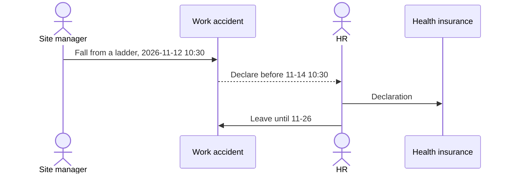

🏠 [Specs](../../../../README.md) › 🧩 [Functional capabilities](../../../README.md) ›
👥 [F9 HR and projects](../../README.md) › 📝 [Use cases](../README.md) ›
📝 [Use cases: FL-F9-09 Train and protect](README.md) › 📝 UC-F9-26 Declare a work accident

# 📝 UC-F9-26 Declare a work accident

**Status:** 🔄 waiting for the owner

## Summary

A manager reports a work or commuting accident; HR declares it to the health insurance within 48 hours, follows the sick
leave and records it in the risk assessment.

## Personas

- [U02 Manager](../../../../01-users/personas/u02-manager.md)
- [U06 Human resources](../../../../01-users/personas/u06-hr.md)
- [U14 Field worker](../../../../01-users/personas/u14-field-worker.md)

## Goal

Every accident declared in time and prevented next time.

## Trigger

An accident at work or on the way.

## Frequency

Rare; a few a year in construction and care.

## Preconditions

- None.

## Postconditions

- **Succeeded:** declared within 48 hours, the leave followed, the risk assessment updated.
- **Failed:** a late declaration is flagged.

## Main flow

1. The manager reports the accident on the phone or the work accident screen
   ([S-F9-23](../../screens/09-train-and-protect/s-f09-23-work-accident.md)): who, when, where, what happened,
   witnesses, first aid.
2. HR checks it and declares it to the health insurance within 48 hours
   ([BR-F9-18](../../business-rules/br-f09-18-a-work-accident-is-declared-within-48-hours.md)); the employee gets the
   accident form.
3. The sick leave and its return are followed; payroll gets the absence (F13).
4. The cause is analysed and the risk assessment updated
   ([UC-F9-27](uc-f09-27-keep-the-occupational-risk-assessment.md)).

## Alternative flows

- 1a. A commuting accident.
- 2a. HR adds reservations on the declaration.

## Error flows

- 2e. The 48 hours near: HR is alerted.
- 1e. No network on site: the report waits on the phone,
  [UC-F2-22](../../../f02-no-code-configuration/use-cases/09-portals-and-offline-forms/uc-f02-22-fill-a-form-offline-on-the-phone.md).

## Business rules

- [BR-F9-18 A work accident is declared within 48 hours](../../business-rules/br-f09-18-a-work-accident-is-declared-within-48-hours.md)
- [BR-F9-02 HR data stays with HR and the person](../../business-rules/br-f09-02-hr-data-stays-with-hr-and-the-person.md)

## Entities

- [E-F9-23 Work accident](../../data/e-f09-23-work-accident.md)
- [E-F9-01 Employee record](../../data/e-f09-01-employee-record.md)

## Permissions

Managers report; HR declares; health data only for HR.

## Notifications

HR: new accident, 48-hour alert.

## Audit events

Reported, declared, closed.

## AI involvement

The AI assistant prepares it for confirmation
([BR-F3-07](../../../f03-assistant/business-rules/br-f03-07-no-deletes-no-irreversible-acts.md)); figures come from
queries ([BR-F3-03](../../../f03-assistant/business-rules/br-f03-03-figures-come-from-queries.md)).

## API, MCP and A2A exposure

T5 operations of F9 with the caller's rights; the MCP tool of F9; no A2A skill.

## Screens

- [S-F9-23 Work accident](../../screens/09-train-and-protect/s-f09-23-work-accident.md)

## Flowchart

See [FL-F9-09 Train and protect](../../flows/fl-f09-09-train-and-protect.md#flowchart).

## Sequence diagram

## Acceptance criteria

1. **Given** an accident on Acme Bâtiment's site Lyon 3 on 2026-11-12 at 10:30 **when** the site manager reports it
   **then** HR must declare it before 2026-11-14 10:30.
2. **Given** no declaration 40 hours after **when** the time passes **then** HR is alerted.
3. **Given** the declaration sent **when** the leave is recorded **then** payroll gets the absence.

## Non-functional notes

Reporting works on a phone, offline included.

## Regulatory references

(Proposed) to read: Code de la sécurité sociale L441-2 and R441-3;
[CR-FR-076](../../../../10-country-packs/france/labour/cr-fr-076-occupational-risk-assessment.md).

## Related use cases

- [UC-F9-27 Keep the occupational risk assessment](uc-f09-27-keep-the-occupational-risk-assessment.md)
- [UC-F13-14 Handle sick leave and daily allowances](../../../f13-payroll/use-cases/04-events/uc-f13-14-handle-sick-leave-and-daily-allowances.md)

## Open questions

None.

---

⬅️ [UC-F9-25 Run the training plan with OPCO funding](uc-f09-25-run-the-training-plan-with-opco-funding.md) ·
⬆️ [Up](README.md) ·
➡️ [UC-F9-27 Keep the occupational risk assessment](uc-f09-27-keep-the-occupational-risk-assessment.md)
