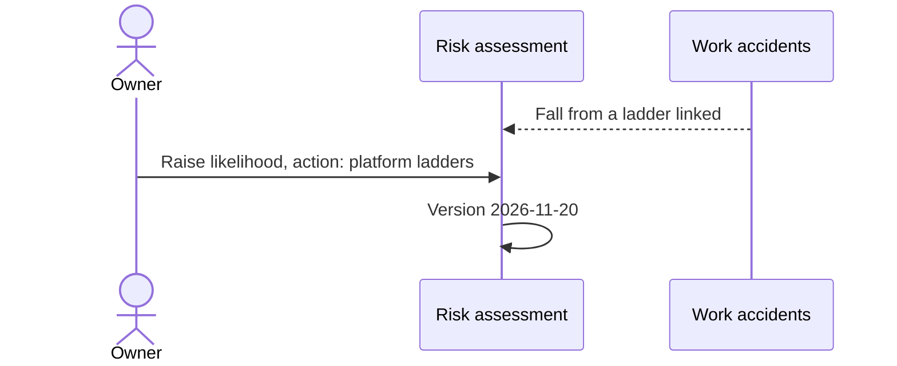

🏠 [Specs](../../../../README.md) › 🧩 [Functional capabilities](../../../README.md) ›
👥 [F9 HR and projects](../../README.md) › 📝 [Use cases](../README.md) ›
📝 [Use cases: FL-F9-09 Train and protect](README.md) › 📝 UC-F9-27 Keep the occupational risk assessment

# 📝 UC-F9-27 Keep the occupational risk assessment

**Status:** ✅ specified

## Summary

The owner and HR keep the single document of occupational risk assessment (DUERP): one document per company that
lists the risks of every work unit (Code du travail R4121-1), with its prevention actions, updated each year and after
an accident.

## Personas

- [U13 Owner](../../../../01-users/personas/u13-owner.md)
- [U06 Human resources](../../../../01-users/personas/u06-hr.md)
- [U27 Quality manager](../../../../01-users/personas/u27-quality-manager.md)

## Goal

Every employer's risks assessed and reduced.

## Trigger

The yearly update; an accident; a new work unit.

## Frequency

Yearly and at events.

## Preconditions

- Work units (sites, teams) defined.

## Postconditions

- **Succeeded:** the assessment is current, versioned and kept.
- **Failed:** an assessment more than a year old is flagged.

## Main flow

1. The owner opens the company's risk assessment
   ([S-F9-24](../../screens/09-train-and-protect/s-f09-24-risk-assessment.md)) and works through it work unit by work
   unit, all in the same document.
2. For each risk: hazard, exposure, severity and likelihood, existing measures.
3. Prevention actions get owners and dates; accidents link to their risk
   ([UC-F9-26](uc-f09-26-declare-a-work-accident.md)).
4. The version is dated and kept; employees and representatives can read it
   ([BR-F9-19](../../business-rules/br-f09-19-the-risk-assessment-is-versioned-and-kept.md)).

## Alternative flows

- 1a. A factory uses its safety registers,
  [UC-F12-17](../../../f12-manufacturing/use-cases/07-compliance-and-safety/uc-f12-17-keep-the-risk-assessment-and-safety-registers.md),
  as well.

## Error flows

- 4e. Older than a year with 11 employees or more: flagged.

## Business rules

- [BR-F9-19 The risk assessment is versioned and kept](../../business-rules/br-f09-19-the-risk-assessment-is-versioned-and-kept.md)

## Entities

- [E-F9-24 Risk assessment line](../../data/e-f09-24-risk-assessment-line.md)

## Permissions

The owner, HR and the quality manager; employees read.

## Notifications

Owners of actions; yearly reminder.

## Audit events

Versions and actions.

## AI involvement

The AI assistant prepares it for confirmation
([BR-F3-07](../../../f03-assistant/business-rules/br-f03-07-no-deletes-no-irreversible-acts.md)); figures come from
queries ([BR-F3-03](../../../f03-assistant/business-rules/br-f03-03-figures-come-from-queries.md)).

## API, MCP and A2A exposure

T5 operations of F9 with the caller's rights; the MCP tool of F9; no A2A skill.

## Screens

- [S-F9-24 Risk assessment](../../screens/09-train-and-protect/s-f09-24-risk-assessment.md)

## Flowchart

See [FL-F9-09 Train and protect](../../flows/fl-f09-09-train-and-protect.md#flowchart).

## Sequence diagram

## Acceptance criteria

1. **Given** a fall from a ladder on site Lyon 3 **when** it is linked **then** the work-at-height risk shows the
   accident.
2. **Given** an assessment dated 2025-09-01 with 40 employees **when** 2026-09-02 comes **then** it is flagged.
3. **Given** a new version **when** it is saved **then** the previous one stays kept.
4. **Given** a company with the work units Site teams and Workshop **when** the assessment is printed **then** one
   document lists the risks of both units.

## Non-functional notes

None.

## Regulatory references

[CR-FR-076](../../../../10-country-packs/france/labour/cr-fr-076-occupational-risk-assessment.md).

## Related use cases

- [UC-F9-26 Declare a work accident](uc-f09-26-declare-a-work-accident.md)
- [UC-F12-17 Keep the risk assessment and safety registers](../../../f12-manufacturing/use-cases/07-compliance-and-safety/uc-f12-17-keep-the-risk-assessment-and-safety-registers.md)

## Open questions

None.

---

⬅️ [UC-F9-26 Declare a work accident](uc-f09-26-declare-a-work-accident.md) · ⬆️ [Up](README.md) ·
➡️ [UC-F9-28](../10-listen-to-employees/uc-f09-28-run-engagement-surveys-and-exit-interviews.md)
