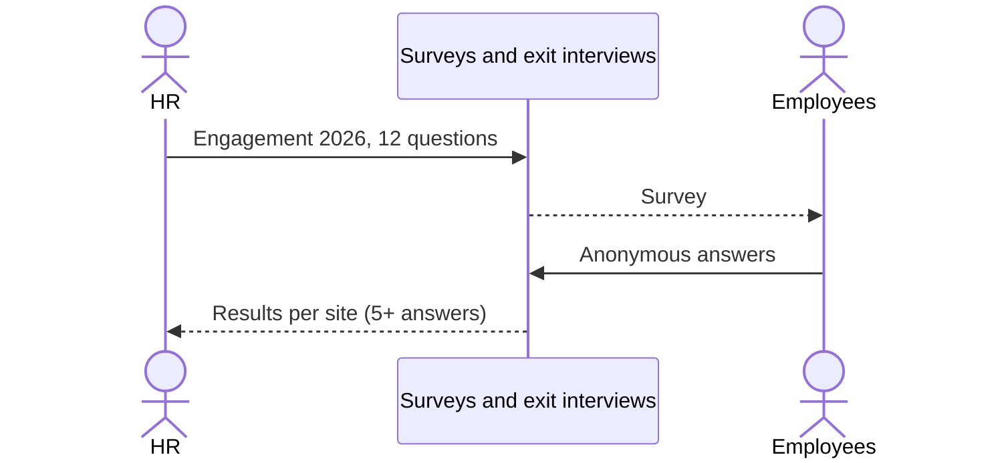

🏠 [Specs](../../../../README.md) › 🧩 [Functional capabilities](../../../README.md) ›
👥 [F9 HR and projects](../../README.md) › 📝 [Use cases](../README.md) ›
📝 [Use cases: FL-F9-10 Listen to employees](README.md) › 📝 UC-F9-28 Run engagement surveys and exit interviews

# 📝 UC-F9-28 Run engagement surveys and exit interviews

**Status:** ✅ specified

## Summary

HR sends engagement surveys with anonymous results by group, and holds exit interviews whose reasons feed the turnover
report.

## Personas

- [U06 Human resources](../../../../01-users/personas/u06-hr.md)
- [U01 Employee](../../../../01-users/personas/u01-employee.md)
- [U13 Owner](../../../../01-users/personas/u13-owner.md)

## Goal

Understand why people stay or leave.

## Trigger

A survey season; a resignation.

## Frequency

Yearly surveys; each leaver.

## Preconditions

- The survey engine of F5,
  [UC-F5-12](../../../f05-social-media/use-cases/08-pages-forms-surveys-and-whatsapp/uc-f05-12-run-surveys-and-live-polls.md).

## Postconditions

- **Succeeded:** results by group and exit reasons in the report.
- **Failed:** groups under 5 answers are hidden
  ([BR-F9-20](../../business-rules/br-f09-20-survey-results-need-5-answers-per-group.md)).

## Main flow

1. HR builds an engagement survey on surveys and exit interviews
   ([S-F9-25](../../screens/10-listen-to-employees/s-f09-25-surveys-and-exit-interviews.md)) and sends it.
2. Employees answer anonymously on any device.
3. Results show by department or site only where 5 people or more answered.
4. For a leaver, HR holds an exit interview ([UC-F9-02](../01-people/uc-f09-02-onboard-and-offboard.md)); the reasons
   are coded.
5. The turnover report shows reasons by department and period.

## Alternative flows

- 4a. The leaver answers an exit form instead.

## Error flows

- 3e. A group of 3 answers: hidden.
- 4e. The leaver declines: recorded as declined.

## Business rules

- [BR-F9-20 Survey results need 5 answers per group](../../business-rules/br-f09-20-survey-results-need-5-answers-per-group.md)

## Entities

- [E-F5-08 Survey](../../../f05-social-media/data/e-f05-08-survey.md)
- [E-F9-01 Employee record](../../data/e-f09-01-employee-record.md)

## Permissions

HR; the owner reads; HR data stays with HR and the person
([BR-F9-02](../../business-rules/br-f09-02-hr-data-stays-with-hr-and-the-person.md)). Managers see their group's results
only above the threshold.

## Notifications

Employees: survey.

## Audit events

Survey sent, closed; exit interviews.

## AI involvement

The AI assistant summarises open answers without quoting a person.

## API, MCP and A2A exposure

T5 operations of F9 with the caller's rights; the MCP tool of F9; no A2A skill.

## Screens

- [S-F9-25 Surveys and exit interviews](../../screens/10-listen-to-employees/s-f09-25-surveys-and-exit-interviews.md)

## Flowchart

See [FL-F9-10 Listen to employees](../../flows/fl-f09-10-listen-to-employees.md#flowchart).

## Sequence diagram

## Acceptance criteria

1. **Given** 48 answers, 4 of them from the Vienne depot **when** results are read **then** Vienne is hidden.
2. **Given** a leaver giving "workload" **when** the interview is coded **then** workload counts in the turnover report.
3. **Given** a manager **when** she opens results **then** she sees only her group above the threshold.

## Non-functional notes

None.

## Regulatory references

GDPR: anonymity of answers
([CR-FR-050](../../../../10-country-packs/france/data-protection/cr-fr-050-privacy-by-design.md)).

## Related use cases

- [UC-F5-12 Run surveys and live polls](../../../f05-social-media/use-cases/08-pages-forms-surveys-and-whatsapp/uc-f05-12-run-surveys-and-live-polls.md)
- [UC-F9-02 Onboard and offboard](../01-people/uc-f09-02-onboard-and-offboard.md)

## Open questions

None.

---

⬅️ [UC-F9-27](../09-train-and-protect/uc-f09-27-keep-the-occupational-risk-assessment.md) · ⬆️ [Up](README.md) ·
➡️ [UC-F9-29](../11-capacity-rounds-and-partners/uc-f09-29-plan-capacity-across-projects.md)
