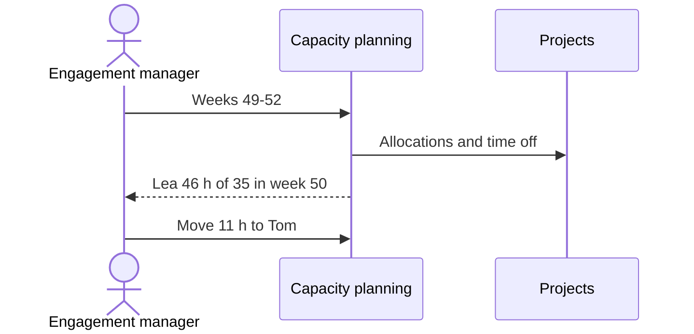

🏠 [Specs](../../../../README.md) › 🧩 [Functional capabilities](../../../README.md) ›
👥 [F9 HR and projects](../../README.md) › 📝 [Use cases](../README.md) ›
📝 [Use cases: FL-F9-11 Capacity, rounds and partners](README.md) › 📝 UC-F9-29 Plan capacity across projects

# 📝 UC-F9-29 Plan capacity across projects

**Status:** ✅ specified

## Summary

An engagement manager sees each person's planned load across projects against their available hours, by week, and
rebalances: move, delay, hire or subcontract.

## Personas

- [U24 Engagement manager](../../../../01-users/personas/u24-engagement-manager.md)
- [U02 Manager](../../../../01-users/personas/u02-manager.md)
- [U13 Owner](../../../../01-users/personas/u13-owner.md)

## Goal

Commit to projects the team can deliver.

## Trigger

A new project, a weekly review.

## Frequency

Weekly.

## Preconditions

- Projects with planned tasks or allocations
  ([UC-F9-17](../06-plan-and-deliver-work/uc-f09-17-manage-projects-and-tasks.md)).

## Postconditions

- **Succeeded:** loads within capacity, or the gap known.
- **Failed:** overloads stay flagged.

## Main flow

1. The engagement manager opens capacity planning
   ([S-F9-26](../../screens/11-capacity-rounds-and-partners/s-f09-26-capacity-planning.md)) by person, skill and week.
2. Each cell shows planned hours against available hours (contract minus time off).
3. Overloads and idle time show; a new project's need shows as unassigned demand.
4. They move allocations, delay tasks, or subcontract
   ([UC-F9-32](uc-f09-32-work-with-subcontractors-and-freelancers-on-projects.md))
   ([BR-F9-21](../../business-rules/br-f09-21-planned-load-stays-within-available-hours.md)).

## Alternative flows

- 1a. By skill: demand for "SAP consultant" against people with it.

## Error flows

- 4e. An allocation beyond a person's hours: flagged, saved only with a reason.

## Business rules

- [BR-F9-21 Planned load stays within available hours](../../business-rules/br-f09-21-planned-load-stays-within-available-hours.md)

## Entities

- [E-F9-25 Resource allocation](../../data/e-f09-25-resource-allocation.md)
- [E-F9-18 Project and task](../../data/e-f09-18-project-and-task.md)

## Permissions

Managers for their team; HR; record rules by department or site.

## Notifications

People: new allocations.

## Audit events

Allocations changed.

## AI involvement

The AI assistant prepares it for confirmation
([BR-F3-07](../../../f03-assistant/business-rules/br-f03-07-no-deletes-no-irreversible-acts.md)); figures come from
queries ([BR-F3-03](../../../f03-assistant/business-rules/br-f03-03-figures-come-from-queries.md)).

## API, MCP and A2A exposure

T5 operations of F9 with the caller's rights; the MCP tool of F9; no A2A skill.

## Screens

- [S-F9-26 Capacity planning](../../screens/11-capacity-rounds-and-partners/s-f09-26-capacity-planning.md)

## Flowchart

See [FL-F9-11 Capacity, rounds and partners](../../flows/fl-f09-11-capacity-rounds-and-partners.md#flowchart).

## Sequence diagram

## Acceptance criteria

1. **Given** Lea with 35 hours a week and 46 hours planned in week 50 **when** capacity opens **then** week 50 shows 131
   % for her.
2. **Given** 11 hours moved to Tom **when** it is saved **then** both show within capacity.
3. **Given** a time off in week 51 **when** capacity opens **then** her available hours drop.

## Non-functional notes

10 people x 26 weeks within 2 seconds.

## Regulatory references

None.

## Related use cases

- [UC-F9-17 Manage projects and tasks](../06-plan-and-deliver-work/uc-f09-17-manage-projects-and-tasks.md)
- [UC-F9-15 Plan shifts](../06-plan-and-deliver-work/uc-f09-15-plan-shifts.md)

## Open questions

None.

---

⬅️ [UC-F9-28](../10-listen-to-employees/uc-f09-28-run-engagement-surveys-and-exit-interviews.md) · ⬆️ [Up](README.md) ·
➡️ [UC-F9-30 Plan rounds and optimise routes](uc-f09-30-plan-rounds-and-optimise-routes.md)
