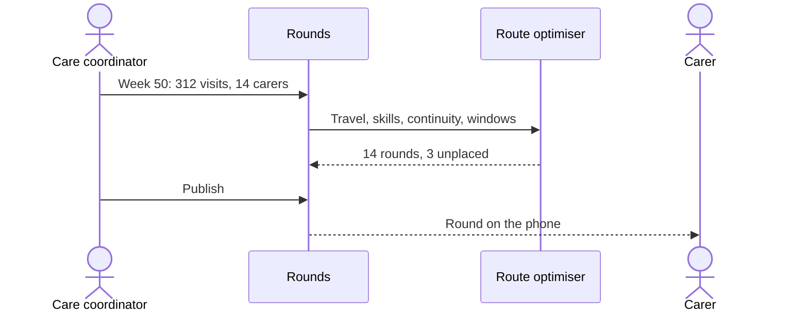

🏠 [Specs](../../../../README.md) › 🧩 [Functional capabilities](../../../README.md) ›
👥 [F9 HR and projects](../../README.md) › 📝 [Use cases](../README.md) ›
📝 [Use cases: FL-F9-11 Capacity, rounds and partners](README.md) › 📝 UC-F9-30 Plan rounds and optimise routes

# 📝 UC-F9-30 Plan rounds and optimise routes

**Status:** 🔄 waiting for the owner

## Summary

A coordinator or dispatcher plans the week's visits or deliveries into rounds; the shared optimiser orders them by
travel time, skills, continuity and time windows, and publishes them to phones; the shared capability of D457.

## Personas

- [U25 Care coordinator](../../../../01-users/personas/u25-care-coordinator.md)
- [U29 Dispatcher](../../../../01-users/personas/u29-dispatcher.md)
- [U26 Carer](../../../../01-users/personas/u26-carer.md)
- [U30 Driver](../../../../01-users/personas/u30-driver.md)
- [U42 Sales representative](../../../../01-users/personas/u42-sales-representative.md)

## Goal

Less driving, visits on time, the same carer for each person where possible.

## Trigger

Planning the week; a change during the day.

## Frequency

Weekly plans; daily changes.

## Preconditions

- Visits or deliveries with addresses, durations and time windows; staff with skills and hours.

## Postconditions

- **Succeeded:** rounds published with their order and travel times.
- **Failed:** unplaced visits are listed with the reason.

## Main flow

1. The coordinator opens rounds ([S-F9-27](../../screens/11-capacity-rounds-and-partners/s-f09-27-rounds.md)) for the
   week with the visits to place: the work requests scheduled by
   [UC-F9-33](../12-schedule-customer-requests/uc-f09-33-schedule-a-work-request.md).
2. The optimiser builds rounds: travel time between addresses, skills needed, the person's usual carer, time windows and
   working-time rules,
   [BR-F9-22](../../business-rules/br-f09-22-rounds-respect-travel-skills-continuity-and-working-time.md).
3. The coordinator checks the map and moves a visit by hand where needed; travel times recompute.
4. They publish; each carer or driver gets their round on the phone, offline
   ([D38](../../../../06-decisions/ux/d38-offline-field-tasks.md)).
5. During the day, a change (an absent carer, a new delivery) is re-optimised on the rest of the round.

## Alternative flows

- 2a. Representatives' visits to customers by frequency and area (SC15).
- 5a. A replacement: the optimiser proposes the nearest qualified carer.

## Error flows

- 2e. A visit no one can reach in its window: unplaced, listed with the reason.
- 4e. A round beyond daily working time: refused
  ([CR-FR-042](../../../../10-country-packs/france/labour/cr-fr-042-working-time-and-rest.md)).

## Business rules

- [BR-F9-22 Rounds respect travel, skills, continuity and working time](../../business-rules/br-f09-22-rounds-respect-travel-skills-continuity-and-working-time.md)
- [BR-F9-09 Shifts respect people and rules](../../business-rules/br-f09-09-shifts-respect-people-and-rules.md)

## Entities

- [E-F9-26 Round](../../data/e-f09-26-round.md)
- [E-F9-16 Shift](../../data/e-f09-16-shift.md)

## Permissions

Managers for their team; HR; record rules by department or site. Coordinators and dispatchers plan; staff see their own
round.

## Notifications

Staff: round published or changed.

## Audit events

Rounds optimised, changed, published.

## AI involvement

The optimiser proposes; the coordinator publishes.

## API, MCP and A2A exposure

T5 operations of F9 with the caller's rights; the MCP tool of F9; no A2A skill.

## Screens

- [S-F9-27 Rounds](../../screens/11-capacity-rounds-and-partners/s-f09-27-rounds.md)
- [S-F9-18 Field service](../../screens/06-plan-and-deliver-work/s-f09-18-field-service.md)

## Flowchart

See [FL-F9-11 Capacity, rounds and partners](../../flows/fl-f09-11-capacity-rounds-and-partners.md#flowchart).

## Sequence diagram

## Acceptance criteria

1. **Given** the example home-care service's 312 visits and 14 carers in week 50 **when** the rounds are optimised
   **then** 14 rounds are built and 3 visits listed unplaced with reasons.
2. **Given** Mme Roche usually visited by Lea **when** the rounds are built **then** Lea gets her visits where possible.
3. **Given** a carer absent on Tuesday **when** the change is entered at 07:00 **then** her visits are re-optimised on
   the others.
4. **Given** Distribution Lemoine's driver with 22 deliveries **when** his trip is optimised **then** the order follows
   travel time and delivery windows.

## Non-functional notes

Optimising 300 visits within 1 minute (Proposed).

## Regulatory references

[CR-FR-106](../../../../10-country-packs/france/labour/cr-fr-106-home-care-travel-and-split-shifts.md);
[CR-FR-117](../../../../10-country-packs/france/transport/cr-fr-117-driving-and-rest-times.md);
[CR-FR-054](../../../../10-country-packs/france/data-protection/cr-fr-054-location-with-consent.md).

## Related use cases

- [UC-F9-18 Run field service](../06-plan-and-deliver-work/uc-f09-18-run-field-service.md)
- [UC-SC04-03 Plan visits and optimise rounds](../../../../08-sectors/sc04-home-care/use-cases/02-plan-the-rounds/uc-sc04-03-plan-visits-and-optimise-rounds.md)
- [UC-SC07-02 Plan trips and optimise routes](../../../../08-sectors/sc07-transport/use-cases/01-orders-and-planning/uc-sc07-02-plan-trips-and-optimise-routes.md)
- [UC-F9-33 Schedule a work request](../12-schedule-customer-requests/uc-f09-33-schedule-a-work-request.md)
- [UC-F9-35 Re-plan after a change](../12-schedule-customer-requests/uc-f09-35-re-plan-after-a-change.md)

## Open questions

None.

---

⬅️ [UC-F9-29 Plan capacity across projects](uc-f09-29-plan-capacity-across-projects.md) · ⬆️ [Up](README.md) ·
➡️ [UC-F9-31 Follow a project as a customer](uc-f09-31-follow-a-project-as-a-customer.md)
