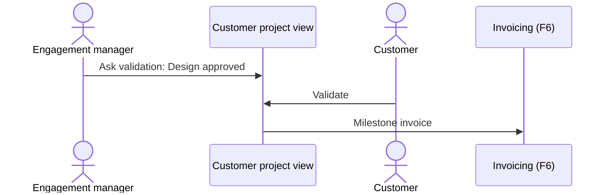

🏠 [Specs](../../../../README.md) › 🧩 [Functional capabilities](../../../README.md) ›
👥 [F9 HR and projects](../../README.md) › 📝 [Use cases](../README.md) ›
📝 [Use cases: FL-F9-11 Capacity, rounds and partners](README.md) › 📝 UC-F9-31 Follow a project as a customer

# 📝 UC-F9-31 Follow a project as a customer

**Status:** 🔄 waiting for the owner

## Summary

A customer follows their project in the portal: progress, milestones, shared documents and tasks, and validates
milestones, which triggers their invoice.

## Personas

- [U09 Customer](../../../../01-users/personas/u09-customer.md)
- [U24 Engagement manager](../../../../01-users/personas/u24-engagement-manager.md)

## Goal

The customer knows where the project stands and agrees each milestone.

## Trigger

The project is shared.

## Frequency

Weekly per active project.

## Preconditions

- The project is shared with the customer
  ([UC-F9-17](../06-plan-and-deliver-work/uc-f09-17-manage-projects-and-tasks.md)).

## Postconditions

- **Succeeded:** the milestone is validated and invoiced.
- **Failed:** a refused milestone goes back with the comment.

## Main flow

1. The customer opens the project in the portal
   ([S-F9-28](../../screens/11-capacity-rounds-and-partners/s-f09-28-customer-project-view.md)): progress, next
   milestones, shared tasks and documents.
2. The engagement manager asks the validation of a milestone.
3. The customer validates it, or refuses with a comment
   ([BR-F9-23](../../business-rules/br-f09-23-customers-validate-milestones-they-see.md)).
4. A validated milestone triggers its invoice,
   [UC-F6-16](../../../f06-customers-and-sales/use-cases/05-benchmark-additions/uc-f06-16-bill-usage-commitments-and-milestones.md).

## Alternative flows

- 1a. The customer comments a shared task.

## Error flows

- 3e. No answer in 10 days (Proposed): reminded.

## Business rules

- [BR-F9-23 Customers validate milestones they see](../../business-rules/br-f09-23-customers-validate-milestones-they-see.md)
- [BR-F1-26 Portal accounts see only their own records](../../../f01-administration/business-rules/br-f01-26-portal-accounts-see-only-their-own-records.md)

## Entities

- [E-F9-18 Project and task](../../data/e-f09-18-project-and-task.md)

## Permissions

The customer's portal accounts for that project.

## Notifications

Customer: validation asked; manager: answer.

## Audit events

Milestones asked, validated, refused.

## AI involvement

None on the portal.

## API, MCP and A2A exposure

T5 project operations for the portal.

## Screens

- [S-F9-28 Customer project view](../../screens/11-capacity-rounds-and-partners/s-f09-28-customer-project-view.md)

## Flowchart

See [FL-F9-11 Capacity, rounds and partners](../../flows/fl-f09-11-capacity-rounds-and-partners.md#flowchart).

## Sequence diagram

## Acceptance criteria

1. **Given** a project of Nuvola Logiciels shared with its customer **when** the customer opens it **then** she sees
   progress and shared tasks only.
2. **Given** milestone "Design approved" asked **when** she validates it **then** its invoice is issued.
3. **Given** she refuses with "missing mobile screens" **when** it is saved **then** the manager sees the comment.

## Non-functional notes

Works on a phone.

## Regulatory references

None.

## Related use cases

- [UC-F9-17 Manage projects and tasks](../06-plan-and-deliver-work/uc-f09-17-manage-projects-and-tasks.md)
- [UC-F6-16 Bill usage, commitments and milestones](../../../f06-customers-and-sales/use-cases/05-benchmark-additions/uc-f06-16-bill-usage-commitments-and-milestones.md)

## Open questions

None.

---

⬅️ [UC-F9-30 Plan rounds and optimise routes](uc-f09-30-plan-rounds-and-optimise-routes.md) · ⬆️ [Up](README.md) ·
➡️ [UC-F9-32](uc-f09-32-work-with-subcontractors-and-freelancers-on-projects.md)
