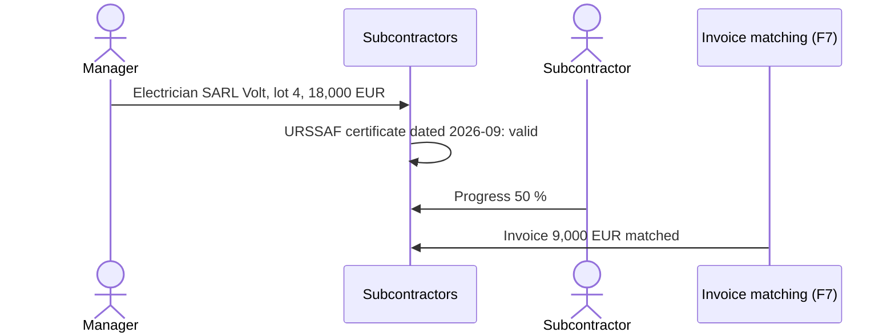

🏠 [Specs](../../../../README.md) › 🧩 [Functional capabilities](../../../README.md) ›
👥 [F9 HR and projects](../../README.md) › 📝 [Use cases](../README.md) ›
📝 [Use cases: FL-F9-11 Capacity, rounds and partners](README.md) ›
📝 UC-F9-32 Work with subcontractors and freelancers on projects

# 📝 UC-F9-32 Work with subcontractors and freelancers on projects

**Status:** ✅ specified

## Summary

A manager adds a subcontractor or a freelancer to a project, with their vigilance documents, their timesheets or
deliveries, and their invoices matched to what was done.

## Personas

- [U02 Manager](../../../../01-users/personas/u02-manager.md)
- [U10 Supplier](../../../../01-users/personas/u10-supplier.md)
- [U24 Engagement manager](../../../../01-users/personas/u24-engagement-manager.md)

## Goal

Outside workers on projects, legally and paid for what they did.

## Trigger

A project needs outside help.

## Frequency

Monthly in construction and services.

## Preconditions

- The subcontractor as a supplier ([E-F7-01](../../../f07-purchasing-and-stock/data/e-f07-01-supplier-record.md)).

## Postconditions

- **Succeeded:** the subcontractor works on the project; their invoice matches their time or deliveries.
- **Failed:** missing vigilance documents block the start.

## Main flow

1. The manager adds the subcontractor to the project on subcontractors
   ([S-F9-29](../../screens/11-capacity-rounds-and-partners/s-f09-29-subcontractors.md)), with the scope, price and
   dates.
2. simple-ERP checks the vigilance documents (URSSAF certificate, registration) and their dates
   ([BR-F9-24](../../business-rules/br-f09-24-no-work-without-vigilance-documents.md)).
3. The subcontractor logs time or deliveries in the supplier portal,
   [UC-F7-12](../../../f07-purchasing-and-stock/use-cases/01-procure/uc-f07-12-use-the-supplier-portal.md).
4. Their invoice is matched to it,
   [UC-F7-04](../../../f07-purchasing-and-stock/use-cases/01-procure/uc-f07-04-capture-and-match-supplier-invoices.md);
   the project's cost updates.

## Alternative flows

- 1a. Construction: the customer's acceptance of the subcontractor and the payment guarantee,
  [CR-FR-086](../../../../10-country-packs/france/construction/cr-fr-086-subcontractor-acceptance-and-payment-guarantee.md).

## Error flows

- 2e. A document expired: the start is blocked and the supplier asked.
- 4e. An invoice beyond the logged time: held.

## Business rules

- [BR-F9-24 No work without vigilance documents](../../business-rules/br-f09-24-no-work-without-vigilance-documents.md)

## Entities

- [E-F9-27 Subcontractor assignment](../../data/e-f09-27-subcontractor-assignment.md)
- [E-F9-18 Project and task](../../data/e-f09-18-project-and-task.md)

## Permissions

Managers for their team; HR; record rules by department or site. Purchasing.

## Notifications

Supplier: documents due every 6 months.

## Audit events

Added, documents, invoices.

## AI involvement

The AI assistant prepares it for confirmation
([BR-F3-07](../../../f03-assistant/business-rules/br-f03-07-no-deletes-no-irreversible-acts.md)); figures come from
queries ([BR-F3-03](../../../f03-assistant/business-rules/br-f03-03-figures-come-from-queries.md)).

## API, MCP and A2A exposure

T5 operations of F9 with the caller's rights; the MCP tool of F9; no A2A skill.

## Screens

- [S-F9-29 Subcontractors](../../screens/11-capacity-rounds-and-partners/s-f09-29-subcontractors.md)

## Flowchart

See [FL-F9-11 Capacity, rounds and partners](../../flows/fl-f09-11-capacity-rounds-and-partners.md#flowchart).

## Sequence diagram

## Acceptance criteria

1. **Given** Acme Bâtiment's electrician with an URSSAF certificate of 2026-04-02 **when** 2026-10-03 comes **then** the
   document shows expired and new work is blocked.
2. **Given** progress logged at 50 % of 18,000 EUR **when** an invoice of 9,000 EUR arrives **then** it is matched.
3. **Given** an invoice of 12,000 EUR at 50 % **when** it arrives **then** it is held.

## Non-functional notes

None.

## Regulatory references

[CR-FR-085](../../../../10-country-packs/france/construction/cr-fr-085-subcontractor-vigilance.md);
[CR-FR-086](../../../../10-country-packs/france/construction/cr-fr-086-subcontractor-acceptance-and-payment-guarantee.md);
[CR-FR-083](../../../../10-country-packs/france/tax-and-vat/cr-fr-083-construction-subcontracting-reverse-charge.md).

## Related use cases

- [UC-F9-17 Manage projects and tasks](../06-plan-and-deliver-work/uc-f09-17-manage-projects-and-tasks.md)
- [UC-F7-12 Use the supplier portal](../../../f07-purchasing-and-stock/use-cases/01-procure/uc-f07-12-use-the-supplier-portal.md)

## Open questions

None.

---

⬅️ [UC-F9-31 Follow a project as a customer](uc-f09-31-follow-a-project-as-a-customer.md) · ⬆️ [Up](README.md) ·
➡️ [UC-F9-33 Schedule a work request](../12-schedule-customer-requests/uc-f09-33-schedule-a-work-request.md)
