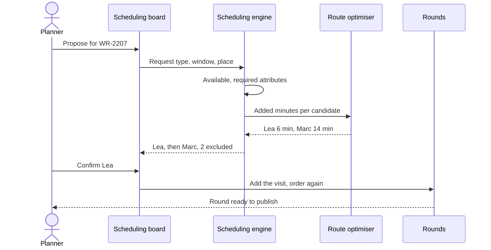

🏠 [Specs](../../../../README.md) › 🧩 [Functional capabilities](../../../README.md) ›
👥 [F9 HR and projects](../../README.md) › 📝 [Use cases](../README.md) ›
📝 [Use cases: FL-F9-12 Schedule customer requests](README.md) › 📝 UC-F9-33 Schedule a work request

# 📝 UC-F9-33 Schedule a work request

**Status:** 🔄 draft (GH-2 step S4b, from VD-27 to VD-29, VD-32, VD-33 / D509 to D511, D514, D515)

## Summary

A planner asks the scheduling engine for a work request. The engine keeps the people available in the window, excludes
anyone missing a required attribute, ranks the others by the preferred attributes and the objectives, and proposes the
best candidate with the next ones and the excluded with their reasons. The planner confirms, edits or overrides with a
reason; the assignment joins the person's round of
[UC-F9-30](../11-capacity-rounds-and-partners/uc-f09-30-plan-rounds-and-optimise-routes.md).

## Personas

- [U25 Care coordinator](../../../../01-users/personas/u25-care-coordinator.md), as a planner (D517)
- [U29 Dispatcher](../../../../01-users/personas/u29-dispatcher.md), as a planner (D517)
- [U26 Carer](../../../../01-users/personas/u26-carer.md), [U30 Driver](../../../../01-users/personas/u30-driver.md),
  [U14 Field worker](../../../../01-users/personas/u14-field-worker.md), who are assigned

## Goal

Each work request is given to an eligible person, on time, with as little travel as possible and a fair load.

## Trigger

A work request becomes ready
[UC-F16-16](../../../f16-customer-support-agents/use-cases/06-take-in-every-request/uc-f16-16-turn-any-request-into-a-work-request.md),
or the planner opens the day to plan.

## Frequency

Every work request, a few to several hundred a day per company; the planner works on the board all day.

## Preconditions

- The work request is ready, with its request type
  ([E-F2-25](../../../f02-no-code-configuration/data/e-f02-25-request-type.md)), place, window and duration.
- The automatic mode is off for this team and request type
  ([UC-F9-34](uc-f09-34-run-the-automatic-scheduling.md) otherwise).
- The planner holds the map right to see the map
  [BR-F1-32](../../../f01-administration/business-rules/br-f01-32-map-right-for-planners-and-managers.md); without
  it, the same proposal shows without the map.

## Postconditions

- **Succeeded:** the work request is scheduled with one person; the proposal records the candidates, the excluded and
  why, who confirmed and any override reason; the visit is in that person's round.
- **Failed:** the work request is blocked with the reasons, or stays ready; nothing is assigned.

## Main flow

1. The planner opens the scheduling board
   ([S-F9-30](../../screens/12-schedule-customer-requests/s-f09-30-scheduling-board.md)) on a day; the ready work
   requests are listed beside the people.
2. The planner selects a work request; SimpleERP asks the scheduling engine
   [REQ-T13-07](../../../../03-technical/t13-maps-and-geodata/requirements/req-t13-07-scheduling-engine.md).
3. The engine reads the request type's attributes, required or preferred with their weights, and its objectives
   (D509 to D511).
4. It keeps the people available in the window: contract, shifts, time off and the rounds already planned.
5. It excludes anyone missing a required attribute that is verified and current
   ([BR-F9-25](../../business-rules/br-f09-25-required-attributes-exclude.md),
   [BR-F9-27](../../business-rules/br-f09-27-unverified-attributes-do-not-count.md)).
6. It asks the route optimiser of
   [BR-F9-22](../../business-rules/br-f09-22-rounds-respect-travel-skills-continuity-and-working-time.md) how many
   minutes each remaining candidate's round would grow, and whether it stays within working time.
7. It ranks the candidates by the preferred attributes and the objectives in the request type's order
   ([BR-F9-35](../../business-rules/br-f09-35-default-order-of-objectives.md)).
8. The proposal opens ([S-F9-31](../../screens/12-schedule-customer-requests/s-f09-31-proposal-review.md)): the best
   candidate, the next ones with their scores, the excluded with a short reason each, and the route on the map.
9. The planner confirms. The work request is scheduled, the visit joins the person's round
   ([E-F9-26](../../data/e-f09-26-round.md)), and the route optimiser orders the round again.
10. The planner publishes the round on [S-F9-27](../../screens/11-capacity-rounds-and-partners/s-f09-27-rounds.md), as
    in UC-F9-30; the person gets it on the phone and the customer is told the day and the window.

## Alternative flows

- 1a. Several work requests: the planner selects them and asks for proposals together; each proposal is reviewed on
  its own.
- 1b. Work without a place (a remote engagement, a session at the office): the engine skips step 6 and no route shows.
- 3a. The planner adds or relaxes one attribute for this request only: logged with the reason; a legal one cannot be
  relaxed ([BR-F9-26](../../business-rules/br-f09-26-legal-requirements-never-relaxed.md)).
- 9a. The planner picks another candidate from the list: the choice is an override, saved with a reason
  ([BR-F9-34](../../business-rules/br-f09-34-overrides-logged-with-a-reason.md)).
- 9b. The planner changes the time within the window: the proposal is computed again.

## Error flows

- 5e. Nobody is left: the work request is blocked, with the reasons counted ("4 without the carer qualification, 2
  absent"). The planner subcontracts
  [UC-F9-32](../11-capacity-rounds-and-partners/uc-f09-32-work-with-subcontractors-and-freelancers-on-projects.md),
  moves the window with the customer, plans a training or refuses.
- 6e. Every round would go beyond working time: the candidate is excluded with "working time"
  ([CR-FR-042](../../../../10-country-packs/france/labour/cr-fr-042-working-time-and-rest.md)).
- 9e. The person was assigned elsewhere meanwhile: the confirmation is refused and the proposal computed again.
- Any step: the engine does not answer; the call is retried first
  ([BR-F3-32](../../../f03-assistant/business-rules/br-f03-32-retry-before-an-error.md)), then the message follows the
  error pattern (D122) and the planner can still assign by hand, logged as an override.

## Business rules

- [BR-F9-25 Required attributes exclude a candidate](../../business-rules/br-f09-25-required-attributes-exclude.md)
- [BR-F9-26 Legal requirements are never relaxed](../../business-rules/br-f09-26-legal-requirements-never-relaxed.md)
- [BR-F9-27](../../business-rules/br-f09-27-unverified-attributes-do-not-count.md)
- [BR-F9-29](../../business-rules/br-f09-29-planners-see-eligibility-only.md)
- [BR-F9-34 Every override is logged with its reason](../../business-rules/br-f09-34-overrides-logged-with-a-reason.md)
- [BR-F9-35 Default order of the scheduling objectives](../../business-rules/br-f09-35-default-order-of-objectives.md)
- [BR-F9-22](../../business-rules/br-f09-22-rounds-respect-travel-skills-continuity-and-working-time.md)
- [BR-F9-09 Shifts respect people and rules](../../business-rules/br-f09-09-shifts-respect-people-and-rules.md)
- [BR-F1-32](../../../f01-administration/business-rules/br-f01-32-map-right-for-planners-and-managers.md)

## Entities

- [E-F16-12 Work request](../../../f16-customer-support-agents/data/e-f16-12-work-request.md): read, changed
- [E-F2-25 Request type](../../../f02-no-code-configuration/data/e-f02-25-request-type.md): read
- [E-F9-28 Assignment proposal](../../data/e-f09-28-assignment-proposal.md): created, changed
- [E-F9-26 Round](../../data/e-f09-26-round.md): changed
- [E-F9-01 Employee record](../../data/e-f09-01-employee-record.md),
  [E-F9-12 Certification](../../data/e-f09-12-certification.md)
  (generalised into Qualification), [E-F9-29 Degree](../../data/e-f09-29-degree.md): read
- [E-T13-02 Route](../../../../03-technical/t13-maps-and-geodata/data/e-t13-02-route.md): read

## Permissions

Planners on the teams and sites their record rules allow (D517); the planners' manager the same.
Planners see "eligible" or "not eligible" with a short reason, never the birth date, the fitness details or a degree's
proof (BR-F9-29). Only roles with the map right see the map.

## Notifications

- The assigned person: work added to their round, at publishing (UC-F9-30).
- The customer: the day and the window, on the request's channel.

## Audit events

Proposal computed (candidates, excluded and reasons, scores), confirmed, overridden with the reason, attribute added or
relaxed on a request with the reason.

## AI involvement

The engine proposes; the planner decides. The AI assistant may explain a proposal ("why not Marc?") from what the
planner may see, and never names a sensitive reason beyond the short label of BR-F9-29.

## API, MCP and A2A exposure

T5 operations of F9 with the caller's rights (ask for a proposal, confirm, override); the MCP tool of F9; no A2A skill.

## Screens

- [S-F16-14](../../../f16-customer-support-agents/screens/06-take-in-every-request/s-f16-14-work-requests.md)
- [S-F9-30 Scheduling board](../../screens/12-schedule-customer-requests/s-f09-30-scheduling-board.md)
- [S-F9-31 Proposal review](../../screens/12-schedule-customer-requests/s-f09-31-proposal-review.md)
- [S-F9-27 Rounds](../../screens/11-capacity-rounds-and-partners/s-f09-27-rounds.md)

## Flowchart

See [FL-F9-12 Schedule customer requests](../../flows/fl-f09-12-schedule-customer-requests.md#flowchart).

## Sequence diagram

## Acceptance criteria

1. **Given** the example home-care service's WR-2207, bathing help for Mme Roche on Tuesday between 08:00 and 09:00,
   with the carer qualification required **when** a proposal is asked **then** the 4 carers without it are listed as
   excluded with "carer qualification" and never ranked.
2. **Given** Lea's qualification read by the AI and still "to verify" **when** the proposal is computed **then** Lea is
   excluded with "qualification to verify".
3. **Given** Lea 6 minutes away and Marc 14 minutes away, both eligible **when** the proposal is computed with the
   default order **then** Lea is first.
4. **Given** the planner picks Marc instead of Lea **when** they confirm **then** a reason is asked and logged.
5. **Given** an electrical intervention that the France pack ties to an electrical authorisation **when** the planner
   tries to relax it **then** it is refused with the source of the requirement.
6. **Given** a planner whose role lacks the map right **when** the proposal opens **then** it shows without the map and
   with the addresses.

## Non-functional notes

A proposal within 5 seconds for one work request with 50 people (Proposed); the existing 300 visits within 1 minute of
UC-F9-30 (Proposed). D408's targets apply to the screens ([Performance](../../../../05-non-functional/performance.md)).

## Regulatory references

[CR-FR-042](../../../../10-country-packs/france/labour/cr-fr-042-working-time-and-rest.md);
[CR-FR-106](../../../../10-country-packs/france/labour/cr-fr-106-home-care-travel-and-split-shifts.md);
[CR-FR-117](../../../../10-country-packs/france/transport/cr-fr-117-driving-and-rest-times.md);
[CR-FR-208](../../../../10-country-packs/france/labour/cr-fr-208-young-workers-regulated-work.md);
[CR-FR-209](../../../../10-country-packs/france/labour/cr-fr-209-reinforced-medical-follow-up.md);
[CR-FR-210](../../../../10-country-packs/france/labour/cr-fr-210-qualifications-tied-to-tasks.md);
[CR-FR-057](../../../../10-country-packs/france/ai-and-recording/cr-fr-057-human-oversight.md).

## Related use cases

- [UC-F16-16](../../../f16-customer-support-agents/use-cases/06-take-in-every-request/uc-f16-16-turn-any-request-into-a-work-request.md)
- [UC-F9-30](../11-capacity-rounds-and-partners/uc-f09-30-plan-rounds-and-optimise-routes.md)
- [UC-F9-34 Run the automatic scheduling](uc-f09-34-run-the-automatic-scheduling.md)
- [UC-F9-35 Re-plan after a change](uc-f09-35-re-plan-after-a-change.md)
- [UC-F2-30](../../../f02-no-code-configuration/use-cases/12-set-up-request-types/uc-f02-30-set-up-a-request-type.md)

## Open questions

None.

---

⬅️ [UC-F9-32](../11-capacity-rounds-and-partners/uc-f09-32-work-with-subcontractors-and-freelancers-on-projects.md) ·
⬆️ [Up](README.md) · ➡️ [UC-F9-34 Run the automatic scheduling](uc-f09-34-run-the-automatic-scheduling.md)
