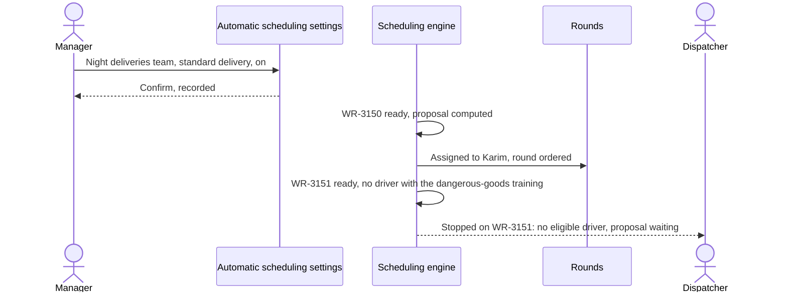

🏠 [Specs](../../../../README.md) › 🧩 [Functional capabilities](../../../README.md) ›
👥 [F9 HR and projects](../../README.md) › 📝 [Use cases](../README.md) ›
📝 [Use cases: FL-F9-12 Schedule customer requests](README.md) › 📝 UC-F9-34 Run the automatic scheduling

# 📝 UC-F9-34 Run the automatic scheduling

**Status:** 🔄 draft (GH-2 step S4b, from VD-33 / D515)

## Summary

The planners' manager or the administrator enables, by hand, the fully automatic mode for a team and some request
types. In it the engine assigns and re-plans on its own, as UC-F9-33 would propose, and stops at the first problem:
it leaves that work request as a proposal and notifies the planner, who decides.

## Personas

- [U02 Manager](../../../../01-users/personas/u02-manager.md), the planners' manager (D517)
- [U07 Administrator](../../../../01-users/personas/u07-administrator.md) (D517)
- [U29 Dispatcher](../../../../01-users/personas/u29-dispatcher.md) and
  [U25 Care coordinator](../../../../01-users/personas/u25-care-coordinator.md), the planners notified

## Goal

Routine work is assigned without a planner, and nothing goes wrong unseen.

## Trigger

Enabling: the manager's choice. Running: each work request that becomes ready, and each change, in a team and request
type where the mode is on.

## Frequency

Enabled rarely; runs on every ready work request of those teams.

## Preconditions

- The request type allows the automatic mode
  ([E-F2-25](../../../f02-no-code-configuration/data/e-f02-25-request-type.md)).
- The person enabling it has the right to (D517).

## Postconditions

- **Succeeded:** work requests scheduled automatically, each with its proposal recorded with mode "automatic".
- **Failed:** the engine stopped on a problem; the planner is notified; the work request waits with its proposal.

## Main flow

1. The manager opens the automatic scheduling settings
   ([S-F9-32](../../screens/12-schedule-customer-requests/s-f09-32-automatic-scheduling-settings.md)).
2. They choose a team and the request types, the problems that stop it, and who is notified.
3. They switch it on; simple-ERP asks them to confirm and records who and when
   ([BR-F9-33](../../business-rules/br-f09-33-automatic-mode-stops-on-a-problem.md)).
4. A work request of those types becomes ready; the engine computes the proposal as in UC-F9-33 steps 3 to 7.
5. No problem is found: the engine assigns the best candidate; the visit joins the person's round and the round is
   ordered again
   [BR-F9-22](../../business-rules/br-f09-22-rounds-respect-travel-skills-continuity-and-working-time.md).
6. The planner sees the automatic assignments on the scheduling board
   ([S-F9-30](../../screens/12-schedule-customer-requests/s-f09-30-scheduling-board.md)), marked "automatic".

## Alternative flows

- 3a. The manager switches it off: from then on the engine only proposes; assignments already made stay.
- 5a. Publishing: the round is published as the team's round setting says, as in UC-F9-30 (Proposed: published at once
  in automatic mode).

## Error flows

- 4e. A problem: no candidate, a legal conflict, a window that would be missed, a cost over the limit, an overlap. The
  engine stops on that work request (proposal "Stopped"); the planner gets a notification with the problem; the
  setting stays on for the other work requests (D517); the proposal waits on
  [S-F9-31](../../screens/12-schedule-customer-requests/s-f09-31-proposal-review.md) (UC-F9-33 from step 8).
- 4f. The engine does not answer: the mode stops in the same way; nothing is assigned half-way.

## Business rules

- [BR-F9-33](../../business-rules/br-f09-33-automatic-mode-stops-on-a-problem.md)
- [BR-F9-25 Required attributes exclude a candidate](../../business-rules/br-f09-25-required-attributes-exclude.md)
- [BR-F9-26 Legal requirements are never relaxed](../../business-rules/br-f09-26-legal-requirements-never-relaxed.md)
- [BR-F9-35 Default order of the scheduling objectives](../../business-rules/br-f09-35-default-order-of-objectives.md)
- [BR-F9-22](../../business-rules/br-f09-22-rounds-respect-travel-skills-continuity-and-working-time.md)

## Entities

- [E-F9-33 Automatic scheduling setting](../../data/e-f09-33-automatic-scheduling-setting.md): created, changed
- [E-F9-28 Assignment proposal](../../data/e-f09-28-assignment-proposal.md): created
- [E-F16-12 Work request](../../../f16-customer-support-agents/data/e-f16-12-work-request.md): changed
- [E-F9-26 Round](../../data/e-f09-26-round.md): changed

## Permissions

The planners' manager or the administrator, per team and request type (D517). Planners see the
setting.

## Notifications

- The planners named in the setting: the engine stopped on a work request, with the problem and a link to the proposal,
  at once, in the app
  and by email (Proposed: SMS as an option).
- The manager: the mode switched on or off.

## Audit events

Mode switched on or off (who, when, team, request types); each automatic assignment with its proposal; each stop with
its problem.

## AI involvement

The engine decides alone only where a person enabled it, and stops at the first problem. It never relaxes an
attribute, never overrides, and never re-enables itself. Human oversight as
[CR-FR-057](../../../../10-country-packs/france/ai-and-recording/cr-fr-057-human-oversight.md) describes: the setting
can be stopped at any time.

## API, MCP and A2A exposure

T5 operations of F9 with the caller's rights (read and change the setting); the MCP tool of F9 may read it but never
switch it on (Proposed); no A2A skill.

## Screens

- [S-F9-32](../../screens/12-schedule-customer-requests/s-f09-32-automatic-scheduling-settings.md)
- [S-F9-30 Scheduling board](../../screens/12-schedule-customer-requests/s-f09-30-scheduling-board.md)
- [S-F9-31 Proposal review](../../screens/12-schedule-customer-requests/s-f09-31-proposal-review.md)

## Flowchart

See [FL-F9-12 Schedule customer requests](../../flows/fl-f09-12-schedule-customer-requests.md#flowchart).

## Sequence diagram

## Acceptance criteria

1. **Given** a new team **when** it is created **then** its automatic mode is off.
2. **Given** Distribution Lemoine's night deliveries team in automatic mode **when** WR-3150 becomes ready with an
   eligible driver **then** it is assigned with mode "automatic" and the proposal kept.
3. **Given** the same team **when** WR-3151 needs a dangerous-goods training no free driver has **then** WR-3151 is
   not assigned, its proposal is "Stopped", and the dispatcher is notified.
4. **Given** a request type that does not allow the automatic mode **when** the manager opens the settings **then** that
   type cannot be ticked.
5. **Given** WR-3151 stopped **when** WR-3152 becomes ready with an eligible driver **then** it is assigned (Proposed:
   the setting stays on).

## Non-functional notes

The stop and its notification within 1 minute of the problem (Proposed).

## Regulatory references

[CR-FR-057](../../../../10-country-packs/france/ai-and-recording/cr-fr-057-human-oversight.md);
[CR-FR-117](../../../../10-country-packs/france/transport/cr-fr-117-driving-and-rest-times.md);
[CR-FR-121](../../../../10-country-packs/france/transport/cr-fr-121-dangerous-goods.md).

## Related use cases

- [UC-F9-33 Schedule a work request](uc-f09-33-schedule-a-work-request.md)
- [UC-F9-35 Re-plan after a change](uc-f09-35-re-plan-after-a-change.md)

## Open questions

None.

---

⬅️ [UC-F9-33 Schedule a work request](uc-f09-33-schedule-a-work-request.md) · ⬆️ [Up](README.md) ·
➡️ [UC-F9-35 Re-plan after a change](uc-f09-35-re-plan-after-a-change.md)
