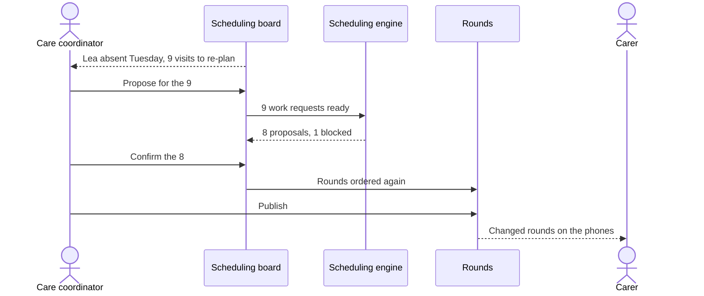

🏠 [Specs](../../../../README.md) › 🧩 [Functional capabilities](../../../README.md) ›
👥 [F9 HR and projects](../../README.md) › 📝 [Use cases](../README.md) ›
📝 [Use cases: FL-F9-12 Schedule customer requests](README.md) › 📝 UC-F9-35 Re-plan after a change

# 📝 UC-F9-35 Re-plan after a change

**Status:** 🔄 draft (GH-2 step S4b, from VD-30, VD-33 / D512, D515)

## Summary

An absence, a delay, an urgent request, a cancellation or an expired qualification changes the plan. The work
concerned goes back to "ready" and is scheduled again: proposed to the planner, or assigned by the automatic mode where
it is on. The rest of each round is ordered again by the route optimiser, as UC-F9-30 step 5 already does.

## Personas

- [U25 Care coordinator](../../../../01-users/personas/u25-care-coordinator.md), as a planner (D517)
- [U29 Dispatcher](../../../../01-users/personas/u29-dispatcher.md), as a planner (D517)
- [U26 Carer](../../../../01-users/personas/u26-carer.md), [U30 Driver](../../../../01-users/personas/u30-driver.md),
  whose rounds change
- [U09 Customer](../../../../01-users/personas/u09-customer.md), told of a new time

## Goal

The day still holds after a change: every visit has an eligible person, or the planner knows which ones do not.

## Trigger

- An absence entered (time off, sickness) for a person with work scheduled.
- A delay reported by the phone or seen at check-in.
- An urgent work request.
- A customer cancels.
- A qualification expires or is rejected.

## Frequency

Several times a day in field teams.

## Preconditions

- Work requests scheduled on the day concerned.

## Postconditions

- **Succeeded:** each affected work request is scheduled again, the rounds concerned are ordered and published, and the
  customers whose time changed are told.
- **Failed:** the work requests nobody can take are blocked with the reasons, at the top of the board.

## Main flow

1. A change is recorded; SimpleERP finds the scheduled work requests it affects.
2. Each one goes back to "ready" and is marked "to re-plan" on the scheduling board
   ([S-F9-30](../../screens/12-schedule-customer-requests/s-f09-30-scheduling-board.md)).
3. The engine proposes for each, as UC-F9-33 steps 3 to 7, keeping the person's usual carer as a preference where
   possible.
4. The planner reviews the proposals
   ([S-F9-31](../../screens/12-schedule-customer-requests/s-f09-31-proposal-review.md)) and confirms them, one by one or
   together.
5. The route optimiser orders the rest of each round again
   [BR-F9-22](../../business-rules/br-f09-22-rounds-respect-travel-skills-continuity-and-working-time.md); the
   planner publishes ([S-F9-27](../../screens/11-capacity-rounds-and-partners/s-f09-27-rounds.md)).
6. The people concerned get their changed round; the customers whose window changed are told.

## Alternative flows

- 1a. The customer cancels: the work request is cancelled, not re-planned; only the round is ordered again.
- 1b. An urgent request: it is ready at once and placed first on the board; the engine may propose to move a visit
  that is not urgent to make room, which the planner confirms (Proposed).
- 3a. The automatic mode is on: the engine assigns on its own, and stops at the first problem (UC-F9-34).

## Error flows

- 3e. Nobody is left for a visit: it is blocked with the reasons; the planner calls the customer to move the window,
  subcontracts or refuses.
- 6e. The phone is offline: the round reaches it at its next sync
  ([D38](../../../../06-decisions/ux/d38-offline-field-tasks.md)); the planner sees "not received yet".

## Business rules

- [BR-F9-22](../../business-rules/br-f09-22-rounds-respect-travel-skills-continuity-and-working-time.md)
- [BR-F9-27](../../business-rules/br-f09-27-unverified-attributes-do-not-count.md)
- [BR-F9-33](../../business-rules/br-f09-33-automatic-mode-stops-on-a-problem.md)
- [BR-F9-34 Every override is logged with its reason](../../business-rules/br-f09-34-overrides-logged-with-a-reason.md)

## Entities

- [E-F16-12 Work request](../../../f16-customer-support-agents/data/e-f16-12-work-request.md): changed
- [E-F9-28 Assignment proposal](../../data/e-f09-28-assignment-proposal.md): created
- [E-F9-26 Round](../../data/e-f09-26-round.md): changed
- [E-F9-09 Time-off request](../../data/e-f09-09-time-off-request.md): read

## Permissions

Planners on their teams (D517); people see their own changed round.

## Notifications

- The people whose round changed: the new round, on the phone.
- The customers whose window changed: the new window, on the request's channel.
- The planner: work blocked after a change.

## Audit events

Change recorded, work requests set back to ready, proposals, confirmations, overrides, rounds published again.

## AI involvement

The engine proposes; the planner confirms, unless the automatic mode is on. The AI assistant may draft the message to a
customer whose window changed; the planner sends it.

## API, MCP and A2A exposure

T5 operations of F9 with the caller's rights; the MCP tool of F9; no A2A skill.

## Screens

- [S-F9-30 Scheduling board](../../screens/12-schedule-customer-requests/s-f09-30-scheduling-board.md)
- [S-F9-31 Proposal review](../../screens/12-schedule-customer-requests/s-f09-31-proposal-review.md)
- [S-F9-27 Rounds](../../screens/11-capacity-rounds-and-partners/s-f09-27-rounds.md)

## Flowchart

See [FL-F9-12 Schedule customer requests](../../flows/fl-f09-12-schedule-customer-requests.md#flowchart).

## Sequence diagram

## Acceptance criteria

1. **Given** Lea absent on Tuesday with 9 visits **when** the absence is entered at 07:00 **then** the 9 work requests
   are back to ready and marked "to re-plan".
2. **Given** those 9 **when** proposals are computed **then** each is proposed to an eligible carer or blocked with the
   reasons.
3. **Given** Mme Roche's window moved from 08:00 to 10:00 **when** the round is published **then** she is told the new
   window.
4. **Given** Paul Martin's electrical authorisation expiring on Monday **when** it expires **then** his interventions
   from Monday that need it are set to re-plan.

## Non-functional notes

Re-planning one person's day within 1 minute (Proposed).

## Regulatory references

[CR-FR-042](../../../../10-country-packs/france/labour/cr-fr-042-working-time-and-rest.md);
[CR-FR-106](../../../../10-country-packs/france/labour/cr-fr-106-home-care-travel-and-split-shifts.md).

## Related use cases

- [UC-F9-30](../11-capacity-rounds-and-partners/uc-f09-30-plan-rounds-and-optimise-routes.md)
- [UC-F9-33 Schedule a work request](uc-f09-33-schedule-a-work-request.md)
- [UC-F9-34 Run the automatic scheduling](uc-f09-34-run-the-automatic-scheduling.md)
- [UC-F9-09 Request and approve time off](../03-time/uc-f09-09-request-and-approve-time-off.md)

## Open questions

None.

---

⬅️ [UC-F9-34 Run the automatic scheduling](uc-f09-34-run-the-automatic-scheduling.md) · ⬆️ [Up](README.md) ·
➡️ [UC-F9-36 See work and places on a map](uc-f09-36-see-work-and-places-on-a-map.md)
