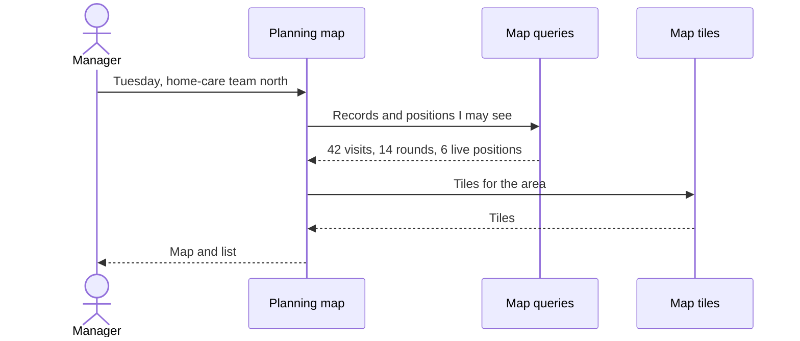

🏠 [Specs](../../../../README.md) › 🧩 [Functional capabilities](../../../README.md) ›
👥 [F9 HR and projects](../../README.md) › 📝 [Use cases](../README.md) ›
📝 [Use cases: FL-F9-12 Schedule customer requests](README.md) › 📝 UC-F9-36 See work and places on a map

# 📝 UC-F9-36 See work and places on a map

**Status:** 🔄 draft (GH-2 step S4b, from VD-18 to VD-22 / D501 to D504)

## Summary

A planner or a manager sees the day's work on a map: the work requests with their places and windows, each person's
round and route, the check-in and check-out positions, and, where the team option is on, the live positions shared
during working hours. Only roles with the map right see the map; everyone else sees the same records as a list with
addresses.

## Personas

- [U02 Manager](../../../../01-users/personas/u02-manager.md)
- [U25 Care coordinator](../../../../01-users/personas/u25-care-coordinator.md), as a planner (D517)
- [U29 Dispatcher](../../../../01-users/personas/u29-dispatcher.md), as a planner (D517)

## Goal

Know at a glance where the work is, who is near it, and which visits are at risk of being late.

## Trigger

Planning the day; a delay; a customer calling to ask where their visit is.

## Frequency

Daily, several times a day in field teams.

## Preconditions

- The user's role holds the map right
  [BR-F1-32](../../../f01-administration/business-rules/br-f01-32-map-right-for-planners-and-managers.md).
- Places are geocoded
  ([REQ-T13-02](../../../../03-technical/t13-maps-and-geodata/requirements/req-t13-02-geocoding.md)).

## Postconditions

- **Succeeded:** the user has seen the map; nothing is changed by looking.
- **Failed:** the map does not load; the list with addresses stays available.

## Main flow

1. The user opens the planning map
   ([S-F9-33](../../screens/12-schedule-customer-requests/s-f09-33-planning-map.md)) on a day and a team.
2. SimpleERP draws, from the records the user may see only
   [REQ-T13-06](../../../../03-technical/t13-maps-and-geodata/requirements/req-t13-06-map-queries-respect-permissions.md);
   the work requests by state, the rounds with their routes, the check-in and check-out positions.
3. Where the team's live-position option is on, the people's last shared positions show, during working hours only
   ([BR-F9-30](../../business-rules/br-f09-30-live-position-team-option-working-hours.md),
   [BR-F9-32](../../business-rules/br-f09-32-who-sees-a-position.md)).
4. The user filters by state, request type, person or area; the list beside the map follows.
5. The user selects a marker: the work request, the round or the person opens in a side panel, with "Open" to its own
   page.

## Alternative flows

- 1a. From the work requests list
  [S-F16-14](../../../f16-customer-support-agents/screens/06-take-in-every-request/s-f16-14-work-requests.md): the
  map layout of the same view.
- 3a. A paused or switched-off position: the person shows at their last check-in, marked "position paused".
- 5a. From a selected work request: "Propose" opens the proposal (UC-F9-33).

## Error flows

- 1e. The user lacks the map right: the screen shows the list with addresses, never the map; nothing hints that a map
  exists.
- 2e. The tiles do not load: the list stays, with "Map not available" (D122).
- 2f. A place has no position: listed under "Not on the map" with its address.

## Business rules

- [BR-F1-32](../../../f01-administration/business-rules/br-f01-32-map-right-for-planners-and-managers.md)
- [BR-F9-30](../../business-rules/br-f09-30-live-position-team-option-working-hours.md)
- [BR-F9-32 Who sees a person's position](../../business-rules/br-f09-32-who-sees-a-position.md)
- [BR-F9-06 Location only at check-in](../../business-rules/br-f09-06-location-only-at-check-in.md)

## Entities

- [E-F16-12 Work request](../../../f16-customer-support-agents/data/e-f16-12-work-request.md): read
- [E-F9-26 Round](../../data/e-f09-26-round.md): read
- [E-F9-10 Attendance](../../data/e-f09-10-attendance.md): read (check-in and check-out positions)
- [E-F9-32 Live position](../../data/e-f09-32-live-position.md): read
- [E-T13-01 Geocoded place](../../../../03-technical/t13-maps-and-geodata/data/e-t13-01-geocoded-place.md),
  [E-T13-02 Route](../../../../03-technical/t13-maps-and-geodata/data/e-t13-02-route.md),
  [E-T13-03 Map layer](../../../../03-technical/t13-maps-and-geodata/data/e-t13-03-map-layer.md): read

## Permissions

Roles with the map right: planner and manager roles (D517). People's positions: their planner or
dispatcher and their manager only, for planning (BR-F9-32). Field workers have no map; an address on their phone opens
their own navigation app (D517).

## Notifications

None.

## Audit events

Opening a map that shows people's positions is logged: who, when, which team (Proposed).

## AI involvement

The AI assistant may answer "who is nearest to Mme Roche?" from the positions the user may see, never from others.

## API, MCP and A2A exposure

T5 map queries of F9 with the caller's rights; the MCP tool of F9 returns places as addresses unless the caller holds
the map right (Proposed); no A2A skill.

## Screens

- [S-F9-33 Planning map](../../screens/12-schedule-customer-requests/s-f09-33-planning-map.md)
- [S-F16-14](../../../f16-customer-support-agents/screens/06-take-in-every-request/s-f16-14-work-requests.md)

## Flowchart

See [FL-F9-12 Schedule customer requests](../../flows/fl-f09-12-schedule-customer-requests.md#flowchart).

## Sequence diagram

## Acceptance criteria

1. **Given** the example home-care service's manager with the map right **when** they open Tuesday's map **then** the
   42 visits, the 14 rounds and the check-in positions show.
2. **Given** a carer of a team without the live-position option **when** the map is open **then** only their check-in
   and check-out positions show.
3. **Given** a sales person without the map right **when** they open the same view **then** they see the list with
   addresses and no map.
4. **Given** 19:30, after the carers' working hours **when** the map is open **then** no live position shows.

## Non-functional notes

The first map within 2 seconds for 500 markers (Proposed); tiles served by the company's own servers
[REQ-T13-01](../../../../03-technical/t13-maps-and-geodata/requirements/req-t13-01-self-hosted-tiles.md). Every
marker is also a row of the list beside the map ([Accessibility](../../../../05-non-functional/accessibility.md)).

## Regulatory references

[CR-FR-054](../../../../10-country-packs/france/data-protection/cr-fr-054-location-with-consent.md);
[CR-FR-211](../../../../10-country-packs/france/data-protection/cr-fr-211-live-geolocation-of-employees.md);
[CR-FR-206](../../../../10-country-packs/france/labour/cr-fr-206-cse-consulted-on-monitoring.md).

## Related use cases

- [UC-F9-33 Schedule a work request](uc-f09-33-schedule-a-work-request.md)
- [UC-F9-37 Share my position during work](uc-f09-37-share-my-position-during-work.md)
- [UC-F9-30](../11-capacity-rounds-and-partners/uc-f09-30-plan-rounds-and-optimise-routes.md)

## Open questions

None.

---

⬅️ [UC-F9-35 Re-plan after a change](uc-f09-35-re-plan-after-a-change.md) · ⬆️ [Up](README.md) ·
➡️ [UC-F9-37 Share my position during work](uc-f09-37-share-my-position-during-work.md)
