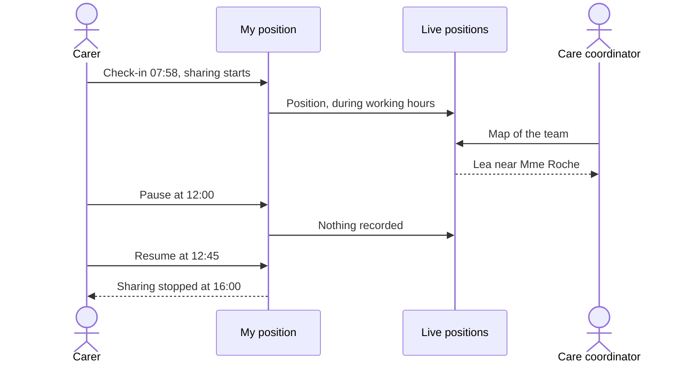

🏠 [Specs](../../../../README.md) › 🧩 [Functional capabilities](../../../README.md) ›
👥 [F9 HR and projects](../../README.md) › 📝 [Use cases](../README.md) ›
📝 [Use cases: FL-F9-12 Schedule customer requests](README.md) › 📝 UC-F9-37 Share my position during work

# 📝 UC-F9-37 Share my position during work

**Status:** ✅ specified

## Summary

In a team where the live-position option is on (drivers and carers), the employee's phone shares its position during
working hours only. A live indicator says when it is shared, what is recorded and who sees it; the employee pauses it
during breaks, and finds their history in their profile. Outside working hours nothing is shared.

## Personas

- [U26 Carer](../../../../01-users/personas/u26-carer.md)
- [U30 Driver](../../../../01-users/personas/u30-driver.md)

## Goal

The employee knows at every moment whether their position is shared, with whom, and can stop it during a break.

## Trigger

The start of working hours (the first check-in or the shift's start) in a team with the option on.

## Frequency

Each working day, for the employees of those teams.

## Preconditions

- The team's live-position option is on, with its stated purpose and its impact assessment
  ([BR-F9-30](../../business-rules/br-f09-30-live-position-team-option-working-hours.md)).
- The staff committee was consulted and the employees informed before it was switched on
  [CR-FR-206](../../../../10-country-packs/france/labour/cr-fr-206-cse-consulted-on-monitoring.md),
  [CR-FR-211](../../../../10-country-packs/france/data-protection/cr-fr-211-live-geolocation-of-employees.md).

## Postconditions

- **Succeeded:** positions recorded during working hours only, except paused times; kept 2 months at most (D517)
  ([BR-F9-31](../../business-rules/br-f09-31-live-positions-kept-two-months.md)).
- **Failed:** nothing is shared; the employee's check-in and check-out positions stay as BR-F9-06 says.

## Main flow

1. Working hours start; the phone shows the live indicator
   ([S-F9-34](../../screens/12-schedule-customer-requests/s-f09-34-my-position.md)): "Your position is shared".
2. The employee opens it: what is recorded (the position, about every few minutes), why (the team's
   purpose), who sees it (their planner or dispatcher, their manager, and the customer an arrival time only during the
   visit's window), and how long it is kept.
3. During a break, the employee taps "Pause"; nothing is recorded until "Resume" or the end of the break.
4. Working hours end; sharing stops by itself and the indicator goes.
5. The employee opens their history in their profile: the days, the times shared and paused, and who
   opened a map that showed them.

## Alternative flows

- 1a. The team option is off: no indicator; positions at check-in and check-out only
  ([BR-F9-06](../../business-rules/br-f09-06-location-only-at-check-in.md)).
- 3a. The break ends without "Resume": sharing resumes at the end of the break planned in the shift.

## Error flows

- 1e. The phone's location is switched off: the indicator says "Not shared"; the planner sees the last check-in only;
  nobody is blamed (no performance use).
- 4e. Working hours overrun: sharing stops at the planned end; the employee may resume it for the overrun, by choice.

## Business rules

- [BR-F9-30](../../business-rules/br-f09-30-live-position-team-option-working-hours.md)
- [BR-F9-31 Live positions kept two months at most](../../business-rules/br-f09-31-live-positions-kept-two-months.md)
- [BR-F9-32 Who sees a person's position](../../business-rules/br-f09-32-who-sees-a-position.md)
- [BR-F9-06 Location only at check-in](../../business-rules/br-f09-06-location-only-at-check-in.md)

## Entities

- [E-F9-32 Live position](../../data/e-f09-32-live-position.md): created, read
- [E-F9-16 Shift](../../data/e-f09-16-shift.md): read (working hours and breaks)

## Permissions

The employee sees everything shared about them. Their planner or dispatcher and their manager see the positions, for
planning only; never for speed or performance (BR-F9-32). HR does not see live positions.

## Notifications

- The employee: "Your position is shared" at the start of working hours; "Sharing stopped" at the end.

## Audit events

Sharing started, paused, resumed, stopped; each opening of the map that showed the person (who, when).

## AI involvement

None. The AI assistant never uses positions to judge speed or performance.

## API, MCP and A2A exposure

T5 operations of F9 for the employee's own history; positions are ingested by T13
([REQ-T13-05](../../../../03-technical/t13-maps-and-geodata/requirements/req-t13-05-live-positions.md)); no MCP tool
returns another person's position; no A2A skill.

## Screens

- [S-F9-34 My position](../../screens/12-schedule-customer-requests/s-f09-34-my-position.md)
- [S-F9-04 My HR](../../screens/01-people/s-f09-04-my-hr.md), for the history

## Flowchart

See [FL-F9-12 Schedule customer requests](../../flows/fl-f09-12-schedule-customer-requests.md#flowchart).

## Sequence diagram

## Acceptance criteria

1. **Given** Lea in a team with the option on **when** her working hours start **then** the indicator shows and says
   who sees her position.
2. **Given** Lea pausing at 12:00 **when** the coordinator opens the map at 12:20 **then** Lea shows "position paused"
   at her last check-in.
3. **Given** 19:00, after her working hours **when** her phone is on **then** nothing is recorded.
4. **Given** a position older than 2 months **when** the nightly clean-up runs **then** it is deleted (D517).
5. **Given** a driver in a team without the option **when** he works **then** no indicator shows and only check-in and
   check-out positions are kept.

## Non-functional notes

Battery use kept low: positions every few minutes, not continuously. The indicator is a word and an icon,
never only a colour.

## Regulatory references

[CR-FR-054](../../../../10-country-packs/france/data-protection/cr-fr-054-location-with-consent.md);
[CR-FR-211](../../../../10-country-packs/france/data-protection/cr-fr-211-live-geolocation-of-employees.md);
[CR-FR-206](../../../../10-country-packs/france/labour/cr-fr-206-cse-consulted-on-monitoring.md);
[CR-FR-052](../../../../10-country-packs/france/data-protection/cr-fr-052-storage-limitation.md).

## Related use cases

- [UC-F9-36 See work and places on a map](uc-f09-36-see-work-and-places-on-a-map.md)
- [UC-F16-17](../../../f16-customer-support-agents/use-cases/06-take-in-every-request/uc-f16-17-follow-the-arrival-of-a-visit.md)
- [UC-F9-10 Record attendance and overtime](../03-time/uc-f09-10-record-attendance-and-overtime.md)

## Open questions

None.

---

⬅️ [UC-F9-36 See work and places on a map](uc-f09-36-see-work-and-places-on-a-map.md) · ⬆️ [Up](README.md) ·
➡️ [UC-F9-38](../13-keep-qualifications/uc-f09-38-record-degrees-and-qualifications.md)
