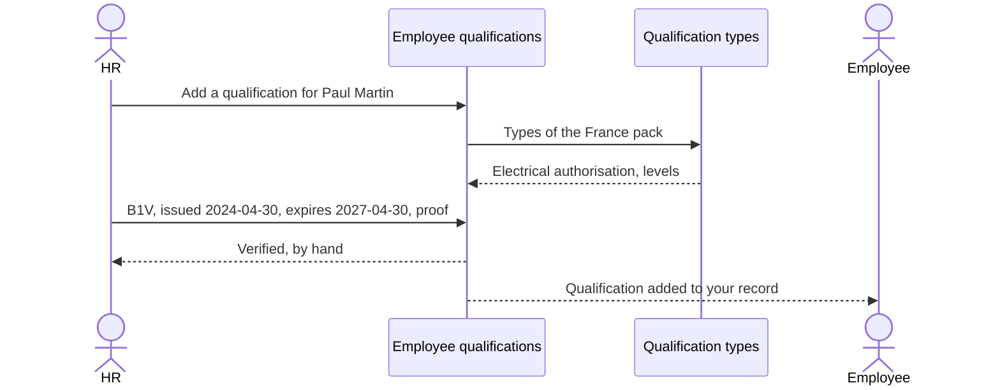

🏠 [Specs](../../../../README.md) › 🧩 [Functional capabilities](../../../README.md) ›
👥 [F9 HR and projects](../../README.md) › 📝 [Use cases](../README.md) ›
📝 [Use cases: FL-F9-13 Keep employees' qualifications](README.md) › 📝 UC-F9-38 Record degrees and qualifications

# 📝 UC-F9-38 Record degrees and qualifications

**Status:** 🔄 draft (GH-2 step S4b, from VD-24, VD-25, VD-27 / D506, D507, D509)

## Summary

HR records by hand the attributes scheduling may use, in four families: degrees and qualifications; skills and
languages; place and travel; person and contract. A degree is optional and structured. A qualification takes its type
from the catalogue of the country and sector packs, with its level, dates and proof. The employee reads their own; the
manager sees the team's eligibility and expiry dates.

## Personas

- [U06 HR](../../../../01-users/personas/u06-hr.md)
- [U01 Employee](../../../../01-users/personas/u01-employee.md), who reads their own
- [U02 Manager](../../../../01-users/personas/u02-manager.md), who sees the team's eligibility

## Goal

Every attribute a request type may require is on file, verified and current, for each person who has it.

## Trigger

Hiring; a new degree, licence or certificate; a renewal; a reminder before an expiry.

## Frequency

A few per employee per year; at hiring for everyone.

## Preconditions

- The employee record exists ([UC-F9-01](../01-people/uc-f09-01-manage-employee-records-and-contracts.md)).
- The qualification types are loaded from the country and sector packs
  ([E-F9-30](../../data/e-f09-30-qualification-type.md)).

## Postconditions

- **Succeeded:** the attribute is saved as verified, with who entered it and when; it counts for scheduling while it is
  current.
- **Failed:** nothing is saved; what was typed stays on the screen.

## Main flow

1. HR opens the employee's qualifications
   ([S-F9-35](../../screens/13-keep-qualifications/s-f09-35-employee-qualifications.md)).
2. HR adds a degree ([E-F9-29](../../data/e-f09-29-degree.md)): title, EQF level 1 to 8 and the national level (RNCP
   in France), field of study, institution, country, year, proof.
3. HR adds a qualification ([E-F9-12](../../data/e-f09-12-certification.md), generalised into Qualification): the type
   from the catalogue (a driving licence category, a CACES, an electrical authorisation, food hygiene, first aid, a
   professional registration), its level or category, issued, expires, proof.
4. HR completes the other families on the employee record ([E-F9-01](../../data/e-f09-01-employee-record.md)): languages
   with level, skills with level, home base, zones, maximum travel, vehicle, cost rate, the birth date (used only for
   age checks) and the medical fitness status (fit, fit with restrictions, unfit, with dates, never a diagnosis).
5. simple-ERP saves each as verified, entered by hand, and shows when each expires.

## Alternative flows

- 1a. The employee opens their own qualifications from My HR
  ([S-F9-04](../../screens/01-people/s-f09-04-my-hr.md)): read only, with what the AI read and where it came from.
- 1b. The manager opens the team: each person's eligibility per qualification type and the expiry dates, never the birth
  date, the fitness details or the proofs ([BR-F9-29](../../business-rules/br-f09-29-planners-see-eligibility-only.md)).
- 2a. HR adds a document instead of typing: the AI reads it ([UC-F9-39](uc-f09-39-read-documents-and-verify.md)).

## Error flows

- 3e. A qualification type not in the catalogue: HR may add a company type (Proposed); a legal type comes only from the
  packs.
- 3f. The expiry date is before the issue date: refused with the field marked.
- 5e. An expiry within 90 days: a reminder to HR, the employee and the manager, as E-F9-12 already does.

## Business rules

- [BR-F9-27](../../business-rules/br-f09-27-unverified-attributes-do-not-count.md)
- [BR-F9-29](../../business-rules/br-f09-29-planners-see-eligibility-only.md)
- [BR-F9-02](../../business-rules/br-f09-02-hr-data-stays-with-hr-and-the-person.md)
- [BR-F9-17](../../business-rules/br-f09-17-mandatory-trainings-must-be-current-for-the-work-that-needs-them.md)

## Entities

- [E-F9-29 Degree](../../data/e-f09-29-degree.md): created, changed
- [E-F9-12 Certification](../../data/e-f09-12-certification.md), generalised into Qualification: created, changed
- [E-F9-30 Qualification type](../../data/e-f09-30-qualification-type.md): read
- [E-F9-01 Employee record](../../data/e-f09-01-employee-record.md): changed

## Permissions

HR on all employees; the employee reads their own; the manager sees the team's eligibility and expiry dates only
(BR-F9-29); planners see only "eligible" or "not eligible" with a short reason.

## Notifications

- HR, the employee and the manager: a qualification expires within 90 days.
- The employee: an attribute added or changed on their record.

## Audit events

Each attribute created, changed or removed, with who and when; each view of a proof document.

## AI involvement

None in this use case; reading documents is [UC-F9-39](uc-f09-39-read-documents-and-verify.md).

## API, MCP and A2A exposure

T5 operations of F9 with the caller's rights; the MCP tool of F9 returns eligibility only to callers without HR
rights; no A2A skill.

## Screens

- [S-F9-35 Employee qualifications](../../screens/13-keep-qualifications/s-f09-35-employee-qualifications.md)
- [S-F9-04 My HR](../../screens/01-people/s-f09-04-my-hr.md)

## Flowchart

See [FL-F9-13 Keep employees' qualifications](../../flows/fl-f09-13-keep-qualifications.md#flowchart).

## Sequence diagram

## Acceptance criteria

1. **Given** Paul Martin's B1V electrical authorisation entered by hand **when** saved **then** it is verified and
   counts for interventions that require it until 2027-04-30.
2. **Given** an expiry on 2027-04-30 **when** 2027-01-30 comes **then** HR, Paul and his manager are reminded.
3. **Given** the manager opening the team **when** the list shows **then** no birth date, fitness detail or proof is
   visible.
4. **Given** a degree with EQF level 6 and RNCP level 6 **when** saved **then** both levels show and a request type may
   require "EQF 6 or more".

## Non-functional notes

D408's targets apply ([Performance](../../../../05-non-functional/performance.md)). Proofs are HR documents with their
retention ([CR-FR-047](../../../../10-country-packs/france/labour/cr-fr-047-hr-records-retention.md)).

## Regulatory references

[CR-FR-210](../../../../10-country-packs/france/labour/cr-fr-210-qualifications-tied-to-tasks.md);
[CR-FR-208](../../../../10-country-packs/france/labour/cr-fr-208-young-workers-regulated-work.md);
[CR-FR-209](../../../../10-country-packs/france/labour/cr-fr-209-reinforced-medical-follow-up.md);
[CR-FR-047](../../../../10-country-packs/france/labour/cr-fr-047-hr-records-retention.md). (Proposed) to read: the
European Qualifications Framework recommendation; the French national register of professional certifications (RNCP).

## Related use cases

- [UC-F9-39 Read documents with the AI and verify](uc-f09-39-read-documents-and-verify.md)
- [UC-F9-11 Run appraisals and track skills](../04-grow/uc-f09-11-run-appraisals-and-track-skills.md)
- [UC-F9-25](../09-train-and-protect/uc-f09-25-run-the-training-plan-with-opco-funding.md)
- [UC-F9-33 Schedule a work request](../12-schedule-customer-requests/uc-f09-33-schedule-a-work-request.md)

## Open questions

None.

---

⬅️ [UC-F9-37](../12-schedule-customer-requests/uc-f09-37-share-my-position-during-work.md) · ⬆️ [Up](README.md) ·
➡️ [UC-F9-39 Read documents with the AI and verify](uc-f09-39-read-documents-and-verify.md)
