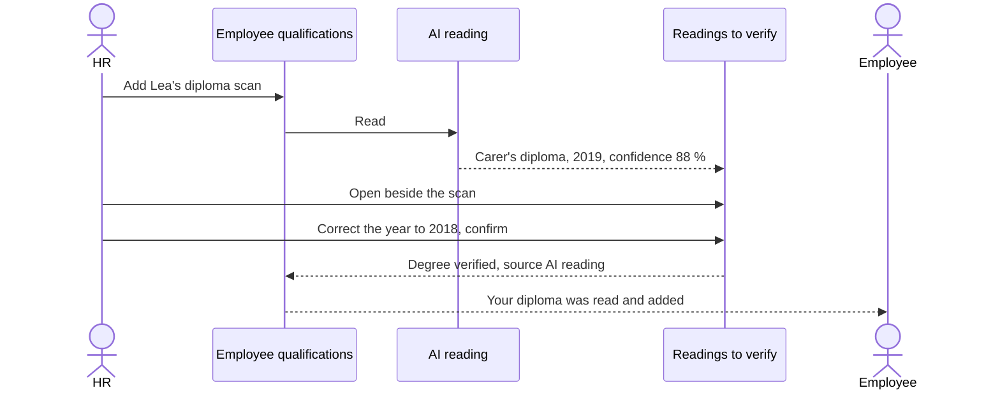

🏠 [Specs](../../../../README.md) › 🧩 [Functional capabilities](../../../README.md) ›
👥 [F9 HR and projects](../../README.md) › 📝 [Use cases](../README.md) ›
📝 [Use cases: FL-F9-13 Keep employees' qualifications](README.md) › 📝 UC-F9-39 Read documents with the AI and verify

# 📝 UC-F9-39 Read documents with the AI and verify

**Status:** 🔄 draft (GH-2 step S4b, from VD-25, VD-26 / D507, D508)

## Summary

HR adds a document: a CV or résumé, a diploma scan or photo, a licence, a certificate, a training record. The AI reads
the attributes it finds, each with a confidence. Every reading is "to verify" and scheduling ignores it until HR has
confirmed it, corrected it or rejected it, the source document beside it. The employee is told what was read.

## Personas

- [U06 HR](../../../../01-users/personas/u06-hr.md)
- [U01 Employee](../../../../01-users/personas/u01-employee.md), who is told what was read

## Goal

Attributes from documents are entered fast, and none counts before a person has checked it.

## Trigger

HR adds a document to an employee's qualifications, or imports a batch at hiring.

## Frequency

At hiring; at each renewal; in batches when a company starts with SimpleERP.

## Preconditions

- The employee record exists.
- Document reading is switched on for the company (T7).

## Postconditions

- **Succeeded:** each reading confirmed or corrected is a verified attribute, with its source "AI reading" and who
  verified it; rejected readings are kept as rejected with the reason.
- **Failed:** nothing is drafted; the document stays attached and HR enters the attribute by hand.

## Main flow

1. HR adds a document on [S-F9-35](../../screens/13-keep-qualifications/s-f09-35-employee-qualifications.md).
2. The AI reads it ([T7](../../../../03-technical/t07-ai-providers-and-models/README.md)) and drafts one reading per
   attribute found ([E-F9-31](../../data/e-f09-31-attribute-reading.md)): the fields read, the confidence of each, the
   place in the document.
3. Each attribute drafted is "to verify"; scheduling ignores it
   ([BR-F9-27](../../business-rules/br-f09-27-unverified-attributes-do-not-count.md)).
4. HR opens the readings to verify ([S-F9-36](../../screens/13-keep-qualifications/s-f09-36-readings-to-verify.md)):
   each reading beside the document, the fields read highlighted where they were found.
5. HR confirms, corrects a field and confirms, or rejects with a reason
   ([BR-F9-28](../../business-rules/br-f09-28-hr-confirms-every-ai-reading.md)).
6. A confirmed reading becomes a verified degree or qualification, source "AI reading", verified by HR with the date.
7. The employee is told what was read and kept.

## Alternative flows

- 1a. A batch at hiring: several documents for one employee, or one per employee for many; the readings queue on
  S-F9-36.
- 1b. The employee sends a document from their phone; it is read the same way and waits for HR (D517).
- 5a. HR confirms several readings of high confidence together, each still shown beside its source (Proposed).

## Error flows

- 2e. The AI cannot read the document (blurred, unknown layout): nothing is drafted; HR is told and enters by hand.
- 2f. The name read differs from the employee's name (Proposed): the reading is flagged and never merged until HR
  decides.
- 5e. HR rejects: the attribute is not created; the reading stays rejected with the reason; the employee is told.
- Any step: the AI service does not answer; the call is retried first
  ([BR-F3-32](../../../f03-assistant/business-rules/br-f03-32-retry-before-an-error.md)), then the document waits with
  "Reading not done" and HR can retry.

## Business rules

- [BR-F9-28 HR confirms every AI reading](../../business-rules/br-f09-28-hr-confirms-every-ai-reading.md)
- [BR-F9-27](../../business-rules/br-f09-27-unverified-attributes-do-not-count.md)
- [BR-F9-02](../../business-rules/br-f09-02-hr-data-stays-with-hr-and-the-person.md)

## Entities

- [E-F9-31 Attribute reading](../../data/e-f09-31-attribute-reading.md): created, changed
- [E-F9-29 Degree](../../data/e-f09-29-degree.md): created
- [E-F9-12 Certification](../../data/e-f09-12-certification.md), generalised into Qualification: created
- [E-F9-30 Qualification type](../../data/e-f09-30-qualification-type.md): read

## Permissions

HR only. The readings and the proof documents are HR documents, with their retention; the employee reads what was read
about them.

## Notifications

- HR: readings waiting to verify (a daily summary, Proposed).
- The employee: what was read and kept, or rejected.

## Audit events

Document added; reading drafted (model, confidence per field); confirmed, corrected (old and new value) or rejected with
the reason, by whom and when.

## AI involvement

The AI reads and drafts; it never verifies. A reading never counts for scheduling before HR confirms it. The employee
is told an AI read the document
[CR-FR-056](../../../../10-country-packs/france/ai-and-recording/cr-fr-056-people-know-they-deal-with-an-ai.md).
The AI reads only the attributes of the four families; it never keeps other content of a CV.

## API, MCP and A2A exposure

T5 operations of F9 for HR (add a document, list readings, confirm, correct, reject); the MCP tool of F9 may list
readings but never confirm one (Proposed); no A2A skill.

## Screens

- [S-F9-35 Employee qualifications](../../screens/13-keep-qualifications/s-f09-35-employee-qualifications.md)
- [S-F9-36 Readings to verify](../../screens/13-keep-qualifications/s-f09-36-readings-to-verify.md)

## Flowchart

See [FL-F9-13 Keep employees' qualifications](../../flows/fl-f09-13-keep-qualifications.md#flowchart).

## Sequence diagram

## Acceptance criteria

1. **Given** Lea's diploma scan **when** HR adds it **then** a reading is drafted with its fields and confidence, and
   the degree is "to verify".
2. **Given** that reading still to verify **when** a work request requires that diploma **then** Lea is excluded with
   "to verify".
3. **Given** HR corrects the year and confirms **when** saved **then** the degree is verified, source "AI reading",
   with the old and new year in the audit.
4. **Given** a blurred photo **when** read **then** nothing is drafted and HR is told.
5. **Given** a CV listing hobbies and a family situation **when** read **then** only attributes of the four families are
   drafted.

## Non-functional notes

A one-page document read within 30 seconds (Proposed); a batch in the background with its progress.

## Regulatory references

[CR-FR-056](../../../../10-country-packs/france/ai-and-recording/cr-fr-056-people-know-they-deal-with-an-ai.md);
[CR-FR-050](../../../../10-country-packs/france/data-protection/cr-fr-050-privacy-by-design.md);
[CR-FR-047](../../../../10-country-packs/france/labour/cr-fr-047-hr-records-retention.md).

## Related use cases

- [UC-F9-38 Record degrees and qualifications](uc-f09-38-record-degrees-and-qualifications.md)
- [UC-F9-01 Manage employee records and contracts](../01-people/uc-f09-01-manage-employee-records-and-contracts.md)

## Open questions

None.

---

⬅️ [UC-F9-38 Record degrees and qualifications](uc-f09-38-record-degrees-and-qualifications.md) · ⬆️ [Up](README.md) ·
➡️ [UC-F9-40 Search and rank LinkedIn profiles](../02-recruit/uc-f09-40-search-and-rank-linkedin-profiles.md)
