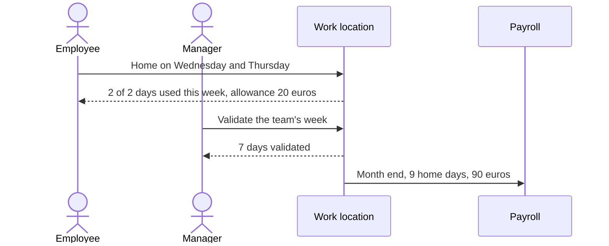

🏠 [Specs](../../../../README.md) › 🧩 [Functional capabilities](../../../README.md) ›
👥 [F9 HR and projects](../../README.md) › 📝 [Use cases](../README.md) › 📝 [Use cases: FL-F9-15](README.md) ›
📝 UC-F9-43 Declare remote-work days

# 📝 UC-F9-43 Declare remote-work days

**Status:** ✅ specified

## Summary

Employees declare where they work each day: at the office, at home, on another site or travelling. Days worked remotely
are checked against the company's remote-work agreement, validated by the manager and, when the agreement pays a
remote-work allowance, passed to payroll. The declared location is a day-level choice made by the employee, never a
position read from the phone ([BR-F9-06](../../business-rules/br-f09-06-location-only-at-check-in.md)).

## Personas

- [U01 Employee](../../../../01-users/personas/u01-employee.md), who declares days from a phone
- [U02 Manager](../../../../01-users/personas/u02-manager.md), who validates the days of the team

## Goal

Everyone knows who is where each day, the agreement's quota is respected and the allowance is paid for the right days
only.

## Trigger

An employee plans or records a remote-work day, or a manager reviews the declared days of the week.

## Frequency

Employees, weekly; managers, once a week.

## Preconditions

- The employee has an employee record and a contract ([E-F9-01 Employee record](../../data/e-f09-01-employee-record.md),
  [E-F9-02 Contract](../../data/e-f09-02-contract.md)).
- The company's remote-work agreement is set: days per week, allowance per day and monthly ceiling
  ([BR-F9-42](../../business-rules/br-f09-42-remote-work-allowances-follow-the-agreement.md)).
- The manager of the employee is known ([E-F9-03 Department](../../data/e-f09-03-department.md)).

## Postconditions

- **Succeeded:** the day is validated and counted against the quota, the allowance of the month is passed to payroll and
  the team calendar shows the location ([E-F9-48 Work location day](../../data/e-f09-48-work-location-day.md)).
- **Failed:** the day stays declared or is refused with a reason and no allowance is counted.

## Main flow

1. The employee opens Work location
   ([S-F9-40](../../screens/15-work-location-headcount-and-learning/s-f09-40-work-location.md)) and sees the week with
   one choice per day: office, home, other site, travelling.
2. The employee declares the days to come, or the days of the week just past, in one tap each.
3. The screen shows the quota used this week and this month and the allowance each home day earns.
4. The manager opens the team's week, sees who works where and validates the declared days in one action.
5. A validated day is counted; at month end the days that earn an allowance are totalled and passed to payroll
   ([BR-F9-42](../../business-rules/br-f09-42-remote-work-allowances-follow-the-agreement.md)).
6. The team calendar and the room and desk booking show the location of the day.

## Alternative flows

- 2a. A fixed pattern (home every Wednesday) is declared once and creates the days of the next three months; the
  employee can change a day.
- 4a. The manager refuses a day with a reason; the employee is told and the day is not counted.
- 4b. The agreement has no allowance: days are recorded for the calendar and the quota only.
- 5a. A day over the quota is validated as an exception by HR, with the reason, and earns no allowance.

## Error flows

- 2e. The day is over the weekly quota of the agreement: the employee is told and may ask for an exception from the
  manager ([BR-F9-42](../../business-rules/br-f09-42-remote-work-allowances-follow-the-agreement.md)).
- 2f. The day falls in a period of time off or sickness
  ([E-F9-09 Time-off request](../../data/e-f09-09-time-off-request.md)): refused, the other absence wins.
- 4e. The month is closed for payroll: the day is kept for the calendar and goes to the next month's review.
- Any step: a service does not answer; the call is retried first
  ([BR-F3-32](../../../f03-assistant/business-rules/br-f03-32-retry-before-an-error.md)), then the message follows the
  error pattern ([D122](../../../../06-decisions/ux/d122-error-message-standard.md)) and the declared days stay as they
  were.

## Business rules

- [BR-F9-42 Remote-work allowances follow the agreement](../../business-rules/br-f09-42-remote-work-allowances-follow-the-agreement.md)
- [BR-F9-06 Location only at check-in](../../business-rules/br-f09-06-location-only-at-check-in.md)
- [BR-F9-02 HR data stays with HR and the person](../../business-rules/br-f09-02-hr-data-stays-with-hr-and-the-person.md)

## Entities

- [E-F9-48 Work location day](../../data/e-f09-48-work-location-day.md): created, validated, refused, withdrawn, passed
  to pay
- [E-F9-01 Employee record](../../data/e-f09-01-employee-record.md): read
- [E-F9-02 Contract](../../data/e-f09-02-contract.md): read, for the agreement's terms
- [E-F9-09 Time-off request](../../data/e-f09-09-time-off-request.md): read, to refuse a clash

## Permissions

An employee declares and sees their own days only. A manager sees and validates the days of their team; HR sees all days
and the exceptions. No one sees where an employee is outside the declared day.

## Notifications

- The manager, in the app: days waiting for validation.
- The employee, in the app: a day refused, with the reason.

## Audit events

Day declared, validated, refused, withdrawn and passed to pay, with who did it; each exception to the quota and its
reason.

## AI involvement

The AI assistant may declare a day on request ("I work from home on Friday") and shows it for confirmation
([BR-F3-34](../../../f03-assistant/business-rules/br-f03-34-every-capability-is-reachable-from-the-assistant.md)); it
never validates a day.

## API, MCP and A2A exposure

T5 operations on work location days for the employee and the manager; one MCP tool to declare a day with confirmation;
no A2A skill.

## Screens

- [S-F9-40 Work location](../../screens/15-work-location-headcount-and-learning/s-f09-40-work-location.md)

## Flowchart

See
[FL-F9-15 Work location, headcount, careers and learning](../../flows/fl-f09-15-work-location-headcount-and-learning.md#flowchart).

## Sequence diagram

## Acceptance criteria

1. **Given** an agreement of 2 remote days a week **when** Claire declares 3 home days in a week **then** the third is
   refused with the quota shown.
2. **Given** a home day declared **when** the manager validates it **then** it counts against the quota and the
   allowance.
3. **Given** a day of time off **when** Claire declares it as a home day **then** it is refused: the absence wins.
4. **Given** an agreement without allowance **when** a day is validated **then** no allowance goes to payroll.
5. **Given** a validated day **when** the month closes **then** it is passed to payroll once.

## Non-functional notes

A week of five declarations is saved in under 2 seconds on a phone, also on a weak network.

## Regulatory references

The terms of remote work (days, allowance, tools) come from the company's agreement or charter. The treatment
of the allowance in tax and social contributions is a rule of the France pack, to be written with the owner's
confirmation, no article cited here.

## Related use cases

- [UC-F9-01 Manage employee records and contracts](../01-people/uc-f09-01-manage-employee-records-and-contracts.md)
- [UC-F9-04 Use employee self-service](../01-people/uc-f09-04-use-employee-self-service.md)
- [UC-F9-09 Request and approve time off](../03-time/uc-f09-09-request-and-approve-time-off.md)
- [UC-F9-10 Record attendance and overtime](../03-time/uc-f09-10-record-attendance-and-overtime.md)
- [UC-F9-44 Plan headcount against budget](uc-f09-44-plan-headcount-against-budget.md)

## Open questions

None.

---

⬅️ [UC-F9-42](../02-recruit/uc-f09-42-turn-a-positive-reply-into-an-applicant.md) · ⬆️ [Up](README.md) ·
➡️ [UC-F9-44 Plan headcount against budget](uc-f09-44-plan-headcount-against-budget.md)
