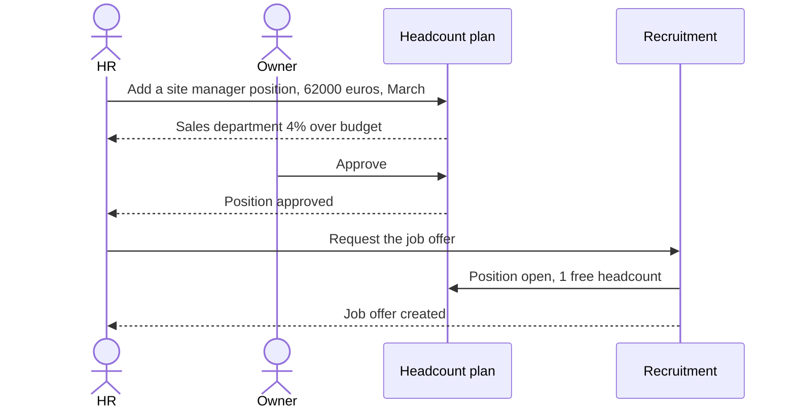

🏠 [Specs](../../../../README.md) › 🧩 [Functional capabilities](../../../README.md) ›
👥 [F9 HR and projects](../../README.md) › 📝 [Use cases](../README.md) › 📝 [Use cases: FL-F9-15](README.md) ›
📝 UC-F9-44 Plan headcount against budget

# 📝 UC-F9-44 Plan headcount against budget

**Status:** ✅ specified

## Summary

HR and the owner plan the positions the company can afford: for each department the positions, their budgeted cost and
start date, the filled and open ones. A job offer can only be requested for a budgeted position with a free headcount,
and the plan shows headcount and payroll cost against the budget, month by month.

## Personas

- [U06 Human resources](../../../../01-users/personas/u06-hr.md), who builds and follows the plan
- [U13 Owner](../../../../01-users/personas/u13-owner.md), who approves the budget and freezes it

## Goal

Hiring follows the budget: no one is recruited for a position nobody agreed to pay for, and the plan shows where
headcount and cost stand.

## Trigger

The yearly budget round, a manager's hiring request, or a leaver who frees a position.

## Frequency

Yearly for the plan, monthly for the follow-up, and for each hiring request.

## Preconditions

- Departments and employees exist ([E-F9-03 Department](../../data/e-f09-03-department.md),
  [E-F9-01 Employee record](../../data/e-f09-01-employee-record.md)).
- A budget plan of the year exists ([E-F8-16 Budget plan](../../../f08-accounting/data/e-f08-16-budget-plan.md)).
- HR may plan positions and the owner may approve them
  ([E-F1-06 Role](../../../f01-administration/data/e-f01-06-role.md)).

## Postconditions

- **Succeeded:** positions are planned, approved and linked to job offers and hires
  ([E-F9-49 Position](../../data/e-f09-49-position.md)), and the plan shows headcount and cost against the budget.
- **Failed:** no job offer is opened and the position stays as it was.

## Main flow

1. HR opens Headcount plan ([S-F9-41](../../screens/15-work-location-headcount-and-learning/s-f09-41-headcount-plan.md))
   and sees each department's positions: title, budgeted cost, start date, state.
2. HR adds a position with its department, title, full-time equivalent, yearly cost and start month.
3. The screen compares planned headcount and cost with the budget of the year and flags a department over budget.
4. The owner approves the positions, or freezes some; an approved position becomes available to recruit.
5. A manager's hiring request names a budgeted position; the position moves to Open and the job offer is created from it
   ([BR-F9-43](../../business-rules/br-f09-43-a-requisition-needs-a-budgeted-position.md)).
6. A hire fills the position; a leaver's position returns to Approved or is cancelled.

## Alternative flows

- 2a. A new position outside the budget is saved as Planned and sent to the owner as a budget change.
- 4a. The owner approves part of the positions and freezes the others; frozen ones cannot be opened.
- 5a. A position is filled by an internal move: the old position is freed in the same action.

## Error flows

- 5e. The hiring request names no budgeted position, or a position with no free headcount: refused with the budget shown
  ([BR-F9-43](../../business-rules/br-f09-43-a-requisition-needs-a-budgeted-position.md)).
- 4e. The budget plan of the year is missing: the cost is shown without a comparison and HR is told.
- 6e. A hire is recorded on a position that is not open: refused, HR opens it first.
- Any step: a service does not answer; the call is retried first
  ([BR-F3-32](../../../f03-assistant/business-rules/br-f03-32-retry-before-an-error.md)), then the message follows the
  error pattern ([D122](../../../../06-decisions/ux/d122-error-message-standard.md)) and the plan stays as it was.

## Business rules

- [BR-F9-43 A requisition needs a budgeted position](../../business-rules/br-f09-43-a-requisition-needs-a-budgeted-position.md)
- [BR-F9-16 HR duties follow the headcount](../../business-rules/br-f09-16-hr-duties-follow-the-headcount.md)
- [BR-F9-02 HR data stays with HR and the person](../../business-rules/br-f09-02-hr-data-stays-with-hr-and-the-person.md)

## Entities

- [E-F9-49 Position](../../data/e-f09-49-position.md): created, approved, opened, filled, frozen
- [E-F9-03 Department](../../data/e-f09-03-department.md): read
- [E-F9-06 Job position](../../data/e-f09-06-job-position.md): created from an open position
- [E-F8-16 Budget plan](../../../f08-accounting/data/e-f08-16-budget-plan.md): read, for the budget

## Permissions

HR plans positions. The owner approves, freezes and lifts. A manager sees the positions of their department and requests
a job offer. Costs are shown to HR and the owner only.

## Notifications

- The owner, in the app: positions waiting for approval.
- The manager, in the app: the answer to a hiring request.

## Audit events

Position planned, approved, frozen, opened, filled and cancelled, with who and the cost; each hiring request refused for
lack of a budgeted position.

## AI involvement

The AI assistant may draft the plan from last year's positions and the leavers to come, and answers "which positions are
open"; it never approves a position
([BR-F3-34](../../../f03-assistant/business-rules/br-f03-34-every-capability-is-reachable-from-the-assistant.md)).

## API, MCP and A2A exposure

T5 operations on positions for HR and the owner; one read-only MCP tool for open positions; no A2A skill.

## Screens

- [S-F9-41 Headcount plan](../../screens/15-work-location-headcount-and-learning/s-f09-41-headcount-plan.md)

## Flowchart

See
[FL-F9-15 Work location, headcount, careers and learning](../../flows/fl-f09-15-work-location-headcount-and-learning.md#flowchart).

## Sequence diagram

## Acceptance criteria

1. **Given** a position approved for March **when** HR requests a job offer **then** the offer is created and the
   position is Open.
2. **Given** a request naming no budgeted position **when** it is submitted **then** it is refused with the budget
   shown.
3. **Given** a frozen position **when** HR tries to open it **then** it is refused.
4. **Given** a department over budget **when** HR opens the plan **then** the department is flagged with the gap.
5. **Given** a hire on an open position **when** it is recorded **then** the position is Filled.

## Non-functional notes

The plan of 500 positions loads in under 2 seconds with the budget comparison.

## Regulatory references

Staff thresholds that change obligations are in
[CR-FR-046](../../../../10-country-packs/france/labour/cr-fr-046-headcount-thresholds.md); the plan feeds the headcount
used by [BR-F9-16](../../business-rules/br-f09-16-hr-duties-follow-the-headcount.md).

## Related use cases

- [UC-F9-01 Manage employee records and contracts](../01-people/uc-f09-01-manage-employee-records-and-contracts.md)
- [UC-F9-05 Publish jobs and source candidates](../02-recruit/uc-f09-05-publish-jobs-and-source-candidates.md)
- [UC-F9-07 Make an offer and hire](../02-recruit/uc-f09-07-make-an-offer-and-hire.md)
- [UC-F9-45 Plan careers and successors](uc-f09-45-plan-careers-and-successors.md)
- [UC-F9-29 Plan capacity across projects](../11-capacity-rounds-and-partners/uc-f09-29-plan-capacity-across-projects.md)

## Open questions

None.

---

⬅️ [UC-F9-43 Declare remote-work days](uc-f09-43-declare-remote-work-days.md) · ⬆️ [Up](README.md) ·
➡️ [UC-F9-45 Plan careers and successors](uc-f09-45-plan-careers-and-successors.md)
