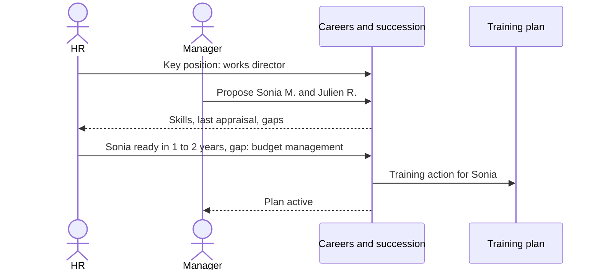

🏠 [Specs](../../../../README.md) › 🧩 [Functional capabilities](../../../README.md) ›
👥 [F9 HR and projects](../../README.md) › 📝 [Use cases](../README.md) › 📝 [Use cases: FL-F9-15](README.md) ›
📝 UC-F9-45 Plan careers and successors

# 📝 UC-F9-45 Plan careers and successors

**Status:** ✅ specified

## Summary

For each key position HR and the line manager name who could take it over and when: successors with a readiness level
(ready now, in one to two years, in three years or more), the gaps to close in skills and experience, and the next steps
of each person's career path. Employees see and discuss their own career wishes and path, never the succession lists.

## Personas

- [U06 Human resources](../../../../01-users/personas/u06-hr.md), who builds the plans with the line
- [U02 Manager](../../../../01-users/personas/u02-manager.md), who proposes successors for their team

## Goal

No key position is left without cover, and people see where their career can go.

## Trigger

A key position is identified, an appraisal raises a career wish, or a holder announces a leave.

## Frequency

Yearly for each key position, and at each appraisal round.

## Preconditions

- Positions and employees exist ([E-F9-49 Position](../../data/e-f09-49-position.md),
  [E-F9-01 Employee record](../../data/e-f09-01-employee-record.md)).
- Skills and appraisals are recorded ([E-F9-12 Qualification](../../data/e-f09-12-certification.md),
  [E-F9-11 Appraisal](../../data/e-f09-11-appraisal.md)).
- HR has the right to read and write succession plans
  ([BR-F9-44](../../business-rules/br-f09-44-successor-lists-are-seen-by-hr-and-the-line.md)).

## Postconditions

- **Succeeded:** a succession plan is active for the key position with its successors and the actions to prepare them
  ([E-F9-50 Succession plan](../../data/e-f09-50-succession-plan.md)).
- **Failed:** no list is shared and the plan stays a draft.

## Main flow

1. HR opens Careers and succession
   ([S-F9-42](../../screens/15-work-location-headcount-and-learning/s-f09-42-careers-and-succession.md)) and picks a key
   position from the headcount plan.
2. The line manager proposes successors from the team; the screen shows each person's skills, qualifications and last
   appraisal next to the position's requirements.
3. For each successor HR sets the readiness level and the gap to close (a training, a project, a move).
4. The plan is agreed with the line manager and becomes Active; its actions go to the training plan and to the next
   appraisal.
5. At each appraisal, the employee states career wishes; they appear in the person's career path and in the screen for
   HR and the line.
6. When the holder or a successor changes, the plan goes under review until HR confirms the list.

## Alternative flows

- 2a. No internal successor: the plan says so and HR may start a recruitment
  ([UC-F9-44](uc-f09-44-plan-headcount-against-budget.md)).
- 3a. The successor is also a successor of another position: the screen flags the overlap.
- 5a. The employee's wish is not feasible in the company: HR records the answer and the reason.

## Error flows

- 2e. The line manager proposes a person of another department the manager may not read: the person is shown by name and
  readiness only ([BR-F9-44](../../business-rules/br-f09-44-successor-lists-are-seen-by-hr-and-the-line.md)).
- 4e. An employee other than HR or the line tries to open a plan: refused
  ([BR-F9-44](../../business-rules/br-f09-44-successor-lists-are-seen-by-hr-and-the-line.md)).
- 3e. A skill used for the gap is expired: it does not count
  ([BR-F9-27](../../business-rules/br-f09-27-unverified-attributes-do-not-count.md)).
- Any step: a service does not answer; the call is retried first
  ([BR-F3-32](../../../f03-assistant/business-rules/br-f03-32-retry-before-an-error.md)), then the message follows the
  error pattern ([D122](../../../../06-decisions/ux/d122-error-message-standard.md)) and the plan stays a draft.

## Business rules

- [BR-F9-44 Successor lists are seen by HR and the line](../../business-rules/br-f09-44-successor-lists-are-seen-by-hr-and-the-line.md)
- [BR-F9-02 HR data stays with HR and the person](../../business-rules/br-f09-02-hr-data-stays-with-hr-and-the-person.md)
- [BR-F9-27 Unverified or expired attributes do not count](../../business-rules/br-f09-27-unverified-attributes-do-not-count.md)

## Entities

- [E-F9-50 Succession plan](../../data/e-f09-50-succession-plan.md): created, activated, reviewed, closed
- [E-F9-49 Position](../../data/e-f09-49-position.md): read
- [E-F9-12 Qualification](../../data/e-f09-12-certification.md): read
- [E-F9-11 Appraisal](../../data/e-f09-11-appraisal.md): read

## Permissions

HR and the line managers of the position and of the successors see and edit the plan. The owner reads all plans. The
employee sees their own career wishes and path only, and never whether they are listed as a successor.

## Notifications

- The line manager, in the app: a plan under review.
- HR, in the app: a key position without a ready successor.

## Audit events

Plan created, activated, reviewed and closed; each successor added or removed with the readiness level and who set it;
each time a plan is opened by someone other than its owners.

## AI involvement

The AI assistant may suggest successors from skills and appraisals with its reasons, flagged as AI
([BR-F9-12](../../business-rules/br-f09-12-ai-calls-say-they-are-ai.md)); HR decides, and it never tells an employee
they are listed.

## API, MCP and A2A exposure

T5 operations on succession plans for HR and the line; no MCP tool writes a plan; no A2A skill.

## Screens

- [S-F9-42 Careers and succession](../../screens/15-work-location-headcount-and-learning/s-f09-42-careers-and-succession.md)

## Flowchart

See
[FL-F9-15 Work location, headcount, careers and learning](../../flows/fl-f09-15-work-location-headcount-and-learning.md#flowchart).

## Sequence diagram

## Acceptance criteria

1. **Given** a key position **when** HR names two successors with readiness **then** the plan is Active with both.
2. **Given** an employee who is a successor **when** they open their career page **then** they do not see the list.
3. **Given** an expired qualification **when** it is used as a gap **then** it does not count.
4. **Given** the holder leaves **when** the departure is recorded **then** the plan goes under review.
5. **Given** a user who is neither HR nor the line **when** they open a plan **then** it is refused and audited.

## Non-functional notes

A plan with 5 successors opens in under 1 second.

## Regulatory references

Ratings of people are personal data: GDPR, [Regulation (EU) 2016/679](https://eur-lex.europa.eu/eli/reg/2016/679/oj),
purpose and access rules; the information to give employees about succession planning, written in the France
pack with the owner's confirmation.

## Related use cases

- [UC-F9-11 Run appraisals and track skills](../04-grow/uc-f09-11-run-appraisals-and-track-skills.md)
- [UC-F9-25 Run the training plan with OPCO funding](../09-train-and-protect/uc-f09-25-run-the-training-plan-with-opco-funding.md)
- [UC-F9-38 Record degrees and qualifications](../13-keep-qualifications/uc-f09-38-record-degrees-and-qualifications.md)
- [UC-F9-44 Plan headcount against budget](uc-f09-44-plan-headcount-against-budget.md)

## Open questions

None.

---

⬅️ [UC-F9-44 Plan headcount against budget](uc-f09-44-plan-headcount-against-budget.md) · ⬆️ [Up](README.md) ·
➡️ [UC-F9-46 Log project risks and change requests](uc-f09-46-log-project-risks-and-change-requests.md)
