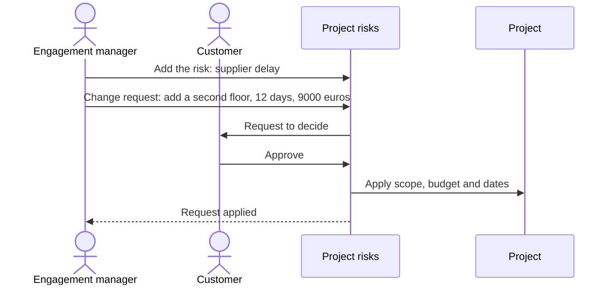

🏠 [Specs](../../../../README.md) › 🧩 [Functional capabilities](../../../README.md) ›
👥 [F9 HR and projects](../../README.md) › 📝 [Use cases](../README.md) › 📝 [Use cases: FL-F9-15](README.md) ›
📝 UC-F9-46 Log project risks and change requests

# 📝 UC-F9-46 Log project risks and change requests

**Status:** ✅ specified

## Summary

A project keeps a risk register (what could go wrong, how likely, how serious, who owns it and what is done) and a log
of change requests. A change request states what changes in scope, cost, days or date; it applies to the project only
once approved, by the customer when the work is billed to one, and by the owner otherwise. A risk that happens can raise
a change request.

## Personas

- [U24 Engagement manager](../../../../01-users/personas/u24-engagement-manager.md), who keeps the register and writes
  the requests
- [U09 Customer](../../../../01-users/personas/u09-customer.md), the customer who approves a change on their project,
  from a phone

## Goal

Surprises are seen early and no change of scope, price or date is made without the right approval.

## Trigger

A risk is noticed, or the customer or the team asks for something outside the agreed scope.

## Frequency

Risks, weekly on a running project; change requests, a few per project.

## Preconditions

- The project exists with its scope, budget and dates
  ([E-F9-18 Project and task](../../data/e-f09-18-project-and-task.md)).
- The customer is known on the project
  ([E-F6-01 Customer record](../../../f06-customers-and-sales/data/e-f06-01-customer-record.md)).
- The engagement manager may edit the project
  ([BR-F9-23](../../business-rules/br-f09-23-customers-validate-milestones-they-see.md)).

## Postconditions

- **Succeeded:** the risk is on the register, and the change request is approved and applied to the project's scope,
  cost and dates, with a quote or order line when billed
  ([E-F9-51 Change request](../../data/e-f09-51-change-request.md)).
- **Failed:** the project stays as it was and the request is rejected or withdrawn with the reason.

## Main flow

1. The engagement manager opens Project risks
   ([S-F9-43](../../screens/15-work-location-headcount-and-learning/s-f09-43-project-risks.md)) and adds a risk:
   description, probability, impact, owner and the action planned.
2. The register ranks risks by probability times impact and shows those past their review date.
3. A change is asked for; the engagement manager writes a change request with its impact on scope, cost, days and date,
   and sends it.
4. The customer receives it on their phone, sees the impact in plain words and approves or rejects; an internal change
   goes to the owner.
5. An approved request is applied: the project's budget, dates and tasks change, and a quote or order line is created
   when the customer pays for it
   ([BR-F9-45](../../business-rules/br-f09-45-a-change-request-applies-only-once-approved.md)).
6. A risk that happened is closed with its outcome; a lesson is kept for the next project.

## Alternative flows

- 1a. A risk can be shared with the customer; only shared risks appear in their view.
- 4a. The customer asks a question: it is kept on the request, and the author answers before the decision.
- 5a. A request is partly approved: a new request for the accepted part replaces it.

## Error flows

- 5e. The request is applied before approval: refused
  ([BR-F9-45](../../business-rules/br-f09-45-a-change-request-applies-only-once-approved.md)).
- 4e. The customer does not answer before the date: the request stays Submitted and the engagement manager is reminded.
- 3e. The impact is missing: the request cannot be sent.
- Any step: a service does not answer; the call is retried first
  ([BR-F3-32](../../../f03-assistant/business-rules/br-f03-32-retry-before-an-error.md)), then the message follows the
  error pattern ([D122](../../../../06-decisions/ux/d122-error-message-standard.md)) and the project and its register
  stay as they were.

## Business rules

- [BR-F9-45 A change request applies only once approved](../../business-rules/br-f09-45-a-change-request-applies-only-once-approved.md)
- [BR-F9-23 Customers validate milestones they see](../../business-rules/br-f09-23-customers-validate-milestones-they-see.md)
- [BR-F9-21 Planned load stays within available hours](../../business-rules/br-f09-21-planned-load-stays-within-available-hours.md)

## Entities

- [E-F9-51 Change request](../../data/e-f09-51-change-request.md): created, submitted, approved, rejected, applied
- [E-F9-18 Project and task](../../data/e-f09-18-project-and-task.md): changed on approval
- [E-F6-01 Customer record](../../../f06-customers-and-sales/data/e-f06-01-customer-record.md): read
- [E-F6-03 Quote](../../../f06-customers-and-sales/data/e-f06-03-quote.md): created for a billed change

## Permissions

The engagement manager and the project team read and write the register; only the engagement manager sends a request.
The customer sees the requests of their project and the risks shared with them, and approves or rejects theirs.

## Notifications

- The customer, by email and in the app: a change request to decide.
- The engagement manager, in the app: the decision, and a risk past its review date.

## Audit events

Risk added, changed and closed; change request sent, approved, rejected, applied, with the decider and the impact
figures at that time.

## AI involvement

The AI assistant may draft a request's impact from the project's tasks and rates, flagged as AI
([BR-F9-12](../../business-rules/br-f09-12-ai-calls-say-they-are-ai.md)); it never approves or applies a request.

## API, MCP and A2A exposure

T5 operations on risks and change requests; one MCP tool lists a project's open requests; no A2A skill.

## Screens

- [S-F9-43 Project risks](../../screens/15-work-location-headcount-and-learning/s-f09-43-project-risks.md)

## Flowchart

See
[FL-F9-15 Work location, headcount, careers and learning](../../flows/fl-f09-15-work-location-headcount-and-learning.md#flowchart).

## Sequence diagram

## Acceptance criteria

1. **Given** a change request of 12 days and 9000 euros **when** the customer approves **then** the project is changed
   and a quote line is created.
2. **Given** a request still Submitted **when** someone tries to apply it **then** it is refused.
3. **Given** a risk marked not shared **when** the customer opens the project **then** they do not see it.
4. **Given** a request without impact figures **when** it is sent **then** it is refused.
5. **Given** a rejected request **when** the engagement manager opens the project **then** the scope is unchanged.

## Non-functional notes

The register of 200 risks and the log of 100 requests open in under 2 seconds.

## Regulatory references

The contract with the customer sets how changes are priced; a quote created for a change follows the sales rules
([UC-F6-03](../../../f06-customers-and-sales/use-cases/01-lead-to-quote/uc-f06-03-create-and-send-a-quote.md)).

## Related use cases

- [UC-F9-17 Manage projects and tasks](../06-plan-and-deliver-work/uc-f09-17-manage-projects-and-tasks.md)
- [UC-F9-29 Plan capacity across projects](../11-capacity-rounds-and-partners/uc-f09-29-plan-capacity-across-projects.md)
- [UC-F9-31 Follow a project as a customer](../11-capacity-rounds-and-partners/uc-f09-31-follow-a-project-as-a-customer.md)
- [UC-F9-32 Work with subcontractors and freelancers on projects](../11-capacity-rounds-and-partners/uc-f09-32-work-with-subcontractors-and-freelancers-on-projects.md)

## Open questions

None.

---

⬅️ [UC-F9-45 Plan careers and successors](uc-f09-45-plan-careers-and-successors.md) · ⬆️ [Up](README.md) ·
➡️ [UC-F9-47 Publish and sell online courses](uc-f09-47-publish-and-sell-online-courses.md)
