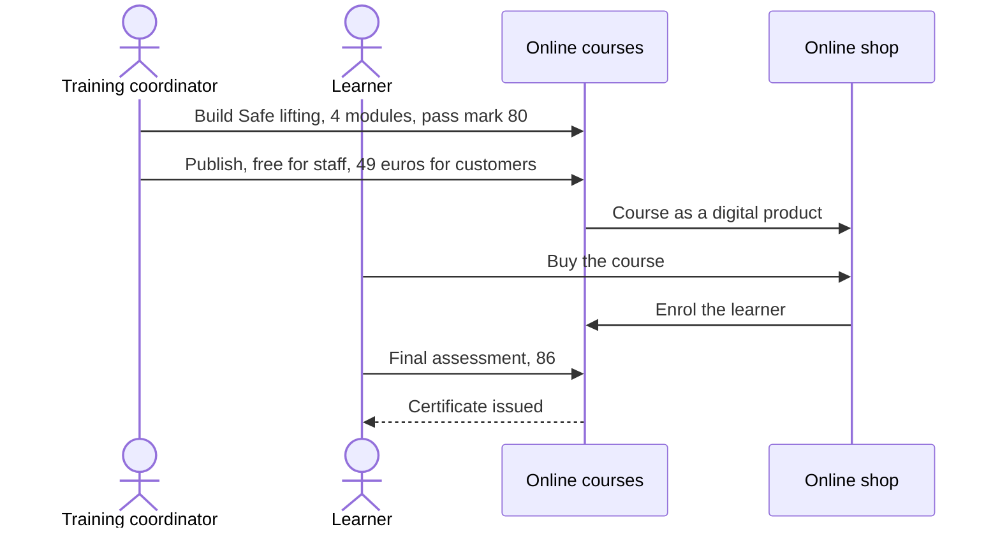

🏠 [Specs](../../../../README.md) › 🧩 [Functional capabilities](../../../README.md) ›
👥 [F9 HR and projects](../../README.md) › 📝 [Use cases](../README.md) › 📝 [Use cases: FL-F9-15](README.md) ›
📝 UC-F9-47 Publish and sell online courses

# 📝 UC-F9-47 Publish and sell online courses

**Status:** ✅ specified

## Summary

The training coordinator builds an online course from modules (text, video, quiz), sets who may take it (staff,
customers, the public), its price and its assessment, and publishes it. Staff take the courses assigned to them;
customers and the public buy a course in the online shop. A learner who passes the assessment receives a certificate,
and for staff the qualification is updated.

## Personas

- [U38 Training coordinator](../../../../01-users/personas/u38-training-coordinator.md), who builds and publishes
  courses
- [U01 Employee](../../../../01-users/personas/u01-employee.md), an employee who takes a course on a phone
- [U09 Customer](../../../../01-users/personas/u09-customer.md), a customer who buys and takes a course on a phone

## Goal

Courses are built once, taken anywhere and sold, and a certificate means the learner passed.

## Trigger

The coordinator creates a course, or a learner opens or buys one.

## Frequency

Courses, a few per quarter; learners, continuously.

## Preconditions

- The training plan exists ([E-F9-22 Training session](../../data/e-f09-22-training-session.md)).
- The online shop is set for digital products
  ([UC-F11-13](../../../f11-online-shop/use-cases/04-special-sales/uc-f11-13-sell-digital-products.md)).
- The coordinator may publish courses ([E-F1-06 Role](../../../f01-administration/data/e-f01-06-role.md)).

## Postconditions

- **Succeeded:** the course is published, learners follow it and pass, and a certificate and a qualification are issued
  ([E-F9-52 Online course](../../data/e-f09-52-online-course.md)).
- **Failed:** the course stays a draft, or the learner keeps their progress and may try again.

## Main flow

1. The coordinator opens Online courses
   ([S-F9-44](../../screens/15-work-location-headcount-and-learning/s-f09-44-online-courses.md)) and creates a course
   with its modules, a quiz per module and a final assessment with a pass mark.
2. The coordinator sets the audience, the price (free for staff, priced for customers) and the validity of the
   certificate, and publishes.
3. For sale to customers or the public, the course appears as a digital product in the shop
   ([UC-F11-13](../../../f11-online-shop/use-cases/04-special-sales/uc-f11-13-sell-digital-products.md)) and is bought
   through checkout ([UC-F11-05](../../../f11-online-shop/use-cases/02-shop-and-check-out/uc-f11-05-check-out.md)).
4. An employee is enrolled by their manager or HR, or enrols; a customer enrols on purchase; each sees the modules and
   their progress on a phone.
5. The learner takes the final assessment; with the pass mark reached, a certificate is issued
   ([BR-F9-46](../../business-rules/br-f09-46-certificates-follow-a-passed-assessment.md)); a failed attempt may be
   repeated within the attempts allowed.
6. For staff, a passed mandatory course updates their qualification
   ([E-F9-12 Qualification](../../data/e-f09-12-certification.md)) and the training record; the coordinator reads
   completion and results.

## Alternative flows

- 2a. The course is internal only: it has no price and does not appear in the shop.
- 5a. The certificate has a validity; before it ends the learner is invited to renew it.
- 6a. A course is retired: learners who started may finish, and no new enrolment is possible.

## Error flows

- 5e. The learner has not reached the pass mark: no certificate; the attempts left are shown
  ([BR-F9-46](../../business-rules/br-f09-46-certificates-follow-a-passed-assessment.md)).
- 3e. The payment fails: the customer is not enrolled and is told
  ([UC-F11-06](../../../f11-online-shop/use-cases/02-shop-and-check-out/uc-f11-06-pay-online.md)).
- 2e. A course with no assessment is published as a certificate course: refused.
- Any step: a service does not answer; the call is retried first
  ([BR-F3-32](../../../f03-assistant/business-rules/br-f03-32-retry-before-an-error.md)), then the message follows the
  error pattern ([D122](../../../../06-decisions/ux/d122-error-message-standard.md)) and the learner's progress and the
  course stay as they were.

## Business rules

- [BR-F9-46 Certificates follow a passed assessment](../../business-rules/br-f09-46-certificates-follow-a-passed-assessment.md)
- [BR-F9-17 Mandatory trainings must be current for the work that needs them](../../business-rules/br-f09-17-mandatory-trainings-must-be-current-for-the-work-that-needs-them.md)
- [BR-F9-02 HR data stays with HR and the person](../../business-rules/br-f09-02-hr-data-stays-with-hr-and-the-person.md)

## Entities

- [E-F9-52 Online course](../../data/e-f09-52-online-course.md): created, published, unpublished, archived; enrolments
  and results kept on it
- [E-F9-12 Qualification](../../data/e-f09-12-certification.md): updated for staff
- [E-F9-22 Training session](../../data/e-f09-22-training-session.md): read
- [E-F11-03 Online product](../../../f11-online-shop/data/e-f11-03-online-product.md): created for a sold course

## Permissions

The coordinator builds and publishes. A manager enrols their team. An employee sees their courses and results. A
customer sees only the courses they bought. HR reads results of staff.

## Notifications

- The learner, by email and in the app: enrolment, a certificate, a renewal to come.
- The manager, in the app: a team member's mandatory course passed or late.

## Audit events

Course published, unpublished and archived; each enrolment, attempt, result and certificate with the date and who issued
it.

## AI involvement

The AI assistant may draft quiz questions from a module, flagged as AI
([BR-F9-12](../../business-rules/br-f09-12-ai-calls-say-they-are-ai.md)); the coordinator reviews them, and it never
marks a final assessment.

## API, MCP and A2A exposure

T5 operations on courses and enrolments; a read MCP tool for a learner's progress; no A2A skill.

## Screens

- [S-F9-44 Online courses](../../screens/15-work-location-headcount-and-learning/s-f09-44-online-courses.md)

## Flowchart

See
[FL-F9-15 Work location, headcount, careers and learning](../../flows/fl-f09-15-work-location-headcount-and-learning.md#flowchart).

## Sequence diagram

## Acceptance criteria

1. **Given** a pass mark of 80 **when** a learner scores 86 **then** a certificate is issued.
2. **Given** the same learner scoring 70 **when** the assessment ends **then** no certificate and the attempts left are
   shown.
3. **Given** a customer who paid **when** they open the course **then** they are enrolled and see their progress.
4. **Given** a mandatory course for staff passed **when** the result is recorded **then** the qualification is updated.
5. **Given** a course archived **when** a customer who started it **then** may finish it, no new enrolment.

## Non-functional notes

A video module streams on a phone on a 4G network; progress is saved at each step.

## Regulatory references

Courses sold to consumers follow the shop's rules
([BR-F11-04](../../../f11-online-shop/business-rules/br-f11-04-prices-with-taxes-and-delivery.md)). The rules
for training providers (declaration, VAT on training, records of attendance) are written in the France pack with the
owner's confirmation, no article cited here.

## Related use cases

- [UC-F9-25 Run the training plan with OPCO funding](../09-train-and-protect/uc-f09-25-run-the-training-plan-with-opco-funding.md)
- [UC-F9-38 Record degrees and qualifications](../13-keep-qualifications/uc-f09-38-record-degrees-and-qualifications.md)
- [UC-F11-13 Sell digital products](../../../f11-online-shop/use-cases/04-special-sales/uc-f11-13-sell-digital-products.md)
- [UC-F11-05 Check out](../../../f11-online-shop/use-cases/02-shop-and-check-out/uc-f11-05-check-out.md)

## Open questions

None.

---

⬅️ [UC-F9-46 Log project risks and change requests](uc-f09-46-log-project-risks-and-change-requests.md) ·
⬆️ [Up](README.md)
