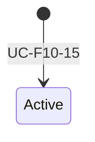

🏠 [Specs](../../../README.md) › 🧩 [Functional capabilities](../../README.md) ›
🏪 [F10 Point of sale (plugin)](../README.md) › 🗃️ [Data](README.md) › 🗃️ E-F10-01 Point of sale

# 🗃️ E-F10-01 Point of sale

**Status:** ✅ specified

## Purpose

A till or a group of tills with its settings.

## Fields

| Name | Type | Required | Validation | Default | Example | Personal data | Custom fields |
|---|---|---|---|---|---|---|---|
| name | text | yes | unique | - | Shop Lyon 2 | no | no |
| mode | shop, restaurant | yes | - | shop | restaurant | no | no |
| payment methods | list | yes | cash not shared (BR-F10-02) | - | cash, card | no | no |
| pricelists, categories | lists | no | - | - | Retail 2026 | no | no |
| devices | list | no | - | - | printer, drawer | no | no |

## Relations

As its use cases.

## Lifecycle

## Indexes and search

By number, date, partner.

## Retention

Kept for the period of its kind of record in the country pack (D293), or else its kind's default in the
[retention schedule](../../../05-non-functional/data-retention.md).

## Audit

Every change.

## Import and export

CSV, FEC where relevant.

## Used by

- [UC-F10-01](../use-cases/01-till-session/uc-f10-01-open-and-close-a-till-session.md)
- [UC-F10-15](../use-cases/07-set-up-and-report/uc-f10-15-set-up-a-point-of-sale-and-its-hardware.md)
- [UC-F10-16](../use-cases/01-till-session/uc-f10-16-log-in-staff-and-set-till-rights.md)

## Open questions

None.

---

⬆️ [Up](README.md) · ➡️ [E-F10-02 Till session](e-f10-02-till-session.md)
