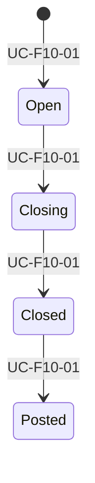

🏠 [Specs](../../../README.md) › 🧩 [Functional capabilities](../../README.md) ›
🏪 [F10 Point of sale (plugin)](../README.md) › 🗃️ [Data](README.md) › 🗃️ E-F10-02 Till session

# 🗃️ E-F10-02 Till session

**Status:** ✅ specified

## Purpose

A till session from opening to closing.

## Fields

| Name | Type | Required | Validation | Default | Example | Personal data | Custom fields |
|---|---|---|---|---|---|---|---|
| point of sale | record | yes | one open per till | - | Shop Lyon 2 | no | no |
| opened, closed | times, users | yes | - | - | 08:55 to 19:10 | no | no |
| float, counted, difference | money | yes | BR-F10-02 | - | 150.00, 1 482.60, -2.40 | no | no |
| state | open, closing, closed, posted | yes | - | open | posted | no | no |

## Relations

As its use cases.

## Lifecycle

## Indexes and search

By number, date, partner.

## Retention

Till data:
[CR-FR-029 Till data kept six years](../../../10-country-packs/france/point-of-sale/cr-fr-029-till-data-kept-six-years.md)
line by line; as an accounting record:
[CR-FR-002 Accounting records kept 10 years](../../../10-country-packs/france/accounting/cr-fr-002-accounting-records-kept-ten-years.md).

## Audit

Every change.

## Import and export

CSV, FEC where relevant.

## Used by

- [UC-F10-01](../use-cases/01-till-session/uc-f10-01-open-and-close-a-till-session.md)
- [UC-F10-14](../use-cases/06-mobile-and-delivery/uc-f10-14-sell-on-the-move-and-offline.md)
- [UC-F10-20](../use-cases/07-set-up-and-report/uc-f10-20-ask-the-assistant-at-the-till.md)
- [UC-F10-23 Manage the safe, bank deposits and cash collection](../use-cases/09-cash-and-settlements/uc-f10-23-manage-the-safe-bank-deposits-and-cash-collection.md)
- [UC-F10-28 Read hourly sales, staff performance and basket analysis](../use-cases/11-store-reports/uc-f10-28-read-hourly-sales-staff-performance-and-basket-analysis.md)

## Open questions

None.

---

⬅️ [E-F10-01 Point of sale](e-f10-01-point-of-sale.md) · ⬆️ [Up](README.md) ·
➡️ [E-F10-03 Point of sale order](e-f10-03-point-of-sale-order.md)
