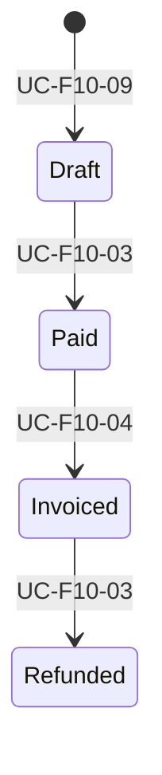

🏠 [Specs](../../../README.md) › 🧩 [Functional capabilities](../../README.md) ›
🏪 [F10 Point of sale (plugin)](../README.md) › 🗃️ [Data](README.md) › 🗃️ E-F10-03 Point of sale order

# 🗃️ E-F10-03 Point of sale order

**Status:** ✅ specified

## Purpose

A basket and its lines, from any channel.

## Fields

| Name | Type | Required | Validation | Default | Example | Personal data | Custom fields |
|---|---|---|---|---|---|---|---|
| number | text | yes | unique, chained | auto | 2026-000184 | no | no |
| lines | product, quantity, unit price, VAT rate, note | yes | BR-F10-01 | - | 2 x coffee 1.80 10 % | no | no |
| channel | till, table, QR, kiosk, mobile, delivery | yes | - | till | QR | no | no |
| customer | contact | no | - | - | J. Martin | yes | no |
| state | draft, paid, invoiced, refunded | yes | never edited once paid (BR-F10-04) | draft | paid | no | no |

## Relations

As its use cases.

## Lifecycle

## Indexes and search

By number, date, partner.

## Retention

Till data:
[CR-FR-029 Till data kept six years](../../../10-country-packs/france/point-of-sale/cr-fr-029-till-data-kept-six-years.md)
line by line; as an accounting record:
[CR-FR-002 Accounting records kept 10 years](../../../10-country-packs/france/accounting/cr-fr-002-accounting-records-kept-ten-years.md).

## Audit

Every change.

## Import and export

CSV, FEC where relevant.

## Used by

- [UC-F10-02](../use-cases/02-sell-at-the-counter/uc-f10-02-sell-at-the-counter.md)
- [UC-F10-03](../use-cases/02-sell-at-the-counter/uc-f10-03-take-payment.md)
- [UC-F10-04](../use-cases/03-after-sales/uc-f10-04-refund-or-exchange.md)
- [UC-F10-05](../use-cases/02-sell-at-the-counter/uc-f10-05-give-the-receipt-or-an-invoice.md)
- [UC-F10-08](../use-cases/02-sell-at-the-counter/uc-f10-08-sell-by-weight-and-barcodes.md)
- [UC-F10-09](../use-cases/04-restaurant-service/uc-f10-09-run-the-restaurant-floor-and-bookings.md)
- [UC-F10-10](../use-cases/04-restaurant-service/uc-f10-10-prepare-orders-on-kitchen-screens.md)
- [UC-F10-11](../use-cases/04-restaurant-service/uc-f10-11-split-the-bill-in-a-restaurant.md)
- [UC-F10-12](../use-cases/05-self-order-and-kiosk/uc-f10-12-self-order-by-qr-at-the-table.md)
- [UC-F10-13](../use-cases/05-self-order-and-kiosk/uc-f10-13-order-at-a-kiosk.md)
- [UC-F10-14](../use-cases/06-mobile-and-delivery/uc-f10-14-sell-on-the-move-and-offline.md)
- [UC-F10-17](../use-cases/06-mobile-and-delivery/uc-f10-17-take-delivery-platform-orders.md)
- [UC-F10-19](../use-cases/05-self-order-and-kiosk/uc-f10-19-show-the-customer-display-and-order-status.md)
- [UC-F10-20](../use-cases/07-set-up-and-report/uc-f10-20-ask-the-assistant-at-the-till.md)
- [UC-F10-26 Look up and transfer stock between stores](../use-cases/10-clienteling-transfers-and-tax-free/uc-f10-26-look-up-and-transfer-stock-between-stores.md)
- [UC-F10-28 Read hourly sales, staff performance and basket analysis](../use-cases/11-store-reports/uc-f10-28-read-hourly-sales-staff-performance-and-basket-analysis.md)

## Open questions

None.

---

⬅️ [E-F10-02 Till session](e-f10-02-till-session.md) · ⬆️ [Up](README.md) ·
➡️ [E-F10-04 Till payment](e-f10-04-till-payment.md)
