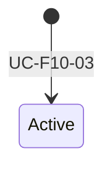

🏠 [Specs](../../../README.md) › 🧩 [Functional capabilities](../../README.md) ›
🏪 [F10 Point of sale (plugin)](../README.md) › 🗃️ [Data](README.md) › 🗃️ E-F10-04 Till payment

# 🗃️ E-F10-04 Till payment

**Status:** ✅ specified

## Purpose

A payment of an order.

## Fields

| Name | Type | Required | Validation | Default | Example | Personal data | Custom fields |
|---|---|---|---|---|---|---|---|
| method | cash, card, QR, gift card, e-wallet | yes | cash limit (BR-F10-03) | - | card | no | no |
| amount, tip | money | yes | - | - | 24.50, 2.00 | no | no |
| terminal reference | text | no | - | - | 0047812 | no | no |

## Relations

As its use cases.

## Lifecycle

## Indexes and search

By number, date, partner.

## Retention

Till data:
[CR-FR-029 Till data kept six years](../../../10-country-packs/france/point-of-sale/cr-fr-029-till-data-kept-six-years.md)
line by line; as an accounting record:
[CR-FR-002 Accounting records kept 10 years](../../../10-country-packs/france/accounting/cr-fr-002-accounting-records-kept-ten-years.md).

## Audit

Every change.

## Import and export

CSV, FEC where relevant.

## Used by

- [UC-F10-03](../use-cases/02-sell-at-the-counter/uc-f10-03-take-payment.md)
- [UC-F10-04](../use-cases/03-after-sales/uc-f10-04-refund-or-exchange.md)
- [UC-F10-11](../use-cases/04-restaurant-service/uc-f10-11-split-the-bill-in-a-restaurant.md)
- [UC-F10-13](../use-cases/05-self-order-and-kiosk/uc-f10-13-order-at-a-kiosk.md)
- [UC-F10-14](../use-cases/06-mobile-and-delivery/uc-f10-14-sell-on-the-move-and-offline.md)
- [UC-F10-21 Accept meal vouchers within the daily cap](../use-cases/08-vouchers-and-age-checks/uc-f10-21-accept-meal-vouchers-within-the-daily-cap.md)
- [UC-F10-24 Match card-terminal settlements net of fees](../use-cases/09-cash-and-settlements/uc-f10-24-match-card-terminal-settlements-net-of-fees.md)

## Open questions

None.

---

⬅️ [E-F10-03 Point of sale order](e-f10-03-point-of-sale-order.md) · ⬆️ [Up](README.md) ·
➡️ [E-F10-05 Receipt](e-f10-05-receipt.md)
