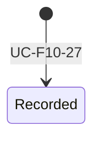

🏠 [Specs](../../../README.md) › 🧩 [Functional capabilities](../../README.md) ›
🏪 [F10 Point of sale (plugin)](../README.md) › 🗃️ [Data](README.md) › 🗃️ E-F10-05 Receipt

# 🗃️ E-F10-05 Receipt

**Status:** ✅ specified

## Purpose

The proof of a sale, with its signature in the chain.

## Fields

| Name | Type | Required | Validation | Default | Example | Personal data | Custom fields |
|---|---|---|---|---|---|---|---|
| order | record | yes | - | - | 2026-000184 | no | no |
| signature | hash | yes | chained (BR-F10-01) | auto | 9f2c... | no | no |
| given as | none, paper, email, SMS, QR | yes | BR-F10-07 | none | email | no | no |
| reprints | count | no | logged | 0 | 1 | no | no |

## Relations

As its use cases.

## Lifecycle

## Indexes and search

By number, date, partner.

## Retention

Till data:
[CR-FR-029 Till data kept six years](../../../10-country-packs/france/point-of-sale/cr-fr-029-till-data-kept-six-years.md)
line by line; as an accounting record:
[CR-FR-002 Accounting records kept 10 years](../../../10-country-packs/france/accounting/cr-fr-002-accounting-records-kept-ten-years.md).

## Audit

Every change.

## Import and export

CSV, FEC where relevant.

## Used by

- [UC-F10-04](../use-cases/03-after-sales/uc-f10-04-refund-or-exchange.md)
- [UC-F10-05](../use-cases/02-sell-at-the-counter/uc-f10-05-give-the-receipt-or-an-invoice.md)
- [UC-F10-27 Sell tax-free to a visitor from outside the EU](../use-cases/10-clienteling-transfers-and-tax-free/uc-f10-27-sell-tax-free-to-a-visitor-from-outside-the-eu.md)

## Open questions

None.

---

⬅️ [E-F10-04 Till payment](e-f10-04-till-payment.md) · ⬆️ [Up](README.md) · ➡️ [E-F10-06 Closure](e-f10-06-closure.md)
