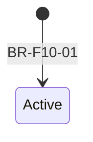

🏠 [Specs](../../../README.md) › 🧩 [Functional capabilities](../../README.md) ›
🏪 [F10 Point of sale (plugin)](../README.md) › 🗃️ [Data](README.md) › 🗃️ E-F10-07 Till archive

# 🗃️ E-F10-07 Till archive

**Status:** ✅ specified

## Purpose

An archive of till data for a period.

## Fields

| Name | Type | Required | Validation | Default | Example | Personal data | Custom fields |
|---|---|---|---|---|---|---|---|
| period | dates | yes | at most a year | - | 2026 | no | no |
| format | open format and French notice | yes | BR-F10-01 | - | CSV + notice | no | no |
| check | integrity result | yes | - | - | intact | no | no |

## Relations

As its use cases.

## Lifecycle

## Indexes and search

By number, date, partner.

## Retention

Till data:
[CR-FR-029 Till data kept six years](../../../10-country-packs/france/point-of-sale/cr-fr-029-till-data-kept-six-years.md)
line by line; as an accounting record:
[CR-FR-002 Accounting records kept 10 years](../../../10-country-packs/france/accounting/cr-fr-002-accounting-records-kept-ten-years.md).

## Audit

Every change.

## Import and export

CSV, FEC where relevant.

## Used by

- [UC-F10-18](../use-cases/07-set-up-and-report/uc-f10-18-report-sales-and-keep-the-legal-archives.md)

## Open questions

None.

---

⬅️ [E-F10-06 Closure](e-f10-06-closure.md) · ⬆️ [Up](README.md) ·
➡️ [E-F10-08 Price promotion](e-f10-08-price-promotion.md)
