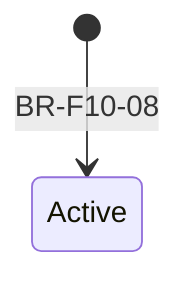

🏠 [Specs](../../../README.md) › 🧩 [Functional capabilities](../../README.md) ›
🏪 [F10 Point of sale (plugin)](../README.md) › 🗃️ [Data](README.md) › 🗃️ E-F10-08 Price promotion

# 🗃️ E-F10-08 Price promotion

**Status:** ✅ specified

## Purpose

A price reduction and its reference price.

## Fields

| Name | Type | Required | Validation | Default | Example | Personal data | Custom fields |
|---|---|---|---|---|---|---|---|
| products | list | yes | - | - | Coffee beans | no | no |
| reduction | percent or price | yes | - | - | -20 % | no | no |
| reference price | money | yes | BR-F10-08 | lowest of 30 days | 12.90 | no | no |
| dates | range | yes | - | - | 1 to 15 Dec | no | no |

## Relations

As its use cases.

## Lifecycle

## Indexes and search

By number, date, partner.

## Retention

Kept for the period of its kind of record in the country pack (D293), or else its kind's default in the
[retention schedule](../../../05-non-functional/data-retention.md).

## Audit

Every change.

## Import and export

CSV, FEC where relevant.

## Used by

- [UC-F10-06](../use-cases/02-sell-at-the-counter/uc-f10-06-apply-prices-promotions-and-combos.md)

## Open questions

None.

---

⬅️ [E-F10-07 Till archive](e-f10-07-till-archive.md) · ⬆️ [Up](README.md) · ➡️ [E-F10-09 Combo](e-f10-09-combo.md)
