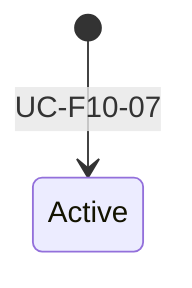

🏠 [Specs](../../../README.md) › 🧩 [Functional capabilities](../../README.md) ›
🏪 [F10 Point of sale (plugin)](../README.md) › 🗃️ [Data](README.md) › 🗃️ E-F10-10 Loyalty card and gift card

# 🗃️ E-F10-10 Loyalty card and gift card

**Status:** ✅ specified

## Purpose

A loyalty card, gift card or e-wallet.

## Fields

| Name | Type | Required | Validation | Default | Example | Personal data | Custom fields |
|---|---|---|---|---|---|---|---|
| kind | loyalty, gift card, e-wallet | yes | - | - | gift card | no | no |
| code | barcode | yes | unique | auto | 2049...| no | no |
| balance | points or money | yes | - | 0 | 50.00 | no | no |
| customer | contact | no | BR-F10-12 | - | J. Martin | yes | no |
| valid until | date | no | - | - | 2027-11-11 | no | no |

## Relations

As its use cases.

## Lifecycle

## Indexes and search

By number, date, partner.

## Retention

While the card is valid, then as an accounting record:
[CR-FR-002 Accounting records kept 10 years](../../../10-country-packs/france/accounting/cr-fr-002-accounting-records-kept-ten-years.md).

## Audit

Every change.

## Import and export

CSV, FEC where relevant.

## Used by

- [UC-F10-07](../use-cases/03-after-sales/uc-f10-07-use-loyalty-gift-cards-and-e-wallet.md)

## Open questions

None.

---

⬅️ [E-F10-09 Combo](e-f10-09-combo.md) · ⬆️ [Up](README.md) ·
➡️ [E-F10-11 Floor and table](e-f10-11-floor-and-table.md)
