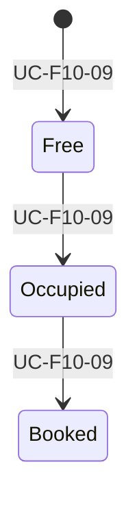

🏠 [Specs](../../../README.md) › 🧩 [Functional capabilities](../../README.md) ›
🏪 [F10 Point of sale (plugin)](../README.md) › 🗃️ [Data](README.md) › 🗃️ E-F10-11 Floor and table

# 🗃️ E-F10-11 Floor and table

**Status:** ✅ specified

## Purpose

A floor plan and its tables.

## Fields

| Name | Type | Required | Validation | Default | Example | Personal data | Custom fields |
|---|---|---|---|---|---|---|---|
| floor | text | yes | - | - | Terrace | no | no |
| table | number, seats, shape | yes | unique per floor | - | T12, 4 seats | no | no |
| state | free, occupied, booked | yes | - | free | occupied | no | no |

## Relations

As its use cases.

## Lifecycle

## Indexes and search

By number, date, partner.

## Retention

Kept for the period of its kind of record in the country pack (D293), or else its kind's default in the
[retention schedule](../../../05-non-functional/data-retention.md).

## Audit

Every change.

## Import and export

CSV, FEC where relevant.

## Used by

- [UC-F10-09](../use-cases/04-restaurant-service/uc-f10-09-run-the-restaurant-floor-and-bookings.md)
- [UC-F10-12](../use-cases/05-self-order-and-kiosk/uc-f10-12-self-order-by-qr-at-the-table.md)
- [UC-F10-15](../use-cases/07-set-up-and-report/uc-f10-15-set-up-a-point-of-sale-and-its-hardware.md)

## Open questions

None.

---

⬅️ [E-F10-10 Loyalty card and gift card](e-f10-10-loyalty-card-and-gift-card.md) · ⬆️ [Up](README.md) ·
➡️ [E-F10-12 Table booking](e-f10-12-table-booking.md)
