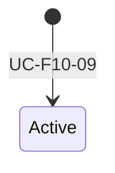

🏠 [Specs](../../../README.md) › 🧩 [Functional capabilities](../../README.md) ›
🏪 [F10 Point of sale (plugin)](../README.md) › 🗃️ [Data](README.md) › 🗃️ E-F10-12 Table booking

# 🗃️ E-F10-12 Table booking

**Status:** ✅ specified

## Purpose

A table booking.

## Fields

| Name | Type | Required | Validation | Default | Example | Personal data | Custom fields |
|---|---|---|---|---|---|---|---|
| guest | name, phone | yes | - | - | J. Martin | yes | no |
| time, guests | time, number | yes | - | - | 20:00, 4 | no | no |
| table | table | no | - | - | T12 | no | no |
| source | phone, website, search engine | yes | - | phone | website | no | no |

## Relations

As its use cases.

## Lifecycle

## Indexes and search

By number, date, partner.

## Retention

Guest details deleted after the booking date plus 1 year;
[CR-FR-052 Personal data kept no longer than needed](../../../10-country-packs/france/data-protection/cr-fr-052-storage-limitation.md).

## Audit

Every change.

## Import and export

CSV, FEC where relevant.

## Used by

- [UC-F10-09](../use-cases/04-restaurant-service/uc-f10-09-run-the-restaurant-floor-and-bookings.md)

## Open questions

None.

---

⬅️ [E-F10-11 Floor and table](e-f10-11-floor-and-table.md) · ⬆️ [Up](README.md) ·
➡️ [E-F10-13 Preparation ticket](e-f10-13-preparation-ticket.md)
