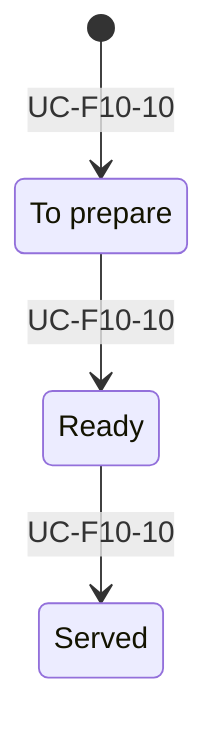

🏠 [Specs](../../../README.md) › 🧩 [Functional capabilities](../../README.md) ›
🏪 [F10 Point of sale (plugin)](../README.md) › 🗃️ [Data](README.md) › 🗃️ E-F10-13 Preparation ticket

# 🗃️ E-F10-13 Preparation ticket

**Status:** ✅ specified

## Purpose

An order's items on a preparation station.

## Fields

| Name | Type | Required | Validation | Default | Example | Personal data | Custom fields |
|---|---|---|---|---|---|---|---|
| station | kitchen, bar, ... | yes | BR-F10-10 | - | kitchen | no | no |
| items | list with notes | yes | - | - | 2 steaks, rare | no | no |
| stage | to prepare, ready, served | yes | - | to prepare | ready | no | no |
| waiting | minutes | yes | red when late | 0 | 14 | no | no |

## Relations

As its use cases.

## Lifecycle

## Indexes and search

By number, date, partner.

## Retention

Kept for the period of its kind of record in the country pack (D293), or else its kind's default in the
[retention schedule](../../../05-non-functional/data-retention.md).

## Audit

Every change.

## Import and export

CSV, FEC where relevant.

## Used by

- [UC-F10-10](../use-cases/04-restaurant-service/uc-f10-10-prepare-orders-on-kitchen-screens.md)

## Open questions

None.

---

⬅️ [E-F10-12 Table booking](e-f10-12-table-booking.md) · ⬆️ [Up](README.md) ·
➡️ [E-F10-14 Point of sale device](e-f10-14-point-of-sale-device.md)
