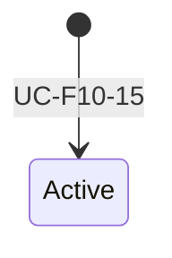

🏠 [Specs](../../../README.md) › 🧩 [Functional capabilities](../../README.md) ›
🏪 [F10 Point of sale (plugin)](../README.md) › 🗃️ [Data](README.md) › 🗃️ E-F10-14 Point of sale device

# 🗃️ E-F10-14 Point of sale device

**Status:** ✅ specified

## Purpose

A device of a point of sale.

## Fields

| Name | Type | Required | Validation | Default | Example | Personal data | Custom fields |
|---|---|---|---|---|---|---|---|
| kind | printer, drawer, scanner, scale, terminal, display | yes | - | - | scale | no | no |
| connection | network, USB, Bluetooth | yes | - | network | USB | no | no |
| legal check | for scales: approval and verification date | no | BR-F10-09 | - | 2026-03-02 | no | no |

## Relations

As its use cases.

## Lifecycle

## Indexes and search

By number, date, partner.

## Retention

Kept for the period of its kind of record in the country pack (D293), or else its kind's default in the
[retention schedule](../../../05-non-functional/data-retention.md).

## Audit

Every change.

## Import and export

CSV, FEC where relevant.

## Used by

- [UC-F10-08](../use-cases/02-sell-at-the-counter/uc-f10-08-sell-by-weight-and-barcodes.md)
- [UC-F10-15](../use-cases/07-set-up-and-report/uc-f10-15-set-up-a-point-of-sale-and-its-hardware.md)
- [UC-F10-19](../use-cases/05-self-order-and-kiosk/uc-f10-19-show-the-customer-display-and-order-status.md)

## Open questions

None.

---

⬅️ [E-F10-13 Preparation ticket](e-f10-13-preparation-ticket.md) · ⬆️ [Up](README.md) ·
➡️ [E-F10-15 Till event log](e-f10-15-till-event-log.md)
