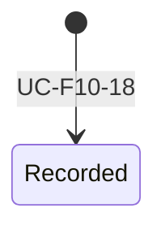

🏠 [Specs](../../../README.md) › 🧩 [Functional capabilities](../../README.md) ›
🏪 [F10 Point of sale (plugin)](../README.md) › 🗃️ [Data](README.md) › 🗃️ E-F10-15 Till event log

# 🗃️ E-F10-15 Till event log

**Status:** ✅ specified

## Purpose

The log of till events for audits.

## Fields

| Name | Type | Required | Validation | Default | Example | Personal data | Custom fields |
|---|---|---|---|---|---|---|---|
| event | open, close, payment, refund, reprint, drawer, price change, training | yes | - | - | reprint | no | no |
| user, time | user, time | yes | - | - | Léa, 14:02 | no | no |
| signature | hash | yes | chained (BR-F10-01) | auto | 3e0d... | no | no |

## Relations

As its use cases.

## Lifecycle

## Indexes and search

By number, date, partner.

## Retention

Till data:
[CR-FR-029 Till data kept six years](../../../10-country-packs/france/point-of-sale/cr-fr-029-till-data-kept-six-years.md)
line by line; as an accounting record:
[CR-FR-002 Accounting records kept 10 years](../../../10-country-packs/france/accounting/cr-fr-002-accounting-records-kept-ten-years.md).

## Audit

Every change.

## Import and export

CSV, FEC where relevant.

## Used by

- [UC-F10-01](../use-cases/01-till-session/uc-f10-01-open-and-close-a-till-session.md)
- [UC-F10-18](../use-cases/07-set-up-and-report/uc-f10-18-report-sales-and-keep-the-legal-archives.md)

## Open questions

None.

---

⬅️ [E-F10-14 Point of sale device](e-f10-14-point-of-sale-device.md) · ⬆️ [Up](README.md) ·
➡️ [E-F10-16 Age check](e-f10-16-age-check.md)
