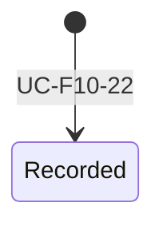

🏠 [Specs](../../../README.md) › 🧩 [Functional capabilities](../../README.md) ›
🏪 [F10 Point of sale (plugin)](../README.md) › 🗃️ [Data](README.md) › 🗃️ E-F10-16 Age check

# 🗃️ E-F10-16 Age check

**Status:** ✅ specified

## Purpose

A recorded age check on a restricted sale.

## Fields

| Name | Type | Required | Validation | Default | Example | Personal data | Custom fields |
|---|---|---|---|---|---|---|---|
| order | point of sale order | yes | - | - | POS/0412 | no | - |
| item and restriction | item, 18+ | yes | - | - | Wine 75 cl, 18+ | no | - |
| result | checked, refused | yes | - | - | checked | no | - |
| cashier and time | user, time | yes | - | - | Lea, 11-12 18:02 | yes | - |

## Relations

On a Point of sale order.

## Lifecycle

Created once.

## Indexes and search

By date and result.

## Retention

As till data ([CR-FR-029](../../../10-country-packs/france/point-of-sale/cr-fr-029-till-data-kept-six-years.md)).

## Audit

Created.

## Import and export

None.

## Used by

- [UC-F10-22 Check age for restricted sales](../use-cases/08-vouchers-and-age-checks/uc-f10-22-check-age-for-restricted-sales.md)

## Open questions

None.

---

⬅️ [E-F10-15 Till event log](e-f10-15-till-event-log.md) · ⬆️ [Up](README.md) ·
➡️ [E-F10-17 Cash movement](e-f10-17-cash-movement.md)
