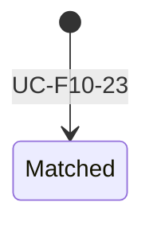

🏠 [Specs](../../../README.md) › 🧩 [Functional capabilities](../../README.md) ›
🏪 [F10 Point of sale (plugin)](../README.md) › 🗃️ [Data](README.md) › 🗃️ E-F10-17 Cash movement

# 🗃️ E-F10-17 Cash movement

**Status:** ✅ specified

## Purpose

Cash moved between a till, the safe, a deposit or the collector.

## Fields

| Name | Type | Required | Validation | Default | Example | Personal data | Custom fields |
|---|---|---|---|---|---|---|---|
| from, to | till, safe, deposit, collector | yes | - | - | session 412 -> safe | no | - |
| amount | amount | yes | - | - | 1,842.30 EUR | no | - |
| counted by | two users | yes | two different | - | Sophie, Lea | yes | - |
| bag number | text | no | - | - | 0088 | no | - |
| bank line | bank line | no | - | - | matched 11-13 | no | - |

## Relations

Between Sessions, the safe and Bank lines.

## Lifecycle

Moved, deposited, matched.

## Indexes and search

By store and date.

## Retention

10 years, [CR-FR-002](../../../10-country-packs/france/accounting/cr-fr-002-accounting-records-kept-ten-years.md).

## Audit

Every move.

## Import and export

None.

## Used by

- [UC-F10-23 Manage the safe, bank deposits and cash collection](../use-cases/09-cash-and-settlements/uc-f10-23-manage-the-safe-bank-deposits-and-cash-collection.md)

## Open questions

None.

---

⬅️ [E-F10-16 Age check](e-f10-16-age-check.md) · ⬆️ [Up](README.md) ·
➡️ [E-F10-18 Card settlement](e-f10-18-card-settlement.md)
