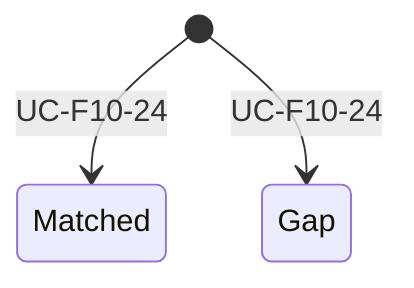

🏠 [Specs](../../../README.md) › 🧩 [Functional capabilities](../../README.md) ›
🏪 [F10 Point of sale (plugin)](../README.md) › 🗃️ [Data](README.md) › 🗃️ E-F10-18 Card settlement

# 🗃️ E-F10-18 Card settlement

**Status:** ✅ specified

## Purpose

An acquirer's settlement with gross, fees and net.

## Fields

| Name | Type | Required | Validation | Default | Example | Personal data | Custom fields |
|---|---|---|---|---|---|---|---|
| acquirer and date | text, date | yes | - | - | Acquirer A, 11-12 | no | - |
| gross, fees, net | amounts | yes | gross - fees = net | - | 6,420 / 70.62 / 6,349.38 | no | - |
| sessions | list | no | - | - | 412, 413 | no | - |
| status | matched, gap | yes | - | - | matched | no | - |

## Relations

Matches Payments and a Bank line.

## Lifecycle

Received, matched.

## Indexes and search

By date.

## Retention

10 years.

## Audit

Matches.

## Import and export

None.

## Used by

- [UC-F10-24 Match card-terminal settlements net of fees](../use-cases/09-cash-and-settlements/uc-f10-24-match-card-terminal-settlements-net-of-fees.md)

## Open questions

None.

---

⬅️ [E-F10-17 Cash movement](e-f10-17-cash-movement.md) · ⬆️ [Up](README.md) ·
➡️ [E-F10-19 Clienteling profile](e-f10-19-clienteling-profile.md)
