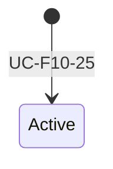

🏠 [Specs](../../../README.md) › 🧩 [Functional capabilities](../../README.md) ›
🏪 [F10 Point of sale (plugin)](../README.md) › 🗃️ [Data](README.md) › 🗃️ E-F10-19 Clienteling profile

# 🗃️ E-F10-19 Clienteling profile

**Status:** ✅ specified

## Purpose

A recognised customer's sizes, preferences, notes and wish list.

## Fields

| Name | Type | Required | Validation | Default | Example | Personal data | Custom fields |
|---|---|---|---|---|---|---|---|
| customer | customer | yes | agreed to be recognised | - | Lea Roux | yes | - |
| sizes and preferences | text | no | - | - | 38, blue | yes | - |
| wish list | items | no | - | - | navy coat | no | - |
| notes | text | no | no sensitive data | - | prefers weekday visits | yes | - |

## Relations

On a Customer (E-F6-01).

## Lifecycle

Created with consent, erased on withdrawal.

## Indexes and search

By customer.

## Retention

3 years after the last purchase, the last contact with the customer
([CR-FR-052 Personal data kept no longer than needed](../../../10-country-packs/france/data-protection/cr-fr-052-storage-limitation.md)).

## Audit

Opened, changed.

## Import and export

None.

## Used by

- [UC-F10-25 Serve a customer with their profile](../use-cases/10-clienteling-transfers-and-tax-free/uc-f10-25-serve-a-customer-with-their-profile.md)

## Open questions

None.

---

⬅️ [E-F10-18 Card settlement](e-f10-18-card-settlement.md) · ⬆️ [Up](README.md) ·
➡️ [E-F10-20 Tax-free form](e-f10-20-tax-free-form.md)
