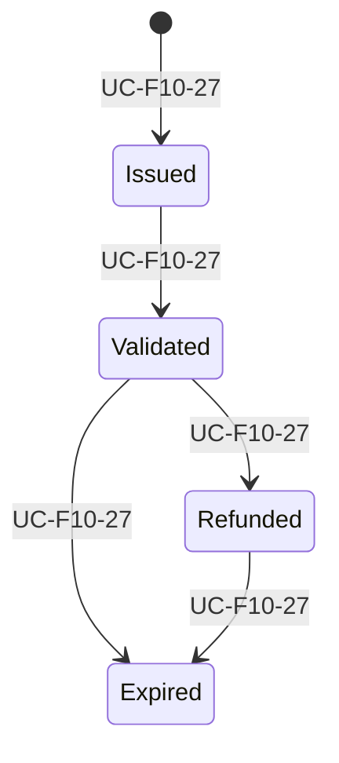

🏠 [Specs](../../../README.md) › 🧩 [Functional capabilities](../../README.md) ›
🏪 [F10 Point of sale (plugin)](../README.md) › 🗃️ [Data](README.md) › 🗃️ E-F10-20 Tax-free form

# 🗃️ E-F10-20 Tax-free form

**Status:** 🔄 waiting for the owner

## Purpose

A tax-free form for an export sale.

## Fields

| Name | Type | Required | Validation | Default | Example | Personal data | Custom fields |
|---|---|---|---|---|---|---|---|
| sale | receipt | yes | above the minimum | - | R-2026-11-0412 | no | - |
| visitor | name, passport, country | yes | outside the EU | - | J. Smith, US | yes | - |
| VAT | amount | yes | - | - | 40 EUR | no | - |
| status | issued, validated, refunded, expired | yes | - | issued | refunded | no | - |

## Relations

On a Receipt (E-F10-05).

## Lifecycle

Issued, validated, refunded.

## Indexes and search

By date and status.

## Retention

10 years (Proposed).

## Audit

Every status.

## Import and export

None.

## Used by

- [UC-F10-27 Sell tax-free to a visitor from outside the EU](../use-cases/10-clienteling-transfers-and-tax-free/uc-f10-27-sell-tax-free-to-a-visitor-from-outside-the-eu.md)

## Open questions

None.

---

⬅️ [E-F10-19 Clienteling profile](e-f10-19-clienteling-profile.md) · ⬆️ [Up](README.md) ·
➡️ [E-F10-21 Table QR code](e-f10-21-table-qr-code.md)
