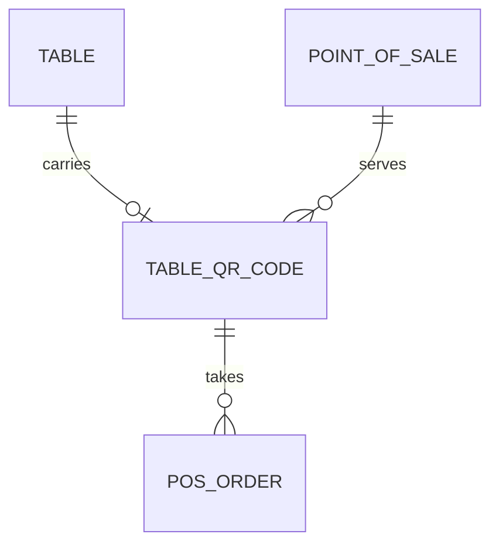
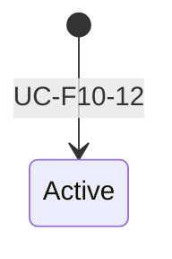

🏠 [Specs](../../../README.md) › 🧩 [Functional capabilities](../../README.md) ›
🏪 [F10 Point of sale (plugin)](../README.md) › 🗃️ [Data](README.md) › 🗃️ E-F10-21 Table QR code

# 🗃️ E-F10-21 Table QR code

**Status:** ✅ specified

## Purpose

The table qr code the flow charts name with the words "QR" ([FL-F10-05](../flows/fl-f10-05-self-order-and-kiosk.md)).
The owner decided to create it
([D516](../../../06-decisions/foundations/d516-naming-rules-and-the-seven-classes-of-names.md)); its fields are derived
from the specifications and confirmed by the owner (D572).

## Fields

| Name | Type | Required | Validation | Default | Example | Personal data | Custom fields |
|---|---|---|---|---|---|---|---|
| title | text | yes | - | - | QR code, table 7 | no | no |
| table | floor and table | yes | - | - | Terrace, T07 | no | no |
| point of sale | point of sale | no | - | - | Bistrot Bellecour | no | no |
| link | web address | yes | opens the QR menu of its table | - | (generated) | no | no |
| mode | order and pay, menu only | no | - | - | menu only | no | no |
| state | active | yes | the lifecycle below | active | active | no | no |

From [UC-F10-12](../use-cases/05-self-order-and-kiosk/uc-f10-12-self-order-by-qr-at-the-table.md): the guest scans the
table's QR code and the menu opens in their phone's language
([S-F10-12](../screens/05-self-order-and-kiosk/s-f10-12-qr-menu.md)), with a menu-only mode; the title is the one the
list [S-F10-L21](../screens/00-lists/s-f10-l21-table-qr-codes.md) shows. Ordering is off while the point of sale has no
open session, and the menu still shows ([BR-F10-11](../business-rules/br-f10-11-self-order-while-open.md)).

## Relations

- [E-F10-11 Floor and table](e-f10-11-floor-and-table.md): the table it stands on.
- [E-F10-01 Point of sale](e-f10-01-point-of-sale.md): whose session must be open to order.
- [E-F10-03 Point of sale order](e-f10-03-point-of-sale-order.md): the orders placed from it, sent to their stations
  ([BR-F10-10](../business-rules/br-f10-10-orders-routed-to-their-station.md)).

## Lifecycle

## Indexes and search

By point of sale, table and state; searched by table, as the list
[S-F10-L21](../screens/00-lists/s-f10-l21-table-qr-codes.md) sorts and filters it.

## Retention

As the other records of its capability.

## Audit

Every change, as the other records of its capability.

## Import and export

CSV or XLSX export of the visible rows and columns from the list
([S-F10-L21](../screens/00-lists/s-f10-l21-table-qr-codes.md)); no import.

## Used by

- [UC-F10-12 Self-order by QR at the table](../use-cases/05-self-order-and-kiosk/uc-f10-12-self-order-by-qr-at-the-table.md)

## Open questions

None.

---

⬅️ [E-F10-20 Tax-free form](e-f10-20-tax-free-form.md) · ⬆️ [Up](README.md) ·
➡️ [E-F10-22 Takeaway order](e-f10-22-takeaway-order.md)
