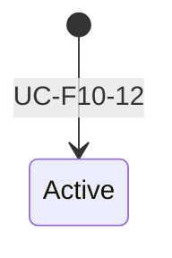

🏠 [Specs](../../../README.md) › 🧩 [Functional capabilities](../../README.md) ›
🏪 [F10 Point of sale (plugin)](../README.md) › 🗃️ [Data](README.md) › 🗃️ E-F10-21 Table QR code

# 🗃️ E-F10-21 Table QR code

**Status:** 🔄 waiting for the owner

## Purpose

(Proposed) The table qr code the flow charts name with the words "QR"
([FL-F10-05](../flows/fl-f10-05-self-order-and-kiosk.md)). The owner decided to create it
([D516](../../../06-decisions/foundations/d516-naming-rules-and-the-seven-classes-of-names.md)); what it holds waits for
the owner's confirmation.

## Fields

(Proposed) To define with the owner: the flow charts name the record, not its fields.

## Relations

(Proposed) To define with the owner, from the use cases below.

## Lifecycle

## Indexes and search

(Proposed) To define with the owner.

## Retention

(Proposed) As the other records of its capability, to confirm with the owner.

## Audit

(Proposed) Every change, as the other records of its capability.

## Import and export

(Proposed) To define with the owner.

## Used by

- [UC-F10-12 Self-order by QR at the table](../use-cases/05-self-order-and-kiosk/uc-f10-12-self-order-by-qr-at-the-table.md)

## Open questions

(Proposed) Its fields, relations and states wait for the owner (waiting list, step 36e).

---

⬅️ [E-F10-20 Tax-free form](e-f10-20-tax-free-form.md) · ⬆️ [Up](README.md) ·
➡️ [E-F10-22 Takeaway order](e-f10-22-takeaway-order.md)
