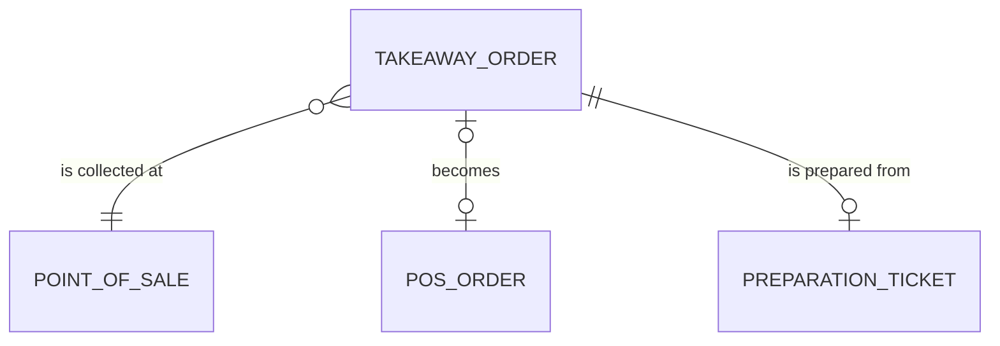
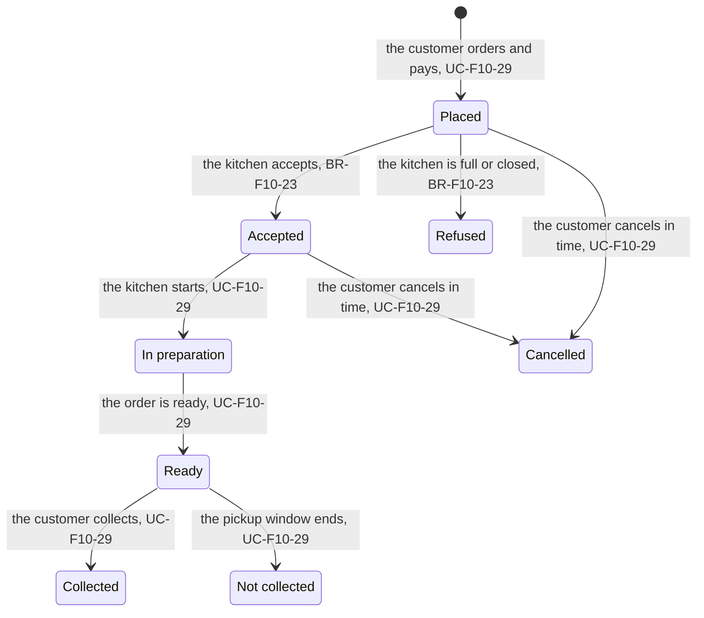

🏠 [Specs](../../../README.md) › 🧩 [Functional capabilities](../../README.md) ›
🏪 [F10 Point of sale (plugin)](../README.md) › 🗃️ [Data](README.md) › 🗃️ E-F10-22 Takeaway order

# 🗃️ E-F10-22 Takeaway order

**Status:** ✅ specified

## Purpose

An order placed online to be collected at a pickup slot, from its placing to its collection
([D529](../../../06-decisions/f10-point-of-sale/d529-benchmark-gaps-f10-point-of-sale.md)).

## Fields

| Name | Type | Required | Validation | Default | Example | Personal data | Custom fields |
|---|---|---|---|---|---|---|---|
| number | text | yes | unique per day | auto | 41 | no | no |
| customer | customer record | yes | - | - | Sonia M. | yes | no |
| pickup slot | date and time | yes | within opening hours and capacity | - | 2026-11-18 12:30 | no | no |
| lines | list of product, quantity | yes | at least 1 | - | 2 burgers | no | no |
| total | money | yes | - | - | 21.80 | no | no |
| payment | paid online, pay at collection | yes | - | paid online | paid online | no | no |
| order | point of sale order | when accepted | - | - | Order 2041 | no | no |
| refusal or cancel reason | text | when refused or cancelled | - | - | Kitchen full | no | no |
| state | placed, accepted, refused, in preparation, ready, collected, cancelled, not collected | yes | the lifecycle below | placed | placed | no | no |

## Relations

- [E-F10-01 Point of sale](e-f10-01-point-of-sale.md)
- [E-F10-03 Point of sale order](e-f10-03-point-of-sale-order.md)
- [E-F10-13 Preparation ticket](e-f10-13-preparation-ticket.md)
- [E-F11-09 Customer account](../../f11-online-shop/data/e-f11-09-customer-account.md)

## Lifecycle

## Indexes and search

By number, slot, customer and state; the orders of a slot and the orders to prepare.

## Retention

Kept as the sale it becomes, as an accounting record
([CR-FR-002](../../../10-country-packs/france/accounting/cr-fr-002-accounting-records-kept-ten-years.md)); a refused
order 1 year.

## Audit

Every state change with the slot and the capacity at that time.

## Import and export

CSV export of a day's takeaway orders; no import.

## Used by

- [UC-F10-29 Take online takeaway orders](../use-cases/12-takeaway-softpos-and-labels/uc-f10-29-take-online-takeaway-orders.md)

## Open questions

None.

---

⬅️ [E-F10-21 Table QR code](e-f10-21-table-qr-code.md) · ⬆️ [Up](README.md) ·
➡️ [E-F10-23 Shelf label](e-f10-23-shelf-label.md)
