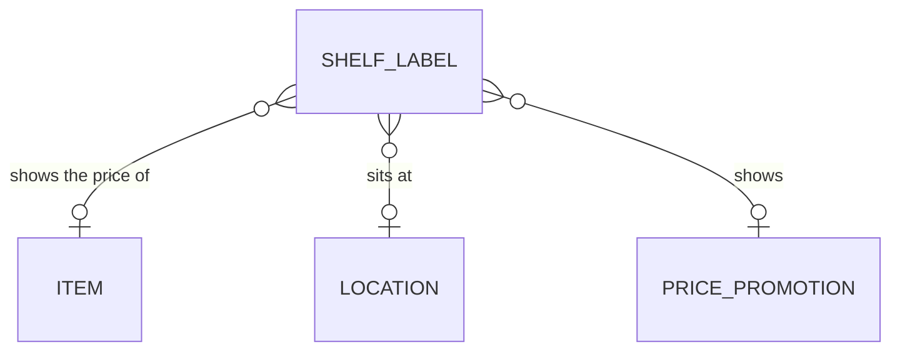
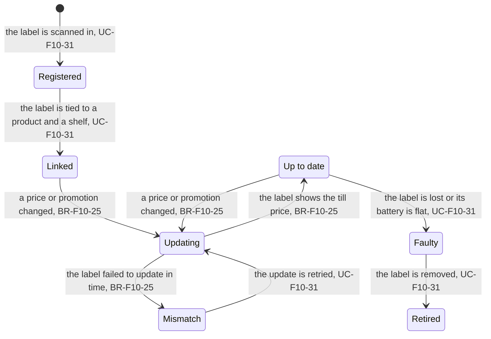

🏠 [Specs](../../../README.md) › 🧩 [Functional capabilities](../../README.md) ›
🏪 [F10 Point of sale (plugin)](../README.md) › 🗃️ [Data](README.md) › 🗃️ E-F10-23 Shelf label

# 🗃️ E-F10-23 Shelf label

**Status:** ✅ specified

## Purpose

One electronic label on a shelf: its product, position, the price it shows and whether it is up to date
([D529](../../../06-decisions/f10-point-of-sale/d529-benchmark-gaps-f10-point-of-sale.md)).

## Fields

| Name | Type | Required | Validation | Default | Example | Personal data | Custom fields |
|---|---|---|---|---|---|---|---|
| code | text | yes | unique | - | 8841 | no | no |
| product | item | when linked | - | - | Olive oil 1 L | no | no |
| shelf position | location | when linked | - | - | Aisle 4, shelf 2 | no | no |
| price shown | money | when linked | - | - | 6.90 | no | no |
| unit price shown | money per unit | no | - | - | 6.90 per litre | no | no |
| promotion shown | promotion | no | - | - | -20% | no | no |
| last confirmed at | date and time | when updated | - | - | 2026-11-18 09:42 | no | no |
| battery | percent | no | 0 to 100 | 100 | 78 | no | no |
| state | registered, linked, updating, up to date, mismatch, faulty, retired | yes | the lifecycle below | registered | registered | no | no |

## Relations

- [E-F7-06 Item](../../f07-purchasing-and-stock/data/e-f07-06-item.md)
- [E-F7-07 Location](../../f07-purchasing-and-stock/data/e-f07-07-location.md)
- [E-F10-08 Price promotion](e-f10-08-price-promotion.md)

## Lifecycle

## Indexes and search

By code, product, shelf, state and battery; the labels in Mismatch or faulty.

## Retention

Kept while linked, then 1 year after retirement.

## Audit

Every link, update, mismatch and retirement, with the price shown and the till price.

## Import and export

CSV import of label codes with their shelf; CSV export of the labels of a shop.

## Used by

- [UC-F10-31 Update electronic shelf labels](../use-cases/12-takeaway-softpos-and-labels/uc-f10-31-update-electronic-shelf-labels.md)

## Open questions

None.

---

⬅️ [E-F10-22 Takeaway order](e-f10-22-takeaway-order.md) · ⬆️ [Up](README.md) ·
➡️ [E-F10-24 Layaway](e-f10-24-layaway.md)
