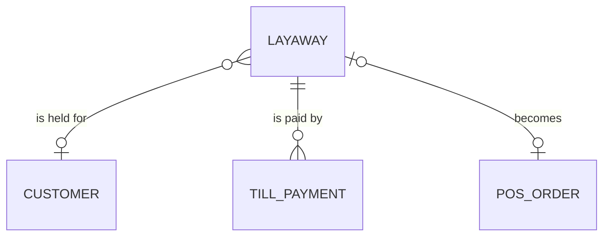
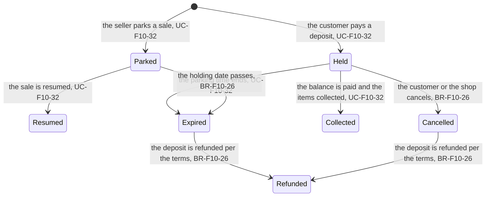

🏠 [Specs](../../../README.md) › 🧩 [Functional capabilities](../../README.md) ›
🏪 [F10 Point of sale (plugin)](../README.md) › 🗃️ [Data](README.md) › 🗃️ E-F10-24 Layaway

# 🗃️ E-F10-24 Layaway

**Status:** ✅ specified

## Purpose

A parked sale or a set of items held for a customer against a deposit
([D529](../../../06-decisions/f10-point-of-sale/d529-benchmark-gaps-f10-point-of-sale.md)).

## Fields

| Name | Type | Required | Validation | Default | Example | Personal data | Custom fields |
|---|---|---|---|---|---|---|---|
| kind | parked sale, layaway | yes | - | - | layaway | no | no |
| customer | customer record | for a layaway | - | - | Sonia M. | yes | no |
| lines | list of product, quantity | yes | at least 1 | - | Winter coat | no | no |
| total | money | yes | - | - | 150.00 | no | no |
| deposit paid | money | for a layaway | at least the shop's minimum | 0 | 45.00 | no | no |
| collection date | date | for a layaway | within the holding time | - | 2026-12-05 | no | no |
| terms shown | text and date | for a layaway | - | - | 30 percent, refund 14 days | no | no |
| refund | money and reason | when refunded | per the terms | - | 45.00, expired | no | no |
| state | parked, held, resumed, expired, collected, cancelled, refunded | yes | the lifecycle below | parked | parked | no | no |

## Relations

- [E-F10-03 Point of sale order](e-f10-03-point-of-sale-order.md)
- [E-F10-04 Till payment](e-f10-04-till-payment.md)
- [E-F7-06 Item](../../f07-purchasing-and-stock/data/e-f07-06-item.md)
- [E-F6-01 Customer record](../../f06-customers-and-sales/data/e-f06-01-customer-record.md)

## Lifecycle

## Indexes and search

By customer, state and collection date; the layaways expiring this week.

## Retention

Kept as the sale or the refund it becomes, as an accounting record
([CR-FR-002](../../../10-country-packs/france/accounting/cr-fr-002-accounting-records-kept-ten-years.md)); a parked sale
that expires is kept 30 days.

## Audit

Every park, resume, deposit, extension, cancellation and refund with the terms shown.

## Import and export

CSV export of the open layaways for the store manager; no import.

## Used by

- [UC-F10-32 Hold an item with a deposit or park a sale](../use-cases/12-takeaway-softpos-and-labels/uc-f10-32-hold-an-item-with-a-deposit-or-park-a-sale.md)

## Open questions

None.

---

⬅️ [E-F10-23 Shelf label](e-f10-23-shelf-label.md) · ⬆️ [Up](README.md)
