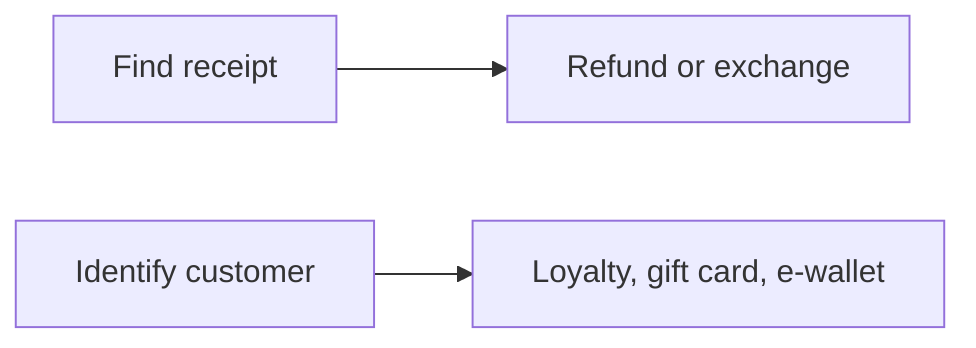

🏠 [Specs](../../../README.md) › 🧩 [Functional capabilities](../../README.md) ›
🏪 [F10 Point of sale (plugin)](../README.md) › 🔀 [Flows](README.md) › 🔀 FL-F10-03 After sales

# 🔀 FL-F10-03 After sales

**Status:** ✅ specified

## Summary

Covers UC-F10-04, UC-F10-07.

## Personas

- [U02 Manager](../../../01-users/personas/u02-manager.md)
- [U09 Customer](../../../01-users/personas/u09-customer.md)
- [U17 Cashier](../../../01-users/personas/u17-cashier.md)

## Flowchart

## Sequence diagram

See each use case.

## Steps

| Step | Persona | Screen | Use case | What happens |
|---|---|---|---|---|
| 1 | U17, U02 | [S-F10-04](../screens/03-after-sales/s-f10-04-refund.md) | [UC-F10-04](../use-cases/03-after-sales/uc-f10-04-refund-or-exchange.md) | Refund or exchange |
| 2 | U17, U09 | [S-F10-07](../screens/03-after-sales/s-f10-07-loyalty.md) | [UC-F10-07](../use-cases/03-after-sales/uc-f10-07-use-loyalty-gift-cards-and-e-wallet.md) | Use loyalty, gift cards and e-wallet |

### Entities and screens

| Entity | States in this flow | Shown at step and screen | Aggregated view |
|---|---|---|---|
| [E-F10-05 Receipt](../data/e-f10-05-receipt.md) | Recorded | 1 [S-F10-04](../screens/03-after-sales/s-f10-04-refund.md) | Receipts |
| [E-F10-03 Point of sale order](../data/e-f10-03-point-of-sale-order.md) | Draft, Paid, Invoiced, Refunded | 1 [S-F10-04](../screens/03-after-sales/s-f10-04-refund.md) | Point of sale orders |
| [E-F10-10 Loyalty card and gift card](../data/e-f10-10-loyalty-card-and-gift-card.md) | Active | 2 [S-F10-07](../screens/03-after-sales/s-f10-07-loyalty.md) | Loyalty card and gift cards |

## Errors

As each use case.

## Images

Every step and error, for each persona taking part, in light and dark mode (D120). Steps are numbered as in the Steps
table; E rows are the error cases.

| Step | Persona | Device | Light | Dark |
|---|---|---|---|---|
| 1 | U17 | desktop | [light](../images/03-after-sales/u17-cashier/1-refund-desktop-light.png) | [dark](../images/03-after-sales/u17-cashier/1-refund-desktop-dark.png) |
| 1 | U17 | phone | [light](../images/03-after-sales/u17-cashier/1-refund-phone-light.png) | [dark](../images/03-after-sales/u17-cashier/1-refund-phone-dark.png) |
| 1 | U17 | tablet | [light](../images/03-after-sales/u17-cashier/1-refund-tablet-light.png) | [dark](../images/03-after-sales/u17-cashier/1-refund-tablet-dark.png) |
| 1 | U02 | desktop | [light](../images/03-after-sales/u02-manager/1-refund-desktop-light.png) | [dark](../images/03-after-sales/u02-manager/1-refund-desktop-dark.png) |
| 1 | U02 | phone | [light](../images/03-after-sales/u02-manager/1-refund-phone-light.png) | [dark](../images/03-after-sales/u02-manager/1-refund-phone-dark.png) |
| 2 | U17 | desktop | [light](../images/03-after-sales/u17-cashier/2-loyalty-desktop-light.png) | [dark](../images/03-after-sales/u17-cashier/2-loyalty-desktop-dark.png) |
| 2 | U17 | phone | [light](../images/03-after-sales/u17-cashier/2-loyalty-phone-light.png) | [dark](../images/03-after-sales/u17-cashier/2-loyalty-phone-dark.png) |
| 2 | U17 | tablet | [light](../images/03-after-sales/u17-cashier/2-loyalty-tablet-light.png) | [dark](../images/03-after-sales/u17-cashier/2-loyalty-tablet-dark.png) |
| 2 | U09 | phone | [light](../images/03-after-sales/u09-customer/2-loyalty-phone-light.png) | [dark](../images/03-after-sales/u09-customer/2-loyalty-phone-dark.png) |
| E1 | U17 | desktop | [light](../images/03-after-sales/u17-cashier/e1-refund-limit-desktop-light.png) | [dark](../images/03-after-sales/u17-cashier/e1-refund-limit-desktop-dark.png) |
| E1 | U17 | phone | [light](../images/03-after-sales/u17-cashier/e1-refund-limit-phone-light.png) | [dark](../images/03-after-sales/u17-cashier/e1-refund-limit-phone-dark.png) |
| E1 | U17 | tablet | [light](../images/03-after-sales/u17-cashier/e1-refund-limit-tablet-light.png) | [dark](../images/03-after-sales/u17-cashier/e1-refund-limit-tablet-dark.png) |

## Open questions

None.

---

⬅️ [FL-F10-02 Sell at the counter](fl-f10-02-sell-at-the-counter.md) · ⬆️ [Up](README.md) ·
➡️ [FL-F10-04 Restaurant service](fl-f10-04-restaurant-service.md)
