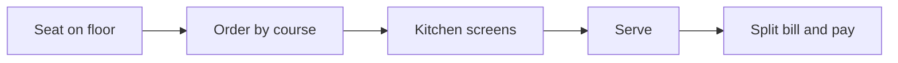

🏠 [Specs](../../../README.md) › 🧩 [Functional capabilities](../../README.md) ›
🏪 [F10 Point of sale (plugin)](../README.md) › 🔀 [Flows](README.md) › 🔀 FL-F10-04 Restaurant service

# 🔀 FL-F10-04 Restaurant service

**Status:** ✅ specified

## Summary

Covers UC-F10-09, UC-F10-10, UC-F10-11.

## Personas

- [U02 Manager](../../../01-users/personas/u02-manager.md)
- [U09 Customer](../../../01-users/personas/u09-customer.md)
- [U18 Waiter](../../../01-users/personas/u18-waiter.md)
- [U19 Kitchen staff](../../../01-users/personas/u19-kitchen-staff.md)

## Flowchart

## Sequence diagram

See each use case.

## Steps

| Step | Persona | Screen | Use case | What happens |
|---|---|---|---|---|
| 1 | U18, U02 | [S-F10-09](../screens/04-restaurant-service/s-f10-09-floor.md) | [UC-F10-09](../use-cases/04-restaurant-service/uc-f10-09-run-the-restaurant-floor-and-bookings.md) | Run the restaurant floor and bookings |
| 2 | U19 | [S-F10-10](../screens/04-restaurant-service/s-f10-10-preparation-screen.md) | [UC-F10-10](../use-cases/04-restaurant-service/uc-f10-10-prepare-orders-on-kitchen-screens.md) | Prepare orders on kitchen screens |
| 3 | U18, U09 | [S-F10-11](../screens/04-restaurant-service/s-f10-11-bill-split.md) | [UC-F10-11](../use-cases/04-restaurant-service/uc-f10-11-split-the-bill-in-a-restaurant.md) | Split the bill in a restaurant |

### Entities and screens

| Entity | States in this flow | Shown at step and screen | Aggregated view |
|---|---|---|---|
| [E-F10-11 Floor and table](../data/e-f10-11-floor-and-table.md) | Free, Occupied, Booked | 1 [S-F10-09](../screens/04-restaurant-service/s-f10-09-floor.md) | Floor and tables |
| [E-F10-03 Point of sale order](../data/e-f10-03-point-of-sale-order.md) | Draft, Paid, Invoiced, Refunded | 1 [S-F10-09](../screens/04-restaurant-service/s-f10-09-floor.md); 2 [S-F10-10](../screens/04-restaurant-service/s-f10-10-preparation-screen.md); 3 [S-F10-11](../screens/04-restaurant-service/s-f10-11-bill-split.md) | Point of sale orders |
| [E-F10-14 Point of sale device](../data/e-f10-14-point-of-sale-device.md) | Active | Shown elsewhere: [S-F10-15 Point of sale settings](../screens/07-set-up-and-report/s-f10-15-point-of-sale-settings.md) | Point of sale devices |

## Errors

As each use case.

## Images

Every step and error, for each persona taking part, in light and dark mode (D120). Steps are numbered as in the Steps
table; E rows are the error cases.

| Step | Persona | Device | Light | Dark |
|---|---|---|---|---|
| 1 | U18 | phone | [light](../images/04-restaurant-service/u18-waiter/1-floor-phone-light.png) | [dark](../images/04-restaurant-service/u18-waiter/1-floor-phone-dark.png) |
| 1 | U18 | tablet | [light](../images/04-restaurant-service/u18-waiter/1-floor-tablet-light.png) | [dark](../images/04-restaurant-service/u18-waiter/1-floor-tablet-dark.png) |
| 1 | U02 | desktop | [light](../images/04-restaurant-service/u02-manager/1-floor-desktop-light.png) | [dark](../images/04-restaurant-service/u02-manager/1-floor-desktop-dark.png) |
| 1 | U02 | phone | [light](../images/04-restaurant-service/u02-manager/1-floor-phone-light.png) | [dark](../images/04-restaurant-service/u02-manager/1-floor-phone-dark.png) |
| 2 | U19 | desktop | [light](../images/04-restaurant-service/u19-kitchen-staff/2-kitchen-screen-desktop-light.png) | [dark](../images/04-restaurant-service/u19-kitchen-staff/2-kitchen-screen-desktop-dark.png) |
| 3 | U18 | phone | [light](../images/04-restaurant-service/u18-waiter/3-split-bill-phone-light.png) | [dark](../images/04-restaurant-service/u18-waiter/3-split-bill-phone-dark.png) |
| 3 | U18 | tablet | [light](../images/04-restaurant-service/u18-waiter/3-split-bill-tablet-light.png) | [dark](../images/04-restaurant-service/u18-waiter/3-split-bill-tablet-dark.png) |
| 3 | U09 | phone | [light](../images/04-restaurant-service/u09-customer/3-split-bill-phone-light.png) | [dark](../images/04-restaurant-service/u09-customer/3-split-bill-phone-dark.png) |
| E1 | U18 | phone | [light](../images/04-restaurant-service/u18-waiter/e1-station-offline-phone-light.png) | [dark](../images/04-restaurant-service/u18-waiter/e1-station-offline-phone-dark.png) |
| E1 | U18 | tablet | [light](../images/04-restaurant-service/u18-waiter/e1-station-offline-tablet-light.png) | [dark](../images/04-restaurant-service/u18-waiter/e1-station-offline-tablet-dark.png) |

## Open questions

None.

---

⬅️ [FL-F10-03 After sales](fl-f10-03-after-sales.md) · ⬆️ [Up](README.md) ·
➡️ [FL-F10-05 Self-order and kiosk](fl-f10-05-self-order-and-kiosk.md)
