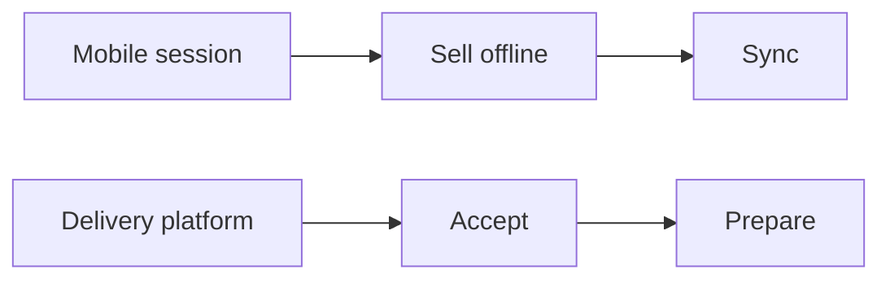

🏠 [Specs](../../../README.md) › 🧩 [Functional capabilities](../../README.md) ›
🏪 [F10 Point of sale (plugin)](../README.md) › 🔀 [Flows](README.md) › 🔀 FL-F10-06 Mobile and delivery

# 🔀 FL-F10-06 Mobile and delivery

**Status:** ✅ specified

## Summary

Covers UC-F10-14, UC-F10-17.

## Personas

- [U14 Field worker](../../../01-users/personas/u14-field-worker.md)
- [U17 Cashier](../../../01-users/personas/u17-cashier.md)
- [U19 Kitchen staff](../../../01-users/personas/u19-kitchen-staff.md)

## Flowchart

## Sequence diagram

See each use case.

## Steps

| Step | Persona | Screen | Use case | What happens |
|---|---|---|---|---|
| 1 | U17, U14 | [S-F10-14](../screens/06-mobile-and-delivery/s-f10-14-mobile-till.md) | [UC-F10-14](../use-cases/06-mobile-and-delivery/uc-f10-14-sell-on-the-move-and-offline.md) | Sell on the move and offline |
| 2 | U17, U19 | [S-F10-17](../screens/06-mobile-and-delivery/s-f10-17-delivery-orders.md) | [UC-F10-17](../use-cases/06-mobile-and-delivery/uc-f10-17-take-delivery-platform-orders.md) | Take delivery-platform orders |

### Entities and screens

| Entity | States in this flow | Shown at step and screen | Aggregated view |
|---|---|---|---|
| [E-F10-02 Till session](../data/e-f10-02-till-session.md) | Open, Closing, Closed, Posted | 1 [S-F10-14](../screens/06-mobile-and-delivery/s-f10-14-mobile-till.md) | Till sessions |

## Errors

As each use case.

## Images

Every step and error, for each persona taking part, in light and dark mode (D120). Steps are numbered as in the Steps
table; E rows are the error cases.

| Step | Persona | Device | Light | Dark |
|---|---|---|---|---|
| 1 | U17 | phone | [light](../images/06-mobile-and-delivery/u17-cashier/1-mobile-offline-phone-light.png) | [dark](../images/06-mobile-and-delivery/u17-cashier/1-mobile-offline-phone-dark.png) |
| 1 | U17 | desktop | [light](../images/06-mobile-and-delivery/u17-cashier/1-mobile-offline-desktop-light.png) | [dark](../images/06-mobile-and-delivery/u17-cashier/1-mobile-offline-desktop-dark.png) |
| 1 | U17 | tablet | [light](../images/06-mobile-and-delivery/u17-cashier/1-mobile-offline-tablet-light.png) | [dark](../images/06-mobile-and-delivery/u17-cashier/1-mobile-offline-tablet-dark.png) |
| 1 | U14 | phone | [light](../images/06-mobile-and-delivery/u14-field-worker/1-mobile-offline-phone-light.png) | [dark](../images/06-mobile-and-delivery/u14-field-worker/1-mobile-offline-phone-dark.png) |
| 2 | U17 | desktop | [light](../images/06-mobile-and-delivery/u17-cashier/2-delivery-desktop-light.png) | [dark](../images/06-mobile-and-delivery/u17-cashier/2-delivery-desktop-dark.png) |
| 2 | U17 | phone | [light](../images/06-mobile-and-delivery/u17-cashier/2-delivery-phone-light.png) | [dark](../images/06-mobile-and-delivery/u17-cashier/2-delivery-phone-dark.png) |
| 2 | U17 | tablet | [light](../images/06-mobile-and-delivery/u17-cashier/2-delivery-tablet-light.png) | [dark](../images/06-mobile-and-delivery/u17-cashier/2-delivery-tablet-dark.png) |
| 2 | U19 | desktop | [light](../images/06-mobile-and-delivery/u19-kitchen-staff/2-delivery-desktop-light.png) | [dark](../images/06-mobile-and-delivery/u19-kitchen-staff/2-delivery-desktop-dark.png) |
| E1 | U17 | phone | [light](../images/06-mobile-and-delivery/u17-cashier/e1-offline-too-long-phone-light.png) | [dark](../images/06-mobile-and-delivery/u17-cashier/e1-offline-too-long-phone-dark.png) |
| E1 | U17 | desktop | [light](../images/06-mobile-and-delivery/u17-cashier/e1-offline-too-long-desktop-light.png) | [dark](../images/06-mobile-and-delivery/u17-cashier/e1-offline-too-long-desktop-dark.png) |
| E1 | U17 | tablet | [light](../images/06-mobile-and-delivery/u17-cashier/e1-offline-too-long-tablet-light.png) | [dark](../images/06-mobile-and-delivery/u17-cashier/e1-offline-too-long-tablet-dark.png) |

## Open questions

None.

---

⬅️ [FL-F10-05 Self-order and kiosk](fl-f10-05-self-order-and-kiosk.md) · ⬆️ [Up](README.md) ·
➡️ [FL-F10-07 Set up and report](fl-f10-07-set-up-and-report.md)
