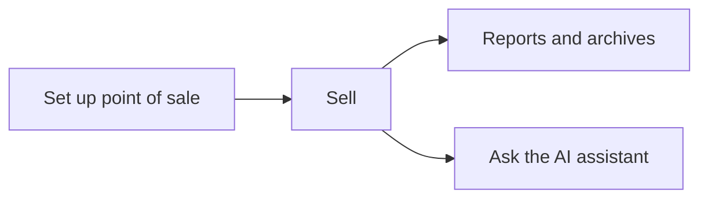

🏠 [Specs](../../../README.md) › 🧩 [Functional capabilities](../../README.md) ›
🏪 [F10 Point of sale (plugin)](../README.md) › 🔀 [Flows](README.md) › 🔀 FL-F10-07 Set up and report

# 🔀 FL-F10-07 Set up and report

**Status:** ✅ specified

## Summary

Covers UC-F10-15, UC-F10-18, UC-F10-20.

## Personas

- [U02 Manager](../../../01-users/personas/u02-manager.md)
- [U05 Accounting](../../../01-users/personas/u05-accounting.md)
- [U07 Administrator](../../../01-users/personas/u07-administrator.md)
- [U13 Owner](../../../01-users/personas/u13-owner.md)
- [U17 Cashier](../../../01-users/personas/u17-cashier.md)
- [U18 Waiter](../../../01-users/personas/u18-waiter.md)

## Flowchart

## Sequence diagram

See each use case.

## Steps

| Step | Persona | Screen | Use case | What happens |
|---|---|---|---|---|
| 1 | U07, U02 | [S-F10-15](../screens/07-set-up-and-report/s-f10-15-point-of-sale-settings.md) | [UC-F10-15](../use-cases/07-set-up-and-report/uc-f10-15-set-up-a-point-of-sale-and-its-hardware.md) | Set up a point of sale and its hardware |
| 2 | U02, U05, U13 | [S-F10-18](../screens/07-set-up-and-report/s-f10-18-point-of-sale-reports.md) | [UC-F10-18](../use-cases/07-set-up-and-report/uc-f10-18-report-sales-and-keep-the-legal-archives.md) | Report sales and keep the legal archives |
| 3 | U17, U18, U02 | [S-F10-20](../screens/07-set-up-and-report/s-f10-20-till-assistant.md) | [UC-F10-20](../use-cases/07-set-up-and-report/uc-f10-20-ask-the-assistant-at-the-till.md) | Ask the AI assistant at the till |

### Entities and screens

| Entity | States in this flow | Shown at step and screen | Aggregated view |
|---|---|---|---|
| [E-F10-01 Point of sale](../data/e-f10-01-point-of-sale.md) | Active | 1 [S-F10-15](../screens/07-set-up-and-report/s-f10-15-point-of-sale-settings.md) | Point of sales |
| [E-F10-07 Till archive](../data/e-f10-07-till-archive.md) | Active | 2 [S-F10-18](../screens/07-set-up-and-report/s-f10-18-point-of-sale-reports.md) | Till archives |

## Errors

As each use case.

## Images

Every step and error, for each persona taking part, in light and dark mode (D120). Steps are numbered as in the Steps
table; E rows are the error cases.

| Step | Persona | Device | Light | Dark |
|---|---|---|---|---|
| 1 | U07 | desktop | [light](../images/07-set-up-and-report/u07-administrator/1-settings-desktop-light.png) | [dark](../images/07-set-up-and-report/u07-administrator/1-settings-desktop-dark.png) |
| 1 | U02 | desktop | [light](../images/07-set-up-and-report/u02-manager/1-settings-desktop-light.png) | [dark](../images/07-set-up-and-report/u02-manager/1-settings-desktop-dark.png) |
| 1 | U02 | phone | [light](../images/07-set-up-and-report/u02-manager/1-settings-phone-light.png) | [dark](../images/07-set-up-and-report/u02-manager/1-settings-phone-dark.png) |
| 2 | U02 | desktop | [light](../images/07-set-up-and-report/u02-manager/2-reports-desktop-light.png) | [dark](../images/07-set-up-and-report/u02-manager/2-reports-desktop-dark.png) |
| 2 | U02 | phone | [light](../images/07-set-up-and-report/u02-manager/2-reports-phone-light.png) | [dark](../images/07-set-up-and-report/u02-manager/2-reports-phone-dark.png) |
| 2 | U05 | desktop | [light](../images/07-set-up-and-report/u05-accounting/2-reports-desktop-light.png) | [dark](../images/07-set-up-and-report/u05-accounting/2-reports-desktop-dark.png) |
| 2 | U13 | desktop | [light](../images/07-set-up-and-report/u13-owner/2-reports-desktop-light.png) | [dark](../images/07-set-up-and-report/u13-owner/2-reports-desktop-dark.png) |
| 2 | U13 | phone | [light](../images/07-set-up-and-report/u13-owner/2-reports-phone-light.png) | [dark](../images/07-set-up-and-report/u13-owner/2-reports-phone-dark.png) |
| 3 | U17 | desktop | [light](../images/07-set-up-and-report/u17-cashier/3-assistant-desktop-light.png) | [dark](../images/07-set-up-and-report/u17-cashier/3-assistant-desktop-dark.png) |
| 3 | U17 | phone | [light](../images/07-set-up-and-report/u17-cashier/3-assistant-phone-light.png) | [dark](../images/07-set-up-and-report/u17-cashier/3-assistant-phone-dark.png) |
| 3 | U17 | tablet | [light](../images/07-set-up-and-report/u17-cashier/3-assistant-tablet-light.png) | [dark](../images/07-set-up-and-report/u17-cashier/3-assistant-tablet-dark.png) |
| 3 | U02 | desktop | [light](../images/07-set-up-and-report/u02-manager/3-assistant-desktop-light.png) | [dark](../images/07-set-up-and-report/u02-manager/3-assistant-desktop-dark.png) |
| 3 | U02 | phone | [light](../images/07-set-up-and-report/u02-manager/3-assistant-phone-light.png) | [dark](../images/07-set-up-and-report/u02-manager/3-assistant-phone-dark.png) |
| 3 | U18 | phone | [light](../images/07-set-up-and-report/u18-waiter/3-assistant-phone-light.png) | [dark](../images/07-set-up-and-report/u18-waiter/3-assistant-phone-dark.png) |
| 3 | U18 | tablet | [light](../images/07-set-up-and-report/u18-waiter/3-assistant-tablet-light.png) | [dark](../images/07-set-up-and-report/u18-waiter/3-assistant-tablet-dark.png) |
| E1 | U02 | desktop | [light](../images/07-set-up-and-report/u02-manager/e1-broken-chain-desktop-light.png) | [dark](../images/07-set-up-and-report/u02-manager/e1-broken-chain-desktop-dark.png) |
| E1 | U02 | phone | [light](../images/07-set-up-and-report/u02-manager/e1-broken-chain-phone-light.png) | [dark](../images/07-set-up-and-report/u02-manager/e1-broken-chain-phone-dark.png) |

## Open questions

None.

---

⬅️ [FL-F10-06 Mobile and delivery](fl-f10-06-mobile-and-delivery.md) · ⬆️ [Up](README.md) ·
➡️ [FL-F10-08 Vouchers and age checks](fl-f10-08-vouchers-and-age-checks.md)
