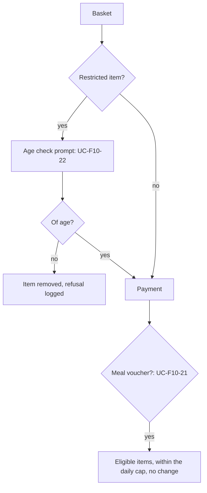

🏠 [Specs](../../../README.md) › 🧩 [Functional capabilities](../../README.md) ›
🏪 [F10 Point of sale (plugin)](../README.md) › 🔀 [Flows](README.md) › 🔀 FL-F10-08 Vouchers and age checks

# 🔀 FL-F10-08 Vouchers and age checks

**Status:** ✅ specified

## Summary

Meal vouchers accepted within the daily cap on eligible items, and age checks before selling alcohol or tobacco.

## Personas

- [U17 Cashier](../../../01-users/personas/u17-cashier.md)

## Flowchart

## Sequence diagram

- [UC-F10-21 Accept meal vouchers within the daily cap](../use-cases/08-vouchers-and-age-checks/uc-f10-21-accept-meal-vouchers-within-the-daily-cap.md#sequence-diagram)

## Steps

| Step | Persona | Screen | Use case | What happens |
|---|---|---|---|---|
| 1 | [U17](../../../01-users/personas/u17-cashier.md) | [S-F10-21](../screens/08-vouchers-and-age-checks/s-f10-21-age-check-prompt.md) | [UC-F10-22](../use-cases/08-vouchers-and-age-checks/uc-f10-22-check-age-for-restricted-sales.md) | Check a customer's age before selling wine |
| 2 | [U17](../../../01-users/personas/u17-cashier.md) | [S-F10-03](../screens/02-sell-at-the-counter/s-f10-03-payment.md) | [UC-F10-21](../use-cases/08-vouchers-and-age-checks/uc-f10-21-accept-meal-vouchers-within-the-daily-cap.md) | Take a meal voucher within the daily cap |

### Entities and screens

| Entity | States in this flow | Shown at step and screen | Aggregated view |
|---|---|---|---|
| [E-F10-03 Point of sale order](../data/e-f10-03-point-of-sale-order.md) | Draft, Paid, Invoiced, Refunded | 2 [S-F10-03](../screens/02-sell-at-the-counter/s-f10-03-payment.md) | Point of sale orders |
| [E-F7-06 Item](../../f07-purchasing-and-stock/data/e-f07-06-item.md) | Active | Shown elsewhere: [S-F7-21 Stock levels](../../f07-purchasing-and-stock/screens/03-replenish/s-f07-21-stock-levels.md) | Items |
| [E-F10-16 Age check](../data/e-f10-16-age-check.md) | Recorded | 1 [S-F10-21](../screens/08-vouchers-and-age-checks/s-f10-21-age-check-prompt.md) | Age checks |
| [E-F10-04 Till payment](../data/e-f10-04-till-payment.md) | Active | 2 [S-F10-03](../screens/02-sell-at-the-counter/s-f10-03-payment.md) | Till payments |

## Errors

A voucher above the cap or on non-food items, an age check refused (BR-F10-16, BR-F10-17).

## Images

Every step and error, for each persona taking part, in light and dark mode (D120). Steps are numbered as in the Steps
table; E rows are the error cases.

| Step | Persona | Device | Light | Dark |
|---|---|---|---|---|
| 1 | U17 | desktop | [light](../images/08-vouchers-and-age-checks/u17-cashier/1-age-check-prompt-desktop-light.png) | [dark](../images/08-vouchers-and-age-checks/u17-cashier/1-age-check-prompt-desktop-dark.png) |
| 1 | U17 | phone | [light](../images/08-vouchers-and-age-checks/u17-cashier/1-age-check-prompt-phone-light.png) | [dark](../images/08-vouchers-and-age-checks/u17-cashier/1-age-check-prompt-phone-dark.png) |
| 1 | U17 | tablet | [light](../images/08-vouchers-and-age-checks/u17-cashier/1-age-check-prompt-tablet-light.png) | [dark](../images/08-vouchers-and-age-checks/u17-cashier/1-age-check-prompt-tablet-dark.png) |
| 2 | U17 | desktop | [light](../images/08-vouchers-and-age-checks/u17-cashier/2-payment-desktop-light.png) | [dark](../images/08-vouchers-and-age-checks/u17-cashier/2-payment-desktop-dark.png) |
| 2 | U17 | phone | [light](../images/08-vouchers-and-age-checks/u17-cashier/2-payment-phone-light.png) | [dark](../images/08-vouchers-and-age-checks/u17-cashier/2-payment-phone-dark.png) |
| 2 | U17 | tablet | [light](../images/08-vouchers-and-age-checks/u17-cashier/2-payment-tablet-light.png) | [dark](../images/08-vouchers-and-age-checks/u17-cashier/2-payment-tablet-dark.png) |
| E1 | U17 | desktop | [light](../images/08-vouchers-and-age-checks/u17-cashier/e1-age-check-prompt-refused-desktop-light.png) | [dark](../images/08-vouchers-and-age-checks/u17-cashier/e1-age-check-prompt-refused-desktop-dark.png) |
| E1 | U17 | phone | [light](../images/08-vouchers-and-age-checks/u17-cashier/e1-age-check-prompt-refused-phone-light.png) | [dark](../images/08-vouchers-and-age-checks/u17-cashier/e1-age-check-prompt-refused-phone-dark.png) |
| E1 | U17 | tablet | [light](../images/08-vouchers-and-age-checks/u17-cashier/e1-age-check-prompt-refused-tablet-light.png) | [dark](../images/08-vouchers-and-age-checks/u17-cashier/e1-age-check-prompt-refused-tablet-dark.png) |

## Open questions

None.

---

⬅️ [FL-F10-07 Set up and report](fl-f10-07-set-up-and-report.md) · ⬆️ [Up](README.md) ·
➡️ [FL-F10-09 Cash and settlements](fl-f10-09-cash-and-settlements.md)
