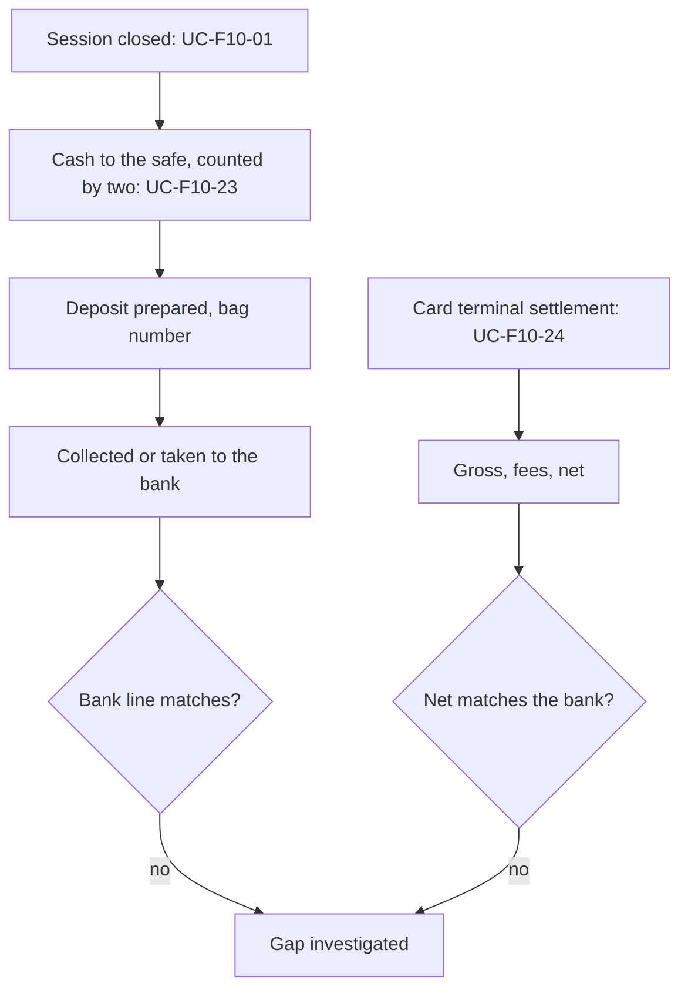

🏠 [Specs](../../../README.md) › 🧩 [Functional capabilities](../../README.md) ›
🏪 [F10 Point of sale (plugin)](../README.md) › 🔀 [Flows](README.md) › 🔀 FL-F10-09 Cash and settlements

# 🔀 FL-F10-09 Cash and settlements

**Status:** ✅ specified

## Summary

Cash beyond the session: from tills to the safe, the safe to the bank or the cash collector; and card-terminal
settlements matched to the bank net of their fees.

## Personas

- [U05 Accounting](../../../01-users/personas/u05-accounting.md)
- [U23 Store manager](../../../01-users/personas/u23-store-manager.md)

## Flowchart

## Sequence diagram

- [UC-F10-23 Manage the safe, bank deposits and cash collection](../use-cases/09-cash-and-settlements/uc-f10-23-manage-the-safe-bank-deposits-and-cash-collection.md#sequence-diagram)

## Steps

| Step | Persona | Screen | Use case | What happens |
|---|---|---|---|---|
| 1 | [U23](../../../01-users/personas/u23-store-manager.md) | [S-F10-22](../screens/09-cash-and-settlements/s-f10-22-safe-and-deposits.md) | [UC-F10-23](../use-cases/09-cash-and-settlements/uc-f10-23-manage-the-safe-bank-deposits-and-cash-collection.md) | Move session cash to the safe and prepare the deposit |
| 2 | [U05](../../../01-users/personas/u05-accounting.md) | [S-F10-22](../screens/09-cash-and-settlements/s-f10-22-safe-and-deposits.md) | [UC-F10-23](../use-cases/09-cash-and-settlements/uc-f10-23-manage-the-safe-bank-deposits-and-cash-collection.md) | Match the deposit to the bank line |
| 3 | [U05](../../../01-users/personas/u05-accounting.md) | [S-F10-23](../screens/09-cash-and-settlements/s-f10-23-card-settlements.md) | [UC-F10-24](../use-cases/09-cash-and-settlements/uc-f10-24-match-card-terminal-settlements-net-of-fees.md) | Match card settlements net of fees |

### Entities and screens

| Entity | States in this flow | Shown at step and screen | Aggregated view |
|---|---|---|---|
| [E-F10-02 Till session](../data/e-f10-02-till-session.md) | Open, Closing, Closed | 1, 2 [S-F10-22](../screens/09-cash-and-settlements/s-f10-22-safe-and-deposits.md) | Till sessions |
| [E-F10-17 Cash movement](../data/e-f10-17-cash-movement.md) | Matched | 1, 2 [S-F10-22](../screens/09-cash-and-settlements/s-f10-22-safe-and-deposits.md) | Cash movements |
| [E-F8-04 Bank line](../../f08-accounting/data/e-f08-04-bank-line.md) | To reconcile, Reconciled, In suspense | Shown elsewhere: [S-F8-06 Bank reconciliation](../../f08-accounting/screens/03-bank-and-collect/s-f08-06-bank-reconciliation.md) | Bank lines |
| [E-F10-18 Card settlement](../data/e-f10-18-card-settlement.md) | Matched, Gap | 3 [S-F10-23](../screens/09-cash-and-settlements/s-f10-23-card-settlements.md) | Card settlements |

## Errors

A safe count different from the expected, a deposit missing at the bank, fees above the contract (BR-F10-18, BR-F10-19).

## Images

Every step and error, for each persona taking part, in light and dark mode (D120). Steps are numbered as in the Steps
table; E rows are the error cases.

| Step | Persona | Device | Light | Dark |
|---|---|---|---|---|
| 1 | U23 | desktop | [light](../images/09-cash-and-settlements/u23-store-manager/1-safe-and-deposits-desktop-light.png) | [dark](../images/09-cash-and-settlements/u23-store-manager/1-safe-and-deposits-desktop-dark.png) |
| 1 | U23 | phone | [light](../images/09-cash-and-settlements/u23-store-manager/1-safe-and-deposits-phone-light.png) | [dark](../images/09-cash-and-settlements/u23-store-manager/1-safe-and-deposits-phone-dark.png) |
| 1 | U23 | tablet | [light](../images/09-cash-and-settlements/u23-store-manager/1-safe-and-deposits-tablet-light.png) | [dark](../images/09-cash-and-settlements/u23-store-manager/1-safe-and-deposits-tablet-dark.png) |
| 2 | U05 | desktop | [light](../images/09-cash-and-settlements/u05-accounting/2-safe-and-deposits-desktop-light.png) | [dark](../images/09-cash-and-settlements/u05-accounting/2-safe-and-deposits-desktop-dark.png) |
| 3 | U05 | desktop | [light](../images/09-cash-and-settlements/u05-accounting/3-card-settlements-desktop-light.png) | [dark](../images/09-cash-and-settlements/u05-accounting/3-card-settlements-desktop-dark.png) |
| E1 | U23 | desktop | [light](../images/09-cash-and-settlements/u23-store-manager/e1-safe-and-deposits-refused-desktop-light.png) | [dark](../images/09-cash-and-settlements/u23-store-manager/e1-safe-and-deposits-refused-desktop-dark.png) |
| E1 | U23 | phone | [light](../images/09-cash-and-settlements/u23-store-manager/e1-safe-and-deposits-refused-phone-light.png) | [dark](../images/09-cash-and-settlements/u23-store-manager/e1-safe-and-deposits-refused-phone-dark.png) |
| E1 | U23 | tablet | [light](../images/09-cash-and-settlements/u23-store-manager/e1-safe-and-deposits-refused-tablet-light.png) | [dark](../images/09-cash-and-settlements/u23-store-manager/e1-safe-and-deposits-refused-tablet-dark.png) |

## Open questions

None.

---

⬅️ [FL-F10-08 Vouchers and age checks](fl-f10-08-vouchers-and-age-checks.md) · ⬆️ [Up](README.md) ·
➡️ [FL-F10-10 Clienteling, transfers and tax-free](fl-f10-10-clienteling-transfers-and-tax-free.md)
