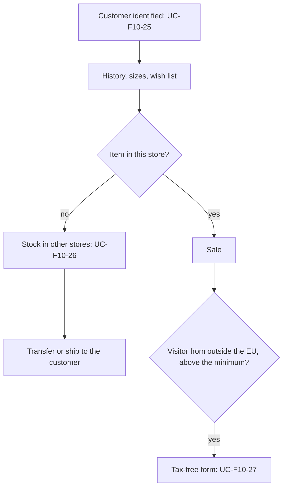

🏠 [Specs](../../../README.md) › 🧩 [Functional capabilities](../../README.md) ›
🏪 [F10 Point of sale (plugin)](../README.md) › 🔀 [Flows](README.md) › 🔀 FL-F10-10 Clienteling, transfers and tax-free

# 🔀 FL-F10-10 Clienteling, transfers and tax-free

**Status:** ✅ specified

## Summary

Sellers serve customers with their history and wishes, find an item in another store and have it transferred, and sell
tax-free to visitors from outside the EU.

## Personas

- [U17 Cashier](../../../01-users/personas/u17-cashier.md)
- [U23 Store manager](../../../01-users/personas/u23-store-manager.md)

## Flowchart

## Sequence diagram

- [UC-F10-26 Look up and transfer stock between stores](../use-cases/10-clienteling-transfers-and-tax-free/uc-f10-26-look-up-and-transfer-stock-between-stores.md#sequence-diagram)

## Steps

| Step | Persona | Screen | Use case | What happens |
|---|---|---|---|---|
| 1 | [U17](../../../01-users/personas/u17-cashier.md) | [S-F10-24](../screens/10-clienteling-transfers-and-tax-free/s-f10-24-clienteling.md) | [UC-F10-25](../use-cases/10-clienteling-transfers-and-tax-free/uc-f10-25-serve-a-customer-with-their-profile.md) | Open a customer's profile and wish list |
| 2 | [U17](../../../01-users/personas/u17-cashier.md) | [S-F10-25](../screens/10-clienteling-transfers-and-tax-free/s-f10-25-store-stock-and-transfers.md) | [UC-F10-26](../use-cases/10-clienteling-transfers-and-tax-free/uc-f10-26-look-up-and-transfer-stock-between-stores.md) | Find the size in another store and ask a transfer |
| 3 | [U23](../../../01-users/personas/u23-store-manager.md) | [S-F10-25](../screens/10-clienteling-transfers-and-tax-free/s-f10-25-store-stock-and-transfers.md) | [UC-F10-26](../use-cases/10-clienteling-transfers-and-tax-free/uc-f10-26-look-up-and-transfer-stock-between-stores.md) | Send and receive the transfer |
| 4 | [U17](../../../01-users/personas/u17-cashier.md) | [S-F10-26](../screens/10-clienteling-transfers-and-tax-free/s-f10-26-tax-free.md) | [UC-F10-27](../use-cases/10-clienteling-transfers-and-tax-free/uc-f10-27-sell-tax-free-to-a-visitor-from-outside-the-eu.md) | Issue a tax-free form |

### Entities and screens

| Entity | States in this flow | Shown at step and screen | Aggregated view |
|---|---|---|---|
| [E-F10-19 Clienteling profile](../data/e-f10-19-clienteling-profile.md) | Active | 1 [S-F10-24](../screens/10-clienteling-transfers-and-tax-free/s-f10-24-clienteling.md) | Clienteling profiles |
| [E-F7-06 Item](../../f07-purchasing-and-stock/data/e-f07-06-item.md) | Active | Shown elsewhere: [S-F7-21 Stock levels](../../f07-purchasing-and-stock/screens/03-replenish/s-f07-21-stock-levels.md) | Items |
| [E-F1-02 Company site](../../f01-administration/data/e-f01-02-company-site.md) | Open | Shown elsewhere: [S-F1-02 Sites](../../f01-administration/screens/02-manage-sites/s-f01-02-sites.md) | Company sites |
| [E-F7-04 Transfer](../../f07-purchasing-and-stock/data/e-f07-04-transfer.md) | Sent, Received, Lost | 2, 3 [S-F10-25](../screens/10-clienteling-transfers-and-tax-free/s-f10-25-store-stock-and-transfers.md) | Transfers |
| [E-F10-03 Point of sale order](../data/e-f10-03-point-of-sale-order.md) | Draft, Paid, Invoiced, Refunded | 2, 3 [S-F10-25](../screens/10-clienteling-transfers-and-tax-free/s-f10-25-store-stock-and-transfers.md) | Point of sale orders |
| [E-F10-20 Tax-free form](../data/e-f10-20-tax-free-form.md) | Issued, Validated, Refunded, Expired | 4 [S-F10-26](../screens/10-clienteling-transfers-and-tax-free/s-f10-26-tax-free.md) | Tax-free forms |

## Errors

A customer without consent for marketing notes, a transfer lost in transit, a tax-free sale under the minimum
(BR-F10-20, BR-F10-21).

## Images

Every step and error, for each persona taking part, in light and dark mode (D120). Steps are numbered as in the Steps
table; E rows are the error cases.

| Step | Persona | Device | Light | Dark |
|---|---|---|---|---|
| 1 | U17 | desktop | [light](../images/10-clienteling-transfers-and-tax-free/u17-cashier/1-clienteling-desktop-light.png) | [dark](../images/10-clienteling-transfers-and-tax-free/u17-cashier/1-clienteling-desktop-dark.png) |
| 1 | U17 | phone | [light](../images/10-clienteling-transfers-and-tax-free/u17-cashier/1-clienteling-phone-light.png) | [dark](../images/10-clienteling-transfers-and-tax-free/u17-cashier/1-clienteling-phone-dark.png) |
| 1 | U17 | tablet | [light](../images/10-clienteling-transfers-and-tax-free/u17-cashier/1-clienteling-tablet-light.png) | [dark](../images/10-clienteling-transfers-and-tax-free/u17-cashier/1-clienteling-tablet-dark.png) |
| 2 | U17 | desktop | [light](../images/10-clienteling-transfers-and-tax-free/u17-cashier/2-store-stock-and-transfers-desktop-light.png) | [dark](../images/10-clienteling-transfers-and-tax-free/u17-cashier/2-store-stock-and-transfers-desktop-dark.png) |
| 2 | U17 | phone | [light](../images/10-clienteling-transfers-and-tax-free/u17-cashier/2-store-stock-and-transfers-phone-light.png) | [dark](../images/10-clienteling-transfers-and-tax-free/u17-cashier/2-store-stock-and-transfers-phone-dark.png) |
| 2 | U17 | tablet | [light](../images/10-clienteling-transfers-and-tax-free/u17-cashier/2-store-stock-and-transfers-tablet-light.png) | [dark](../images/10-clienteling-transfers-and-tax-free/u17-cashier/2-store-stock-and-transfers-tablet-dark.png) |
| 3 | U23 | desktop | [light](../images/10-clienteling-transfers-and-tax-free/u23-store-manager/3-store-stock-and-transfers-desktop-light.png) | [dark](../images/10-clienteling-transfers-and-tax-free/u23-store-manager/3-store-stock-and-transfers-desktop-dark.png) |
| 3 | U23 | phone | [light](../images/10-clienteling-transfers-and-tax-free/u23-store-manager/3-store-stock-and-transfers-phone-light.png) | [dark](../images/10-clienteling-transfers-and-tax-free/u23-store-manager/3-store-stock-and-transfers-phone-dark.png) |
| 3 | U23 | tablet | [light](../images/10-clienteling-transfers-and-tax-free/u23-store-manager/3-store-stock-and-transfers-tablet-light.png) | [dark](../images/10-clienteling-transfers-and-tax-free/u23-store-manager/3-store-stock-and-transfers-tablet-dark.png) |
| 4 | U17 | desktop | [light](../images/10-clienteling-transfers-and-tax-free/u17-cashier/4-tax-free-desktop-light.png) | [dark](../images/10-clienteling-transfers-and-tax-free/u17-cashier/4-tax-free-desktop-dark.png) |
| 4 | U17 | phone | [light](../images/10-clienteling-transfers-and-tax-free/u17-cashier/4-tax-free-phone-light.png) | [dark](../images/10-clienteling-transfers-and-tax-free/u17-cashier/4-tax-free-phone-dark.png) |
| 4 | U17 | tablet | [light](../images/10-clienteling-transfers-and-tax-free/u17-cashier/4-tax-free-tablet-light.png) | [dark](../images/10-clienteling-transfers-and-tax-free/u17-cashier/4-tax-free-tablet-dark.png) |
| E1 | U17 | desktop | [light](../images/10-clienteling-transfers-and-tax-free/u17-cashier/e1-clienteling-refused-desktop-light.png) | [dark](../images/10-clienteling-transfers-and-tax-free/u17-cashier/e1-clienteling-refused-desktop-dark.png) |
| E1 | U17 | phone | [light](../images/10-clienteling-transfers-and-tax-free/u17-cashier/e1-clienteling-refused-phone-light.png) | [dark](../images/10-clienteling-transfers-and-tax-free/u17-cashier/e1-clienteling-refused-phone-dark.png) |
| E1 | U17 | tablet | [light](../images/10-clienteling-transfers-and-tax-free/u17-cashier/e1-clienteling-refused-tablet-light.png) | [dark](../images/10-clienteling-transfers-and-tax-free/u17-cashier/e1-clienteling-refused-tablet-dark.png) |

## Open questions

None.

---

⬅️ [FL-F10-09 Cash and settlements](fl-f10-09-cash-and-settlements.md) · ⬆️ [Up](README.md) ·
➡️ [FL-F10-11 Store reports](fl-f10-11-store-reports.md)
